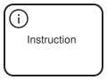
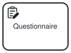
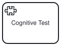
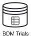

## Overview

Business Process Model and Notation (BPMN 2.0) is an OMG standard for process modeling, widely used in industry for its clear semantics and extensibility. In practice, BPMN supports domain‐specific extensions (e.g. in healthcare or finance) via an integrated extension mechanism. For example, research systems like ProjectFlow leverage BPMN so that investigators can “create custom workflows using Business Process Model and Notation” for study protocols. Similarly, Knight et al. (2024) used BPMN to visualize a neurology patient-care workflow and its data movements. These examples along with availability of BPMN in many off-the-shelf tools (e.g., diagrams.io, miro, bpmn.io, etc) show that BPMN is a good candidate to model scientific research workflows. Recent work even implements a BPMN-based scientific workflow engine, underscoring its applicability beyond business domains. Despite this, we found no open BPMN profile specifically for experimental researches; using BPMN to model study protocols (hypothesis, IRB, tasks, analysis, etc.) remains an open need.

To capture cognitive-science workflows, we propose Studyflow extension to BPMN in which traditional elements (tasks, events, gateways) are complemented by study-specific constructs, metadata and constraints.  At a high level, each StudyPhase (e.g. experimental design, recruitment, data acquisition, analysis, publication) can be represented as a sequence or nested sub-processes.  BPMN supports hierarchical subprocesses, allowing the diagram to be in hierarchical format and address the requrement of several stake-holders. For example, the “Data Acquisition” phase could be a collapsed subprocess containing tasks like “Run Cognitive Test,” “Record EEG,” “Store Data,” etc.  Swimlanes or pools can partition responsibilities (e.g. “Researcher,” “IRB Committee,” “Lab Technician”). Custom node and edge types are introduced by defining new visual representations and a set of attrbutes that faciliate the need for multiple representation profiles for different stakeholders. For instance, an “Ethics Review” task could be a BPMN user task with a special icon or tag; a “Questionnaire” might be a service task that invokes a sub-workflow that asks subjects to complete a questionnaire.  These new types can be implemented via BPMN’s extension elements (adding attributes or new shape markers) without breaking the core semantics.  In effect, the extended BPMN graph G′=(V,E, t, \lambda) has node types for standard tasks/events and also domain-specific types {CognitiveTest, Questionnaire, Instruction, Publication, …}.

In addition to the elements specified in BPMN2.1, the studyflow language introduces several new elements and processes that are specifically designed to support the unique requirements of scientific research. These elements aim to facilitate the design, execution, and analysis of experiments, ensuring that researchers can effectively manage their workflows and data.

### Formulation

A workflow is a (N, E, T, $\tau$, $\lambda$) tuple, where N is a finite set of elements (activities, gateways, events), $E\subseteq N\times N$ represents sequence flows (edges), T is a set of pre-defined node types (Activity, Event, Gateway), $\tau: N \rightarrow T$ is a typing function that assigned types (Activity, Event, Gateway) to the nodes, and $\lambda$ is a labeling function that assigns additional attributes to the nodes (e.g., event triggers, gateway logic, implementations). The elements are connected by directed edges, forming a directed acyclic graph (DAG) that represents the flow of the study.

Studyflow extends this formulation by introducing additional type hierarchies and attributes to the elements, allowing for a more detailed representation of the workflow, tailored to the specific needs of scientific research.

TODO: 
- attributes of the elements
- input/outputs
- branching and joining patterns
- grouping mechanisms:
    - subprocesses (can be another graph G)
    - groups of flow objects (paths in the G)
    - bpmn2:group -> visual annotation

### Studyflow elements

See [studyflow.yaml schema](https://behaverse.org/data-model/assets/schemas/studyflow.yaml) for a complete list of elements and their properties.

The basic elements of the studyflow are tailored to the specific needs scientific research and include:

{#fig-start-event}

- **Start Event**: Defines the beginning of the workflow. It can be conditioned on human participants giving informed consent, supporting the ethical and legal requirements.

- **Instructions**: Define and deliver instructions to the participants.

- **Questionnaires**: Surveys and questionnaires for gathering self-reported data.

- **Cognitive Tests**: Various cognitive assessment tasks within the study design, including [cognitive assessment tests](https://behaverse.org/projects/cognitive-tests.html).

- **Video Games**: Interactive games as part of the experimental paradigm.

- **Datasets**: TO describe how data is stored and formatted. It supports various dataset formats, including BDM, BIDS, Psych-DS, and others. It can also be used to describe levels of the data in [Behaverse Data Model (BDM)](https://behaverse.org/data-model): events, trials, or models.
    - Events: represent the raw data collected during an activity. In BDM, Events are stored in the events.csv file within the activity folder of a BDM dataset.
    - Trials: represent a single attempt at an activity accompanied by the participant's response and experimenter's interpretation of the response. Trials are stored in the trials.csv file within the activity folder of a BDM dataset.
    - Statistics & Models: the most abstract level of data that represent the data analysis and interpretation of the data, like a checkpoint for a deep learning model that predicts performance.

- **End Event**: Defines the end of the workflow, typically after all the data has been collected. It can redirect to a different workflow or terminate the study.

Processes:

- StudyStep: a generic step in the study workflow.
- DesignExperiment
- CollectData
- ValidateData
- TransformData

#### Data Processing
- MapData
- ReduceData
- FilterData

#### Tabular data transformation
- TransformTable
- TransformTables

#### MLOps
- TrainModel
- FineTuneModel
- EvaluateModel
- BenchmarkModel
- VersionData
- VersionModel
- DeployModel
- PublishModel
- MonitorModel