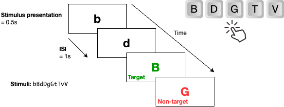
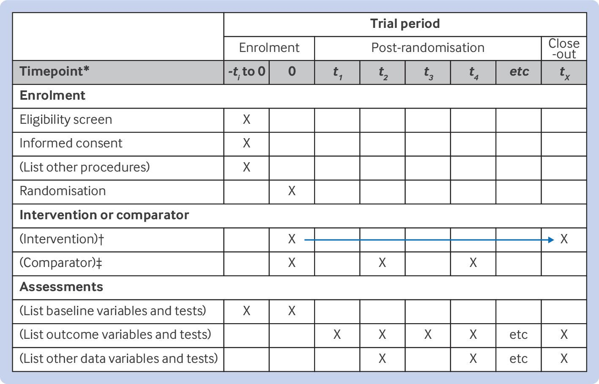

# Example Use Cases

## Use Case: CONSORT

CONSORT is a checklist and flow diagram for reporting randomized controlled trials (RCTs). It is designed to improve the quality of reporting in RCTs and to help readers understand the design of experiments. Studyflow diagrams can be used to create a CONSORT flow in a more concise and readable format than traditional box-and-arrow figures. Additionally, since the studyflow diagrams are machine-readable, they can also be used to simulate the RCTs (see supplementary materials for a simulation video).

@fig-consort compares traditional CONSORT diagram against the same CONSORT created in studyflow language. The studyflow diagram (Panel B) reads from top to bottom and uses similar text format as in the original CONSORT. On Panel C, the diagram uses more concise elements accompanied with iconography and events to describe the the same flow using BPMN error handling events. Boundary error events are used to describe the flow of participants through the trial, and the diagram is more compact and easier to read than the original CONSORT diagram. The studyflow diagram can also include additional metadata such as colors, checklists, and other elements to enhance readability and understanding. Since the metadata is machine-readable, the diagram can be used to generate reports or simulate the flow of participants through the experiment.

::: {#fig-consort layout-ncol=1}

:::

## Use Case: Cognitive Tests

One common way to describe cognitive tests and their trial structures is to visualize different stages of a trial as slides annotated them with timing parameters (see for example N-back task in figure below). However, this approach is not always reproducible, not machine-readable, and does not provide a formal and complete description of the experiment.

## Use Case: Reporting

Reporting specific types of research (e.g., in science and health) requires structured formats to ensure the quality and transparency of research studies, and to guide authors while writing manuscripts [^1].

[^1]: https://www.equator-network.org/about-us/what-is-a-reporting-guideline/

To this end, several [reporting guidelines](https://www.equator-network.org/library/) are proposed to help researchers report their studies in a a structured and standardized way. These guidelines are usually a set of checklists, flow diagrams, and structured texts that are developed using specific methodologies. They provide a framework for reporting various types of studies, including randomized trials, observational studies, systematic reviews, and more. The following table lists some of the most commonly used guidelines in science and health and their corresponding checklists.

| Topic | Guideline | Description |
|-------|-----------|-------------|
| Randomised trials | CONSORT | Consolidated Standards of Reporting Trials |
| Study protocols | SPIRIT | Standard Protocol Items: Recommendations for Interventional Trials |
| Observational studies | STROBE | Strengthening the Reporting of Observational Studies in Epidemiology |
| Systematic reviews | PRISMA | Preferred Reporting Items for Systematic Reviews and Meta-Analyses |
| Diagnostic/prognostic studies | STARD | Standards for Reporting Diagnostic Accuracy |
| Case reports | CARE | CAse REport guidelines |
| Clinical practice guidelines | AGREE | Appraisal of Guidelines for Research & Evaluation |
| Qualitative research | SRQR | Standards for Reporting Qualitative Research |
| Animal pre-clinical studies | ARRIVE | Animal Research: Reporting In Vivo Experiments |
| Quality improvement studies | SQUIRE | Standards for Quality Improvement Reporting Excellence |
| Economic evaluations | CHEERS | Consolidated Health Economic Evaluation Reporting Standards |

As an example, the [SPIRIT 2025](https://www.consort-spirit.org/) checklist recommends a set of 34 items across 9 topics to describe an interventional trial. It includes items such as the administrative information, open science, methods, ethics, outcomes, and statistical methods that should be included when reporting the protocol of an intervention.

Studyflow can be used to create checklists that adhere to these guidelines, making it easier to ensure that all necessary information is included in the diagram. The following figure shows the SPIRIT 2025 checklist in studyflow format.

 SPIRIT checklist in studyflow format can be used to ensure that all necessary information for reporting is included in the diagram. The checklist is formatted as a markdown list with checkboxes, and each item can be linked to a specific section in SPRIT and an element in the studyflow. The checklist is designed to be machine-readable and can be used to generate reports.
 

## Use Case: Data Collection

## Use Case: Analysis and Modeling (MLOps)

## Use Case: Visualization and Publication

## Multi-Agent Collaborative Experiments

BPMN2 introduced choreography tasks that can be used to model multi-agent collaborative experiments. Studyflow extends this concept to allow for the modeling of human studies and multi-agent experiments in a more intuitive way. The following example shows how to model a multi-agent experiment using studyflow.