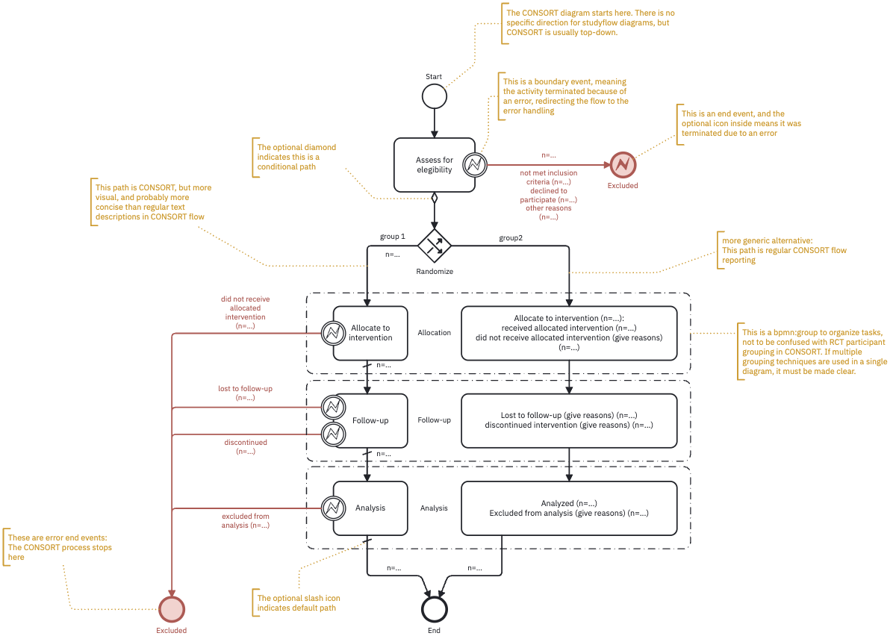
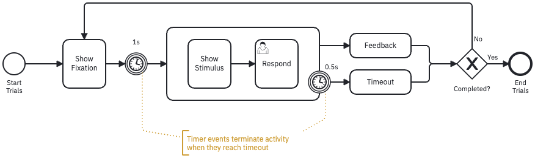

# Example Use Cases

## Use Case: CONSORT

CONSORT is a checklist and flow diagram for reporting randomized controlled trials (RCTs). It is designed to improve the quality of reporting in RCTs and to help readers understand the design of experiments. Studyflow diagrams can be used to create a CONSORT flow in a more concise and readable format than traditional box-and-arrow figures. Additionally, since the studyflow diagrams are machine-readable, they can also be used to simulate the RCTs (see supplementary materials for a simulation video).

@fig-consort compares traditional CONSORT diagram against the same CONSORT created in studyflow language. The studyflow diagram (Panel B) reads from top to bottom and uses similar text format as in the original CONSORT. On Panel C, the diagram uses more concise elements accompanied with iconography and events to describe the the same flow using BPMN error handling events. Boundary error events are used to describe the flow of participants through the trial, and the diagram is more compact and easier to read than the original CONSORT diagram. The studyflow diagram can also include additional metadata such as colors, checklists, and other elements to enhance readability and understanding. Since the metadata is machine-readable, the diagram can be used to generate reports or simulate the flow of participants through the experiment.

::: {#fig-consort layout-ncol=1}

:::

## Use Case: Checklists

## Use Case: Experimental Design

## Use Case: Cognitive Tests

One common way to describe cognitive tests and their trial structures is to visualize different stages of a trial as slides annotated them with timing parameters (see for example N-back task in figure below). However, this approach is not always reproducible, not machine-readable, and does not provide a formal and complete description of the experiment.

## Use Case: Data Collection

## Use Case: Analysis and Modeling (MLOps)

## Use Case: Visualization and Publication

## Multi-Agent Collaborative Experiments

BPMN2 introduced choreography tasks that can be used to model multi-agent collaborative experiments. Studyflow extends this concept to allow for the modeling of human studies and multi-agent experiments in a more intuitive way. The following example shows how to model a multi-agent experiment using studyflow.