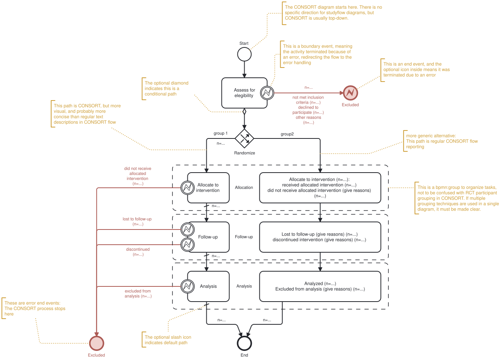

## Example Use Cases

### CONSORT

CONSORT is a checklist and flow diagram for reporting randomized controlled trials (RCTs). It is designed to improve the quality of reporting in RCTs and to help readers understand the design of RCTs. Studyflow can be used to create a CONSORT flow in a more concise and readable way than traditional box-and-arrow along with text descriptions. Additonally, since the studyflow diagrams are machine-readable, they can also be used to simulate the RCTs (see supplementary materials for a simulation video).

Figure X shows an example of CONSORT flow diagram created in studyflow language. It reads from top to bottom, and the the default format for CONSORT is shown on the right path of diagram. On the left path, the diagram uses more advanced and concise elements to describe the the same flow using error handling events.

### Use Case: Cognitive Tests

One common way to describe cognitive tests and their trial structures is to visualize different stages of a trial as slides annotated them with timing parameters (see for example N-back task in figure below). However, this approach is not always reproducible, not machine-readable, and does not provide a formal and complete description of the experiment.

### Use Case: Data Analysis and Visualization

### MLOps

### Multi-agent collaborative experiments

BPMN2 introduced coreography tasks that can be used to model multi-agent collaborative experiments. Studyflow extends this concept to allow for the modeling of human studies and multi-agent experiments in a more intuitive way. The following example shows how to model a multi-agent experiment using studyflow.