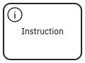
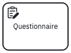
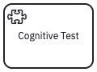
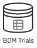
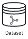

+-----------------------------------+-----------------------------------------------------------------------------------------------------------------------------------------------------------------------------------------------------------------------------------------------------------------------------+----------------------------------------------------------------------------------+
| Element                           | Definition                                                                                                                                                                                                                                                                  | Notation                                                                         |
+===================================+=============================================================================================================================================================================================================================================================================+==================================================================================+
| Start Event                       | Defines the beginning of the workflow. It can be conditioned on human participants giving informed consent, supporting the ethical and legal requirements.                                                                                                                  | {#fig-start-event alt="Start event"} |
+-----------------------------------+-----------------------------------------------------------------------------------------------------------------------------------------------------------------------------------------------------------------------------------------------------------------------------+----------------------------------------------------------------------------------+
| End Event                         | Defines the end of the workflow, typically after all the data has been collected. It can redirect to a different workflow or terminate the study.                                                                                                                           | {alt="End event"}                      |
+-----------------------------------+-----------------------------------------------------------------------------------------------------------------------------------------------------------------------------------------------------------------------------------------------------------------------------+----------------------------------------------------------------------------------+
| Instruction                       | Define and deliver instructions to the participants. The scope of the instruction can be: within an activity, and independent instruction outside the scope of any activity.                                                                                                | {alt="Instruction"}                  |
+-----------------------------------+-----------------------------------------------------------------------------------------------------------------------------------------------------------------------------------------------------------------------------------------------------------------------------+----------------------------------------------------------------------------------+
|                                   | Surveys and questionnaires for gathering self-reported data.                                                                                                                                                                                                                | {alt="Instruction"}                |
+-----------------------------------+-----------------------------------------------------------------------------------------------------------------------------------------------------------------------------------------------------------------------------------------------------------------------------+----------------------------------------------------------------------------------+
| Cognitive Test                    | Various cognitive assessment tasks within the study design, including [cognitive assessment tests](https://behaverse.org/projects/cognitive-tests.html).                                                                                                                    | {alt="Cognitive test"}            |
+-----------------------------------+-----------------------------------------------------------------------------------------------------------------------------------------------------------------------------------------------------------------------------------------------------------------------------+----------------------------------------------------------------------------------+
| Video Game                        | Interactive games as part of the experimental paradigm.                                                                                                                                                                                                                     | {alt="Video game"}                    |
+-----------------------------------+-----------------------------------------------------------------------------------------------------------------------------------------------------------------------------------------------------------------------------------------------------------------------------+----------------------------------------------------------------------------------+
| Exprimental Design                |                                                                                                                                                                                                                                                                             |                                                                                  |
+-----------------------------------+-----------------------------------------------------------------------------------------------------------------------------------------------------------------------------------------------------------------------------------------------------------------------------+----------------------------------------------------------------------------------+
| Dataset                           | Describe how data is stored and formatted. It supports various dataset formats, including BDM, BIDS, Psych-DS, and others. It can also be used to describe levels of the data in [Behaverse Data Model (BDM)](https://behaverse.org/data-model): events, trials, or models. | {alt="Dataset"}                          |
+-----------------------------------+-----------------------------------------------------------------------------------------------------------------------------------------------------------------------------------------------------------------------------------------------------------------------------+----------------------------------------------------------------------------------+
| BDM Dataset (Events)              | Data records represent the raw data collected during an activity. In BDM, Events are stored in the events.csv file within the activity folder of a BDM dataset.                                                                                                             | {alt="BDM Events"}                    |
+-----------------------------------+-----------------------------------------------------------------------------------------------------------------------------------------------------------------------------------------------------------------------------------------------------------------------------+----------------------------------------------------------------------------------+
| BDM Dataset (Trials)              | A dataset in which data records represent a single attempt at an activity accompanied by the participant's response and experimenter's interpretation of the response. Trials are stored in the trials.csv file within the activity folder of a BDM dataset.                | {alt="BDM Trials"}                    |
+-----------------------------------+-----------------------------------------------------------------------------------------------------------------------------------------------------------------------------------------------------------------------------------------------------------------------------+----------------------------------------------------------------------------------+
| BDM Dataset (Statistics & Models) | Statistics & Models: the most abstract level of data that represent the data analysis and interpretation of the data, like a checkpoint for a deep learning model that predicts performance.                                                                                | {alt="BDM Models"}                    |
+-----------------------------------+-----------------------------------------------------------------------------------------------------------------------------------------------------------------------------------------------------------------------------------------------------------------------------+----------------------------------------------------------------------------------+
| BIDS Dataset                      |                                                                                                                                                                                                                                                                             | {alt="BIDS"}                                |
+-----------------------------------+-----------------------------------------------------------------------------------------------------------------------------------------------------------------------------------------------------------------------------------------------------------------------------+----------------------------------------------------------------------------------+
| Psych-DS Dataset                  |                                                                                                                                                                                                                                                                             | {alt="Psych-DS"}                        |
+-----------------------------------+-----------------------------------------------------------------------------------------------------------------------------------------------------------------------------------------------------------------------------------------------------------------------------+----------------------------------------------------------------------------------+

: Studyflow elements. See [studyflow.yaml schema](https://behaverse.org/data-model/assets/schemas/studyflow.yaml) for a complete list of elements and their attributes.
