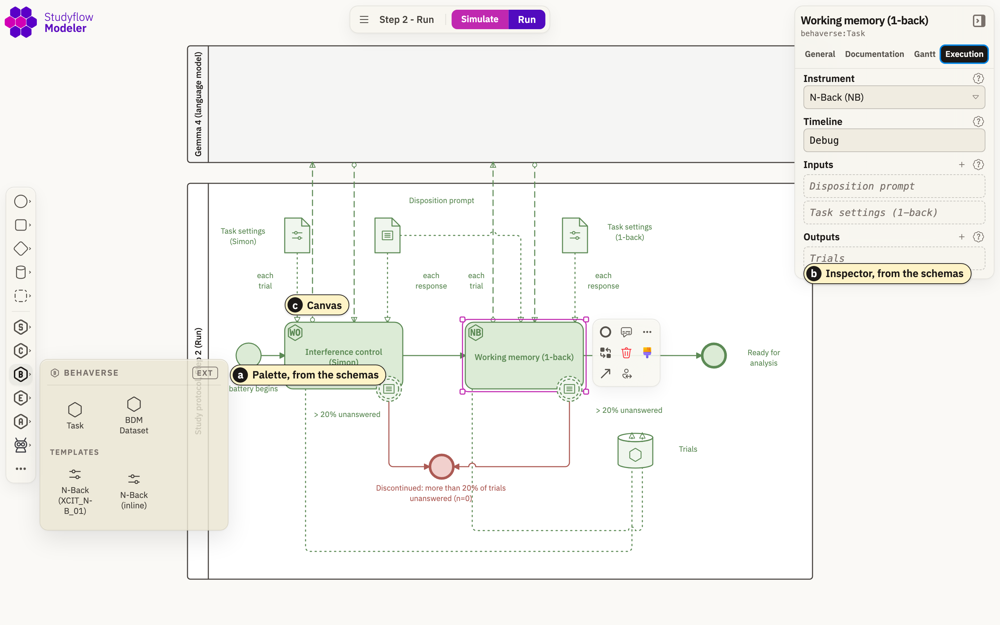
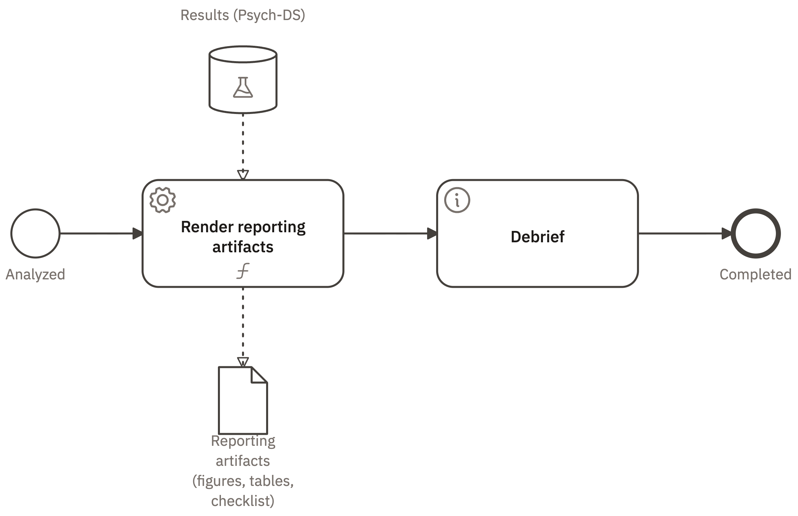

# Introduction

## A key driver of the reproducibility gap: *processes*, not just data

An experimental study in cognitive science passes through many hands and computerized systems. It is designed, evaluated, approved, preregistered, run, analyzed, reported, reviewed as a manuscript, and rebuilt by a replicator. Each stage typically creates its own artifacts (e.g., data, diagrams, text files, code). Critically, there are no solid mechanisms to ensure those artifacts remain consistent. As each artifact carries its own copy of the study's parameters (with different copies typically containing overlapping subsets of information), there is a substantial risk for copies to drift apart and for information about the study to become ambiguous, inaccurate, or plainly wrong.

This drift is real and consequential--even when standard research practices are endorsed [@claesen2021adherence; @hair2019iicarus]. It has been documented at several stages of a study's lifecycle: only nine of 67 audited trials reported their outcomes faithfully [@goldacre2019compare]; only 11 of 35 open-data articles reproduced without author assistance [@hardwicke2018cognition]; 29 teams given one question and one dataset returned odds ratios spanning 0.89 to 2.93 [@silberzahn2018manyanalysts]; and 70 teams analyzing a single dataset produced no two identical neuroimaging workflows [@botviniknezer2020variability].

One key cause of these consistency failures is the lack of standardized processes. Over the past decade, there have been notable efforts towards standardizing data (i.e., how they are formatted, organized in files, named and shared; see e.g., [@bids; @psychds; @bdm]), an objective which undoubtedly remains essential. However, standardized data is insufficient to address the reproducibility gap: we also need standardized processes to cover the whole research pipeline [@olive2007conceptual; @aguilar2022experiments; @momeni2026guidelines]. In fact, sharing the data does not make a result reproducible: of 14 articles that earned an open-data badge, only six also shared their analysis code, and only one could be reproduced exactly [@cruwell2023badge].

Processes are harder to standardize than data, because experimental studies, in cognitive science as in other fields, can be complex, involve many people and tools, and serve a variety of purposes. These processes are currently handled in idiosyncratic, segmented ways: they may be described in prose or hand-made diagrams, placed in project documents, lab conventions, slides or custom code [@bell2021perspectives; @osc2015; @nosek2022replicability]. There are initiatives aiming to promote greater standardization of processes, typically via voluntary narrative reporting, preregistration and data sharing. But adoption of these practices remains limited [@hardwicke2024prevalence], perhaps because they require substantial "additional" effort without offering a clear, immediate benefit. Furthermore, there is a gap between endorsing a guideline and actually adhering to it, as can be seen when reviewing practices across fields and journal policies [@percie2020arrive; @hair2019iicarus; @hardwicke2024transparency]. When standards are based only on narrative reporting, assessing conformance with the standard requires substantial human effort, is subjective, and error-prone.

The problem with current practices is not only motivational: convincing more people to endorse current standards will not solve it. The deeper problem is structural: we need a better approach to standardizing research processes. This is a realization that has already occurred in other fields: clinical research is turning its trial protocols from documents into structured, machine-readable specifications [@ich2025m11; @cdisc_odm].

Reviewing current approaches highlights several pain points (see Supplementary materials for a full review). For instance, most tools cover only a small aspect of the study lifecycle: workflow engines execute pipelines; experiment builders specify tasks and trials; reporting guidelines structure the write-up; and data standards fix the input/output formats. Furthermore, there are no clear mechanisms to connect the artifacts of these different elements in a form that is complete and consistent and which every audience could read (@fig-overview). Finally, most tools lack specificity (e.g., a checklist mentions what to report but not how). They also cope poorly with the changes that inevitably occur during a study: a preregistration, for example, fixes a static plan, and the gap between it and the executed procedure reopens as soon as the study deviates [@claesen2021adherence; @hardwicke2023preregistration].

There is also a structural reason why common practice based on prose plus custom code cannot keep a study's artifacts consistent. A program does two things: it computes (shows a stimulus, scores a response, fits a model), and it coordinates those computations into a whole (their order, the decisions between them, and the data each hands to the next) [@gelernter1992coordination]. Ordinary experiment code leaves that coordination implicit, spread across function calls and shared variables, which is exactly where the information drift accumulates. The machine learning community has documented the same failure modes as glue code and pipeline jungles, where changing anything changes everything [@sculley2015hidden]. A workflow notation makes the coordination explicit, in a form people can read and check.

The key insight behind our approach is that to overcome these challenges, reproducibility must be a core property that is integrated in a single artifact shared by every stage, and not simply optional documentation that lives somewhere beside it. To realize such a system, multiple key requirements must be met (@tbl-requirements).

Here we present Studyflow, a visual notation that gives the experimental process a single representation that is machine-readable, human-understandable, and executable. A single file serves at once as the protocol, the runnable study, the analysis specification, the provenance, and the publication figure; each of these is a view of the same artifact for a different audience, rather than being distinct artifacts (@tbl-requirements describes how Studyflow meets each of the requirements). In other words, Studyflow is a coordination language for experimental studies, written for the domain expert rather than the programmer. The computations (content of a protocol, code to show a stimulus, code to process the data, manuscript figures) stay in the tools built for them, while the notation carries the order of steps, the decisions, and the data hand-offs that currently live in preregistrations, manuscripts, slides, and ad hoc scripts, and it carries them in the terms of experimental design.

The design of Studyflow follows from the realization that the problem at hand meets the classic criteria for preferring a domain-specific language (a notation built around one field's recurring structures) over general-purpose code [@mernik2005dsl]. However, rather than inventing a new language from scratch, Studyflow extends a tried-and-tested notation that many engineers and researchers already recognize: the Business Process Model and Notation (BPMN 2.0; @tbl-glossary defines this and the other technical terms the paper uses). BPMN is an expressive and well-documented standard [@bpmnspec; @white2004introduction] that is widely adopted [@geiger2016bpmn] and has been applied and extended in research and clinical settings [@dhond2021projectflow; @knight2024visualizing; @pufahl2022; @braun2014; @zarour2019].

BPMN provides the backbone of Studyflow: a graphical process language built from a standard set of shapes, whose vocabulary and file format are fixed by an international standard (ISO/IEC 19510) rather than by any tool or vendor [@bpmnspec], so any BPMN tool can read and draw a Studyflow file without the software that wrote it, while running it follows the Studyflow specification (Materials and methods).

Two design decisions keep the cost of using BPMN low for a researcher in cognitive science who does not already know it. First, the author works with domain elements (for example, a cognitive task, a questionnaire, or a randomization gateway, the decision point that allocates participants) rather than BPMN's generic vocabulary (a service task, a manual task, an exclusive gateway). Second, the rules for running a diagram come from the Studyflow specification rather than from a third-party BPMN engine [@geiger2016bpmn], so a Studyflow diagram runs without the author learning any additional tools to work with BPMN diagrams.

This paper makes three contributions. The first contribution is the notation: a domain-specific BPMN 2.0 profile that carries the elements experimental research needs, defined by a schema and supported by open-source tools, both under the MIT license (see Data availability). This makes BPMN accessible to cognitive science researchers by presenting it in the language of experimental design. The second contribution is a formal account of the Studyflow diagram: a precise definition of what a diagram contains, when it is well-formed, how each view is derived from it, and how it runs, which is the basis for Studyflow's presentation, validation, and execution (Materials and methods). The third contribution is a demonstration of Studyflow's capabilities using an example study that runs end to end from one diagram. More specifically, this example study is a pilot structured by common reporting guidelines. A cohort of artificial agents (small language models standing in for people) is enrolled, screened, allocated, administered, excluded, analyzed, and reported through that single artifact, and a human cohort would take the same protocol through the same interface. This demonstrates that a single Studyflow file can support the complete study lifecycle, and that the protocol is written only once, so there is no second copy to drift.

# The Studyflow notation

Studyflow is one formal object, and projections map it to the views each audience reads, such as a diagram, a schedule, a checklist, or a figure. This section introduces that object, relates it to the BPMN standard, and describes how it is stored on disk and run; its formal definition, well-formedness conditions, and execution semantics are in Materials and methods.

## The formal object

A Studyflow diagram represents a study as a graph, $S$, whose nodes and edges have types fixed by a schema (Materials and methods). In experimental terms, the nodes are a study's events, tasks, decisions, and data, and the edges record both what happens next (control flow) and which data each node reads and writes (data flow). Data appear on the diagram as datasets, such as the recorded trials; the values a run accumulates and later reads, such as an allocated condition or a running count of failed trials, are the study's *state* (Materials and methods).

### Projections

Projections are the key mechanism to satisfy the specific information needs of different audiences about a common study. Each view keeps what one audience needs and renders it in a familiar form, such as a schedule, a checklist, or a figure (@fig-views); Step 4 describes what each view shows of the example study. The projection mechanism implemented in Studyflow therefore addresses multiple limitations these study artifacts have when they are handcrafted, as is customary today. With Studyflow the different artifacts are consistent by construction, standardized, and checkable by machine; whether they are complete depends on what the file states, and a file can mark a value as unstated (@tbl-encoded).

## Relation to the BPMN standard

The object $S$ is implemented as a domain-specific profile of BPMN 2.0, the Object Management Group's (OMG) standard [@bpmnspec; @white2004introduction], using BPMN's own extension mechanism to add domain types without breaking the standard [@stroppi2011; @magnani2009bpdmn]. Studyflow keeps BPMN's shapes and adds the elements experimental research needs: cognitive tasks, questionnaires, and instructions; gateways for randomization and eligibility; and datasets bound to community standards such as BIDS [@bids] and Psych-DS [@psychds] (@supptbl-catalog). A lab or a field can add element types of its own, and the places where running a diagram departs from the BPMN specification are listed in Materials and methods (@tbl-departures).

## One file, from plan to record

A study lives on disk as one plain-text Studyflow file, which records the diagram completely and converts without loss to the standard BPMN file that any BPMN tool reads. Two conventions serve the single source of truth requirement (R1 in @tbl-requirements). Version control shows each edit to the file as the lines it changed (@lst-diff), and an exported image of the diagram carries the whole file, so a deposited Studyflow figure is shareable as it is: the image *is* the Studyflow file, carrying all the information about the study. The same file holds the plan before a run and, as the study runs, the record of what happened: the software that ran it, the random seed, a fingerprint of the protocol each run followed, and the counts. The deviation report (@sec-results) is therefore the difference between the file's two states, rather than a comparison across unrelated documents.

In summary, a Studyflow file is one object: people read it as a diagram, machines check and run it, each audience receives it as a view, and every run leaves its record in the same file.

# Results: one study, from design to report {#sec-results}

@fig-combined is the whole example study as one diagram: who was enrolled and how they were allocated, what each did trial by trial and who stopped, how the data were analyzed and each question decided, and what was reported, with every count recorded as the study ran. The rest of this section reads that figure one part at a time.

The example study takes the form of a randomized controlled trial, not because this design needs one but because CONSORT's participant flow is the most demanding flow a reporting guideline asks for: a within-subject experiment is the same file without its allocation phase. It enrolls a cohort and administers two cognitive tasks (Materials and methods). A participant is enrolled at a start event, screened against eligibility criteria, and allocated at random to one of two instruction conditions. The participant is then administered the tasks one trial at a time: an interference-control task (a Simon task, one block of 30 trials) and a working-memory task (a 1-back, on the timeline the battery's human studies run). A participant who fails the screening, or leaves more than one trial in five unanswered on a task (the preregistered discontinuation criterion), leaves through an exit that the diagram draws and counts. We use artificial agents, small language models, for convenience: they stand in for people so that every element of the protocol can be run and checked as registered, and we draw no conclusions about language models from them (Box 1). A human cohort would take the same protocol through the same interface; what differs is the actor, not the protocol.

::: {.callout-note title="Box 1. What this pilot does not show"}
The pilot does not show how language models perform cognitive tasks, whether they show a Simon effect, or whether they can stand in for human participants. Nor does it show the timing of the tasks for people, or a human cohort taking the same file, which is designed for but not demonstrated here.
:::

The first subsection measures the problem: published Methods sections leave run-critical decisions unstated. The next four build the example study one step per stage of its lifecycle, each a complete diagram that runs on its own. The last draws five conclusions: Studyflow works, it supports the full study lifecycle, it can replace current practices, it avoids their problems because there is one document, and it opens up new uses.

## Prose leaves critical decisions unstated

Before building the example study, we asked how much of a published study's process its Methods section fixes. We encoded two published interference-control studies as Studyflow files from their Methods sections alone: the flanker task of Study 1 of @hedge2018reliability and the double-shot Simon condition of the final experiment of @kucina2023calibration (Appendix 3). Every value an encoding carries is quoted from the Methods section, and every value a replicator needs that the section does not state is written `unstated`, so the file is complete in form while its gaps stay visible.

Each encoding left eight to ten run-critical values unstated (@tbl-encoded). Some govern what participants saw: the order of trials and how it was randomized, the response deadline, the number of trials per block, the proportion of congruent trials, the stimulus duration and the interval between trials, the viewing distance and the display's refresh rate. Others govern what the analysis did: how a missed response was handled, and how the trimming or the reliability estimate was implemented. Each is a decision a replication has to make again, and differences in such choices, from stimulus timing across platforms to the many defensible ways of processing the same data, can change a result [@bridges2020timing; @steegen2016multiverse]. Some of these values may be stated in supplements or code that we did not consult; the encodings measure what the Methods sections alone specify. Audited the same way, the example study's own file states the timing, block sizes, and test orders of both its tasks, and leaves two things to the task software: the 1-back's tutorial blocks, and the order of the Simon trials, which the task draws as it starts and records with every trial (@tbl-encoded).

The notation does not make the missing values known, but it makes their absence visible. The rest of this section builds the alternative: a study whose single file states each of these decisions once, runs from it, and reports from it.

## Step 1 (Design): every design decision is an element, and attrition is part of the flow

Who was enrolled, who was excluded and why, and how were the rest allocated? The first diagram answers these questions for the enrollment and allocation phases of the study, from the consent start event through screening and eligibility to random allocation (@fig-step1-design). The study has the structure of a randomized controlled trial, and its CONSORT participant flow is not a picture drawn for publication; it is the protocol itself. @fig-consort places the CONSORT 2025 reference flow beside its Studyflow diagram; the two share labels and pathways [@hopewell2025consort].

Domain-specific elements make each design decision explicit rather than narrative. The enrollment start event references the consent document, so when the protocol runs a human cohort, an ethics board approves the same form that renders at that node. The screening task carries the checklist that later drives the guideline audits, and asks the actor the comprehension check wired into it. The eligibility gateway lists its inclusion and exclusion criteria (for this cohort, a registered model at a recorded version, and a comprehension check answered as instructed), and its "yes" flow carries the condition that tests the screening answer. The randomization gateway carries its allocation rule and parameters (permuted blocks of four, 1:1), and each cognitive task reads the settings wired into it. Every element defines information that the study will later consume, such as the random assignment of participants during data collection.

How these elements are wired together is as much a part of the design as the elements themselves. Participant attrition, for example, is encoded in the control flow rather than manually annotated beside it. In a published CONSORT figure, each Excluded, Lost to follow-up, or Discontinued box sits off to the side, and the reader has to infer that its counts subtract from the main path. In Studyflow, every exit is a path of the control flow that ends at a named end event. The eligibility gateway's "no" answer ends at the Excluded exit, and each task carries a preregistered discontinuation rule that ends at the Discontinued exit; the rule is drawn on the task itself. The connections of the published flow diagram are the paths the study takes when it runs.

As the study runs, it counts the participants that reach every element and follow every path, and each exit label shows its count: zero in the registered file, and the number reached in the figure after the run. The registered plan and the final report are therefore one diagram at two points in its life. Because flows are counted too, the counts must balance at every node, the participants that came in equalling those that went on plus those that left, which the validator checks.

## Step 2 (Run): one interface administers any actor

What did each participant do, trial by trial, and who stopped? The second step executes the two tasks, one trial at a time. At each trial, the study exchanges two messages with the actor, that is, whoever is taking the study (human or artificial). The first message carries the observation: the stimulus, the response options, the timing constraint, and, for actors that need to see the screen, the rendered frame. The second carries back the response, which the task times. Studyflow draws this exchange in the diagram itself, as two arrows between the participants and the actor, so the interface between the study and whoever takes it is part of the protocol rather than of custom code. What the exchange looks like depends only on the actor: a language model receives the trial as text.

In the example study the actor is a small language model, and each pilot cohort is [TODO: N, in the hundreds] participants answered by one such model (Materials and methods). Three models take the study, each from its own copy of the file, and the copies differ in one line, the one that names the model (@lst-swap): the protocol is written once, whoever answers it. The randomization gateway from Step 1 assigns each participant to one of two instruction conditions, cautious or impulsive, whose text is wired into both tasks, as instructions that stress accuracy or speed would be for human participants [@heitz2014sat]. The cohorts are sized to run one file for hundreds of participants, so that the protocol's paths and counts are exercised at scale, not to estimate an effect in language models (Box 1).

Both tasks come from the Behaverse battery [@behaverse], and the study seed fixes every random branch the diagram takes, the allocation included, so the path of any run can be replayed.

To see what one of these tasks contains, @fig-step2-nback shows the traditional slide figure of the N-back next to its Studyflow diagram. The traditional slide is intuitive but underspecified: timing values live in the caption, the trial-to-block boundary stays implicit, and what counts as a correct match is buried in analysis code. Such details matter: trial timing alone differs measurably across experiment platforms [@bridges2020timing; @anwylirvine2021timing]. In contrast, the Studyflow diagram draws the trial itself: the stimulus, a timer that closes the response window, a second timer for the interval between stimuli, and labeled match and non-match branches.

A reply outside the allowed options, or none within the response window, leaves a trial unanswered. A participant who leaves more than one trial in five unanswered on a task takes the counted Discontinued exit of Step 1 (@fig-step2-run), and every exchange is recorded with the run (Materials and methods), so failures can be examined afterwards rather than silently dropped.

## Step 3 (Analyze): the registered analysis decides each question by its rule

What was tested, and how was each question decided? The third step is the analysis, drawn in the same notation as the study it analyzes rather than kept as a separate script (@fig-step3-analyze). It asks two example questions, of the kind a study with these tasks would register; in this pilot they exercise the registered analysis rather than test a hypothesis about the participants. Both are about accuracy, because response times are not analyzed here (Materials and methods). 1) Does the cohort show the congruency effect of the Simon task, more errors when the stimulus appears on the side opposite the response it calls for [@simon1969reactions]? 2) Do the two instruction conditions differ, that is, does a classifier separate them from accuracy in the two tasks better than chance? Each question has a test and a decision rule fixed in the diagram before the first run (Materials and methods), so the registered analysis and the executed analysis are the same object.

The pipeline that answers them is a chain of data operations. It reads the raw trials, excludes the unanswered ones, and keeps the trials of the participants who completed the protocol, as an activity on their completion path records them. It then summarizes in two stages, first to one accuracy per participant and task and then to group-level statistics, and hands each question the table it needs. The two exclusion operations are the analysis exclusions that the CONSORT flow reports, and because they are fixed before the first run, they remove choices an analyst could otherwise make after seeing the data [@simmons2011falsepositive].

Each question ends in a decision, and the decision is drawn (@fig-step3-analyze-b). @tbl-rule sets one question as preregistrations typically word it beside what the diagram fixes: the decisions the prose leaves to the analyst are elements of the diagram. A first gateway sends a cohort too small for the test to *Not testable*; otherwise the test runs, and a second gateway compares its $p$ value with alpha, ending at *Supported* or *Not supported*. The run records which end was reached, so every question leaves the study with a claim state rather than a bare estimate. Every threshold, and the direction of each hypothesis, sits once, in one table of decision rules that the analysis reads. The rule need not be a $p$ value: a decision gateway reads any result the analysis writes, so a rule on a Bayes factor or on an interval is drawn the same way.

Each operation names the published function that performs it, with its arguments and its package version, so the analysis reruns as it ran [@kapoor2023leakage]. The recorded trials come with a data dictionary of their columns, so an analysis that reads a column the data will not have is rejected before any data are collected (@supplst-step3-analyze) [@hoytO3GuidelinesOpen2024].

## Step 4 (Report): views are exported, and deviations are a diff

Where do the reported figures and counts come from, and what changed since registration? The fourth step closes the study lifecycle (@fig-combined; @suppfig-step4-report) with one activity that turns the analysis outputs into the reporting artifacts and a completion event that ends the study. Nothing else is added for reporting, because every reporting artifact renders a view of the file that Steps 1 to 3 built (@fig-views).

The Study view shows all the information available about the study: here, the full diagram of @fig-combined. The Gantt view reads the onset and duration of each activity and lays them out on a time axis, so one can see that the two tasks run in a fixed order, the Simon task first and the 1-back second, and how long a full session takes per participant. The Checklist view lists the screening checklist, the analysis exclusion criteria, and the reporting exports as items, which is the form an audit ticks off. The Provenance view lists the runs, each with its random seed, the software that ran it, and its run repository, with a record for every step it ran; the fingerprint of the protocol each run followed sits in the same record in the file. The Manuscript Figure view is the diagram with the state of Step 1 resolved: after the runs, the exit labels read the actual counts, and the exported image embeds the full file in its metadata, so a deposited figure is the runnable study and provenance rather than a picture of it.

The same views are the artifacts many reporting guidelines ask for. The SPIRIT 2025 schedule of enrollment and assessment is the Gantt view [@chan2025spirit; @spirit2013]. The CONSORT participant flow is the Manuscript Figure view after execution, with attrition already counted on the error exits. At publication these artifacts are exported, not redrawn.

Deviations from the preregistration are found the same way. Since the file deposited at registration and the file after execution are the same object at two points in time, their diff is the deviation report (@lst-diff). In the example study every line of that diff is an addition: the run's records, the counts, and the values the analysis wrote [TODO: confirm from the language-model runs]. A protocol edited after the run cannot hide from that comparison either, because each run records a fingerprint of the protocol it followed and the validator recomputes it (Materials and methods). A prose comparison between a registry entry and a published paper offers no such guarantee [@claesen2021adherence; @cummins2026regcheck], and current guidance asks authors to compile their deviations into a table by hand [@willroth2024deviations].

To see what that comparison reports, twelve deviations of the kinds that audits of preregistered studies find [@claesen2021adherence], among them fewer trials than registered, a relaxed accuracy criterion, and a replaced primary outcome, were seeded one at a time into a small registered study by an agent that never saw the checks (@tbl-blind; Appendix 3). The diff between the registered file and each altered one shows the deviation as the line that changed, with its old and new value, inside the element that carries it, so a deviation is located rather than merely detected; whether each change was justified is for a reader to judge.

## One file, no second copy

The example study supports five conclusions.

**Studyflow works.** The registered file fixed in advance what each check should return, and every check held (@tbl-pilot). Permuted blocks of four split each cohort into two arms of equal size. The counts balance at every node and equal those the run recorded. The discontinuation rule removed exactly the participants whose trials crossed its threshold, and the protocol each run followed is the registered one. Because what an artificial cohort will do is not known in advance, the registered analysis was also checked where the answer is known, as a statistical method is checked on simulated data and a model on parameter recovery [@morris2019simulation; @wilson2019tensimple]: it reached *Supported* on both questions when an effect was planted, and *Not supported* on both when none was (Materials and methods).

<!-- TODO: run the three language-model copies (N subjects per model, in the hundreds and a multiple of four, one copy per model) and fill tbl-pilot, supptbl-agents and lst-diff from those runs. -->
[TODO: from the language-model runs: which checks held for each model, how many of its participants completed the protocol, and the claim state of each question.] For the language models, these claim states are outputs of the pilot, not claims about language models; their accuracies are in @supptbl-agents, and what a congruency effect would mean in an artificial cohort is a question we return to in the Limitations.

**It supports the full study lifecycle.** Each step is a complete example on its own, and @fig-combined is their composition: at once the protocol as registered, the study as executed, and the record of what happened.

**It can replace current practices.** The artifacts that current practice draws by hand come out of that file. The CONSORT flow, the SPIRIT schedule, the checklist, and the deviation report are views of it, and the counts the CONSORT flow reports are the counts recorded as the study ran.

**It avoids the problems of current practices, because there is one document.** The Simon task's length shows what that provides. It is set in the file exactly once (`Trials: 30`, in the settings wired into the task). The Study view displays it, the task uses it to end the block, the analysis receives the data it produces, and the exported figure renders it. A protocol, a script, a methods paragraph, and a figure cannot disagree about its value, because there is no second copy. Changing it to forty trials is a one-line edit:

```diff
-                  - Trials: 30
+                  - Trials: 40
```

@tbl-copies extends the count to four decisions of the example study. Kept as separate documents, each would be written in three or four places that someone keeps in agreement by hand; in the Studyflow file each is written once, and everything else reads it there.

**It opens up new uses.** Here we used Studyflow to orchestrate artificial agents across two tasks of a cognitive battery and to automate the analysis of their responses, without writing any code for the study: the file calls only the task software and the published library functions it names [TODO: confirm from the language-model runs]. The same file serves the two kinds of repetition differently [@nosek2022replicability]. Anyone can reproduce the analysis from the executed copy and its data, and a replication can run the deposited protocol on new participants, which this paper designs for but does not demonstrate.

# Discussion {#sec-discussion}

## One artifact instead of a document trail

Current practice in cognitive science typically scatters an experimental study across a registry entry, an ethics PDF, a recruitment system, custom analysis code, and a flow diagram drawn only for publication, none of them a machine-readable representation of the others [@moher2012; @rennie2001]. Studyflow collapses that trail into one diagram whose views cannot diverge. Because the file is plain text, every change to it shows line by line under version control, and it can be embedded in exported images. Both properties serve reproducibility and quality control. A protocol change is a reviewable diff rather than a new version of a document; the deviation between the deposited plan and the executed study is the diff between two copies of one file (@lst-diff); and a published figure carries the study that produced it, so a reader who has only the image can open, validate, and run that study.

For preregistration, merging those documents changes the registered object itself. Preregistered studies deviate from their registrations without disclosure often enough that researchers now use language models to compare registrations against the papers that follow them [@claesen2021adherence; @hardwicke2023preregistration; @bakcoleman2024rigour; @cummins2026regcheck]. Two earlier ideas pushed in the same direction: structured preregistration made the plan machine-readable [@peters2023preregr], and machine-readable hypothesis tests made the results checkable [@lakens2021machinereadable]. Studyflow extends that logic to the whole experimental process. The diagram is the plan, each question ends in a claim state its registered rule decides, and a deviation is a diff rather than a prose comparison (@lst-diff).

The reporting guidelines that journals ask authors to follow, such as CONSORT for trials or PRISMA for reviews, fit the same notation. A guideline consists of a controlled vocabulary, a checklist, and sometimes a flow diagram. In a Studyflow diagram, the vocabulary becomes the elements, the checklist becomes an attribute of the elements it concerns, and the flow becomes the structure of the diagram itself. Adherence is then a property of the file that a reader can audit and, for a flow's counts, a validator can verify. The same mapping holds for the other guidelines in this family, among them SPIRIT, TIDieR, and ARRIVE, and their AI extensions CONSORT-AI and SPIRIT-AI [@page2021prisma; @hoffmann2014tidier; @percie2020arrive; @liu2020consortai; @cruzrivera2020spiritai].

## What a researcher gains, and what it costs

Studyflow asks for work before any data are collected, so a lab will ask what it gives back before the study is published. It gives back three things at once. First, the design is checked before anyone is recruited: an exit no participant can reach, two criteria that overlap, or an analysis that names a column the data will not have are reported as faults of the file (@tbl-faults). Second, the registered analysis can run on simulated participants before the first real one is enrolled. The example study's pipeline check did this with a planted effect and a null copy, and found two faults in an analysis that had looked correct: a classifier that failed on unstandardized features, and an analysis that stopped when a participant was discontinued (Materials and methods). Any study written in the notation can be checked this way, which extends the advice to simulate before collecting data [@wilson2019tensimple] from a model to a whole protocol. Third, the participant flow and the schedule that a registration and a journal ask for are views of the file rather than drawings made for the occasion.

Studyflow also has costs. The author learns a notation and a modeler; the example study, a pilot with two tasks, is a file of more than a thousand lines; and what happens within a task, such as the order of its trials, stays in the task software unless the author writes it into the file (@tbl-scope). Whether the gains outweigh these costs for a given lab is an empirical question that we have not measured (Limitations).

## Where Studyflow sits among other tools

Studyflow replaces none of the tools a study already uses (@fig-overview). Experiment builders such as jsPsych [@deleeuw2015jspsych] and PsychoPy [@peirce2019psychopy] specify the trials, several of them more expressively than Studyflow does; workflow engines run analysis pipelines at scale [@nextflow; @cwl]; and data and provenance standards describe the datasets and what was run [@bids; @psychds; @w3cprov]. None of them expresses the study itself: a between-subjects design, the assignment of participants, a consent step, or a preregistered hypothesis. Studyflow adds that missing layer and calls the other tools from it; no neighboring family meets R1, R5, or R7 in full (@tbl-compare; Appendix 2).

## Between prose and code

These properties matter more as language models enter research. Natural language is becoming the way people instruct machines, taking over much of the role programming languages had, but it remains ambiguous: the same question given to many analysts returns many analyses [@silberzahn2018manyanalysts; @botviniknezer2020variability], and a language model can read the same prose differently from one run to the next. Code removes the ambiguity but is opaque to most of the people who design, approve, and review a study. A coordination language sits between the two. A cognitive scientist reads it as a diagram of the study, a language model can draft and read it as text, and a validator and a runtime treat it exactly, so a study written in it means the same thing to every reader, person or machine, and the runtime walks it the same way each time, given the same seed and the same answers. Studyflow is therefore less a new tool than a precise, shared medium for the people and the machines that now work on the same study.

# Limitations

BPMN is heavyweight, and asking researchers to learn one more notation is a cost. Comprehension of a process model also degrades as the model grows [@reijers2011understandability; @bogale2024]; the usual mitigation, which Studyflow inherits from BPMN, is hierarchical decomposition into subprocesses that expand and collapse. We hold that cost down with a small vocabulary specific to cognitive science over a domain-neutral core. Conceptually, a Studyflow diagram is a flowchart carrying extra attributes, one that can also be checked automatically, tracked line by line under version control, embedded in an image, and run. Like any domain-specific notation, Studyflow's core vocabulary is designed to cover common experimental workflows rather than every possible experimental paradigm. Specialized use cases are expected to extend the core schema with additional elements where needed, while preserving compatibility with BPMN.

Validation checks form, not science. A file that passes validation is well-formed, its counts balance, and its protocol is the one its runs recorded; the validator cannot tell a difference test from an equivalence test [@lakens2017equivalence], or an inequality flipped in every branch from an intended one (@tbl-faults). A passing check read as an endorsement would discourage exactly the reading those faults need.

A human cohort taking the same file is a design goal that this paper does not demonstrate: the example study ran only with artificial agents, in the reference implementation's local runtime (Appendix 1).

The reference tools do not yet run everything the notation can state (@tbl-scope; @tbl-claims). What happens within a task is registered only when it is written into the task's settings, so in the example study the order of trials is recorded after the run rather than registered before it. The analysis runs only as calls to Python library functions; R and mixed-effects models are not demonstrated. The browser runtime does not send a session's record to the platforms laboratories use to host online studies, nor resume an interrupted session, and participant identifiers are not yet pseudonymised, so a study with human participants needs data protection beyond what is built in. Each of these is a matter of tooling rather than of the notation, and each is future work. Running a diagram also asks the reader to trust the external code it calls, which the file pins by version. Any BPMN tool can open and draw the exported file, but running it needs a runtime that follows the Studyflow specification, which at present one group maintains.

We have not measured whether Studyflow diagrams are easier to read than the protocol PDFs, figures, and scripts they replace, and the classic flowchart-versus-text comparisons are mixed [@scanlan1989flowcharts; @shneiderman1977flowcharts]. Diagrams can make explicit the relations that a text leaves the reader to infer [@larkin1987diagram], and we designed every feature with comprehension in mind, but we treat the benefit as a hypothesis awaiting a usability study [@figl2017comprehension].

Finally, the language models in the example study stand in for participants only to exercise the protocol. We chose them because they are the cheapest actor that fails in some of the ways people do, answering outside the allowed responses or not in time, so the protocol's exits can fire on failures that were not planted. They are not replacements for humans, and treating their data as human evidence invites documented misinterpretations [@dillion2023replace; @lin2025fallacies; @messeri2024illusions]. Our claim in the example study stays at the level of the notation: the pilot shows that the protocol ran as registered, not what the models can do. Whether the tasks measure the same constructs in artificial agents as in humans is an open question that the shared protocol makes testable rather than resolves [@bean2025construct].

# Future work

The first future direction is machine authorship. Systems that generate research (from agents generating hypotheses to autonomous pipelines) typically produce their protocols as prose that no validator can verify. In fact, language models draft process diagrams fluently but without guarantees [@kourani2024promoai; @lauer2026assessing], and agents that run analyses can reproduce selective analysis, premature declarations of success, and the optimization of the wrong criterion [@chen2026brainresearcher]. Resolving that needs a verifiable, human-understandable notation with static checks for well-formedness, consistency, and standard format. Studyflow enables a language model to draft the study, the validator to verify it, and a human reviewer to review a diff rather than a complete manuscript. It could become the oversight notation for machine-generated experiments. How much the validator adds can be measured the way agentic systems are now evaluated, by the same models drafting the same studies with and without it [@chen2026brainresearcher].

The second direction is to standardize experimental science. Experimental science increasingly runs on large datasets and automated pipelines, yet the process that produces the data still has no counterpart to what data standards gave the data. Studyflow is one candidate for that process standard role, hence a study read, run, and trusted from a single source instead of from a trail of documents about it. A study built this way ends with its resources in agreement, because it keeps only one.

# Figures


![**Unlike data, the process has no standard shared artifact. Studyflow notation standardizes the process.** The four columns are the stages of a study's lifecycle (Design, Run, Analyze, Report), colored as in every following figure. **(a)** Today, each audience works from its own artifact: the researcher from a protocol PDF, the ethics board from an ethics application, the engineer from an experiment script, the participant from task screens, the analyst from an analysis notebook, the reviewer from checklists, and the replicator from a manuscript figure. Each holds its own copy of the study's parameters, and nothing keeps the copies consistent. **(b)** Families of tools mapped onto the slice of the lifecycle each covers; no representation spans the whole study in a form every audience can read, validate, and execute. **(c)** Studyflow closes that gap with one file. The example study of @sec-results, compacted to one row (the pool of subjects drawn as one, the analysis collapsed), as the reference modeler draws it: a consented start event, the screening questionnaire, the eligibility and randomization gateways, the two allocation arms, the two tasks with the instruction of each condition wired in as a data object, the preregistered analysis, and the report, with the counts recorded at every exit. Other tools plug into it (Behaverse or jsPsych tasks, library code for the analysis) rather than being replaced. Below it, three of the modeler's views of that same file, unedited: the Gantt view from each activity's onset and duration (the schedule an ethics board or a SPIRIT registration asks for), the Checklist view from the checklists the elements carry (what a reviewer audits), and the Provenance view from the run records (the seed, the software, and the run repository a replicator needs, with the protocol's fingerprint in the same record). The Manuscript Figure view of the full study, its CONSORT participant flow, is @fig-consort; its Gantt, Provenance, and Checklist views at full size are @fig-views.](figures/fig-overview.studyflow.png){#fig-overview}

![**The complete example study as a single Studyflow file (`example_study.studyflow.yaml`), after execution.** Three pools, top to bottom: the actor, a language model that answers for the subjects, the subjects (one process run once per subject, [TODO: N] times, as the parallel marker in its title band shows, with its three CONSORT phases as lanes), and the analysis and report, which the subjects' pool starts once its last instance has ended. Every `n` is a count recorded as the cohort ran: [TODO: from the re-run: how many were assessed for eligibility, excluded, randomized, allocated to each condition, discontinued, and completed the protocol]. Beside the trials dataset sits the data dictionary it is bound to, and beside the collapsed analysis the Decision rules it reads. Record the completion appends each completer to the Completers dataset, whose subjects alone the analysis reads. The protocol, tasks, analysis, and report all live in this one artifact; the views, the guideline audits, and the deviation report are derived from it.](figures/fig-combined.studyflow.png){#fig-combined height=82%}

::: {#fig-consort layout="[[38,62]]"}

{#fig-consort-a}

{#fig-consort-b}

**The CONSORT flow.** The example study's participant flow is the protocol itself, not a picture drawn for publication. (a) The CONSORT 2025 reference flow, redrawn from the template [@hopewell2025consort]. (b) The executed example study projected as its Manuscript Figure view: the three CONSORT phases as lanes of the subjects' pool, the analysis and the report as a pool of their own, attrition drawn as the paths that end at the Excluded and Discontinued exits, and every `n` a count recorded as the study ran (`{reached}` on each element the subjects passed). The counts differ in kind: the template asks, at each step, for those who left and those who continued, whereas here every element carries the number that reached it and each answer of a gateway the number that took it, so a branch's continuing count is the count on the element it leads to. Opened in a Studyflow editor, each element shows its details, such as every reason for exclusion behind one count.
:::

![**Step 1 (Design): the enrollment and allocation phases** as a part of the study that runs on its own, laid out in Enrolment and Allocation lanes. The consented start event binds the consent form; the screening questionnaire carries the audit checklist and asks the actor the comprehension check along message flows; the eligibility gateway lists its criteria and its "yes" flow tests the answer; the randomization gateway carries its allocation rule (permuted blocks of four, 1:1); the allocation tasks record each subject's arm and the instruction that goes with it. Every exit counts the subjects that reach it, cited by its label as `n={reached}`, and the file is deposited with every count at zero. @supplst-step1-design shows these elements in the file.](figures/fig-step1-design.studyflow.png){#fig-step1-design}

::: {#fig-step2-nback layout="[[51,-49],[100]]"}

{#fig-step2-nback-a}

{#fig-step2-nback-b}

**Step 2 (Run): the N-back.** (a) The traditional slide-style figure is intuitive but underspecified: timing values live in the caption, the trial-to-block boundary stays implicit, and what counts as a correct match is buried in analysis code. (b) The Studyflow diagram makes the trial of the example study's 1-back an explicit subprocess repeated once per digit of its two test blocks of 28 (BPMN's loop marker; the timeline's tutorial and practice blocks are not drawn): a stimulus activity, a boundary timer that closes the response window, labeled match and non-match branches, and a timer for the inter-stimulus interval. The same block collapses into a single Behaverse task that names its timeline (`XCIT_NB_01`), from which the build makes its trials, and reads the 1-back protocol and the settings for an artificial actor. The timings drawn are the protocol's for a person, as the file states them: each digit for 0.5 s, then 2.2 s, with 2.7 s from its onset to answer. The settings for an artificial actor let each digit wait up to 30 s for its answer instead.
:::

![**Step 2 (Run): one interface, any actor.** The subjects' pool administers the two tasks one trial at a time; at every trial a task sends a trial (stimulus, options, timing) to the actor's pool and receives its response, drawn as typed message flows (a trial out, a response back). The actor's pool names its kind and the model that answers (Materials and methods); a human participant (designed for, not demonstrated) or another model would take the same exchange through a pool of its own, with the protocol unchanged. The instruction of the subject's condition is wired into both tasks, and each task names its instrument and reads its protocol, wired in beside it, and the settings for an artificial actor, drawn in the actor's pool, which give the actor 30 s to answer every trial. A task whose result reports more than 20% of its trials unanswered triggers its discontinuation rule (a conditional boundary event), which routes to the counted Discontinued exit. Every trial is logged to the BDM trials dataset. @supplst-step2-run shows the 1-back task and its exit in the file.](figures/fig-step2-run.studyflow.png){#fig-step2-run}

::: {#fig-step3-analyze layout="[[100],[100]]"}

{#fig-step3-analyze-a}

{#fig-step3-analyze-b}

**Step 3 (Analyze): the analysis as data operations, each question ending in a decision.** (a) Seven preregistered operations: read the recorded trials, keep the answered trials of the test blocks (the first analysis exclusion), summarize the trials of the subjects who completed the protocol (the second) to one accuracy per subject and task, summarize those to group statistics, the two questions (the congruency effect within subjects and the difference between the two instruction conditions), and the figure. Every operation names the library function it calls (for example pingouin's paired *t* test), or groups the few such calls one operation takes; nothing here is code written for the study. The trials dataset is bound to its data dictionary, and the thresholds of every decision (alpha, the minimum samples, the number of permutations) sit in one Decision rules table wired into the questions that read them, so a change of rule is an edit to a value rather than a redraw. (b) The congruency question expanded: the descriptive table, a feasibility gateway that ends a cohort too small for the test at Not testable, the one-sided paired t test, one library call on the trials, and a decision gateway whose answers end at Supported or Not supported. The run records which end each question reached. Everything here is fixed before the first run, so the registered and the executed analysis are the same object.
:::


![**Step 4 (Report): one file, five views.** The Study view of the executed example study is @fig-combined and its Manuscript Figure view, the CONSORT participant flow, is @fig-consort; the other three views are the reference modeler's own renderings of the same file. (a) The Gantt view, from each activity's onset and duration, on a time axis from the consent event. (b) The Provenance view, from the records appended to the file as the study ran: the run that executed the study, named by its seed (42), the software that ran it, and its run repository, with a record for every step it ran. (c) The Checklist view, from the declared checklists: the screening checklist, the analysis exclusion criteria, and the reporting exports. Because projections only discard and never rewrite, editing the file updates every view.](figures/fig-views.studyflow.png){#fig-views height=85%}

<!-- TODO: re-render fig-combined, fig-consort and fig-overview (and fig-step2-run) from a language-model run of the Behaverse study; until then they show the planted pipeline run, whose tasks are simulate:// timelines -->


# Code listings


```{#lst-swap .diff lst-cap="Who takes the study is one line. The example study and each of its copies for another model differ only in the actor pool's implementation, the language model a local Ollama serves; the planted and null files of the pipeline check differ from each other the same way (Materials and methods)."}
--- example_study.studyflow.yaml
+++ example_study-gemma4-12b.studyflow.yaml
-      implementation: ollama://gemma4:e2b-mlx
+      implementation: ollama://gemma4:12b-it-qat
--- example_study.studyflow.yaml
+++ example_study-llama3.1-8b.studyflow.yaml
-      implementation: ollama://gemma4:e2b-mlx
+      implementation: ollama://llama3.1:8b
```

<!-- TODO: regenerate lst-diff from a language-model run of the Behaverse study; this excerpt is from the planted pipeline-check run of 2026-10-02 (study/pipeline-check/run-planted) -->

```{#lst-diff .diff lst-cap="The deviation report of the example study: the diff between the Studyflow file deposited at preregistration and the same file after execution (excerpt, from the planted run of the pipeline check). Every line is an addition: the run record the runner appended, carrying the fingerprint of the protocol it walked; a record on each element it ran; the counts of the subjects that reached each element and followed each flow; and the values the analysis wrote, among them the congruency test. No line of the protocol changed, and `studyflow validate` confirms it by recomputing the fingerprint."}
--- pipeline-check/planted.studyflow.yaml (deposited)
+++ pipeline-check/planted.studyflow.yaml (after execution)
+state:
+  _meta:
+    prov:
+      - action: executed
+        when: "2026-10-02T22:30:53.718+02:00"
+        with: studyflow-cli/26.9.29
+        run: run-planted
+        seed: 42
+        plan: sha256:8268b53e2a332deb9c9de443785933041a804c7fb77345069ebcaa82c01c39d8
+    reached:
+      Enroll: 8
+      Screening: 8
+      Flow_Eligible: 8
+      Randomize_Disposition: 8
+      Allocate_Impulsive: 4
+      Task_Interference: 8
+      Task_WorkingMemory: 8
+      Record_Completion: 8
+      Sub_End: 8
+      Allocate_Cautious: 4
+      C_Supported: 1
+      D_Supported: 1
+      Completed: 1
+  Congruency:
+    congruency_test:
+      statistic: 4.079853428221753
+      pvalue: 0.0023452759794757665
+      subjects: 8
```

<!-- Every float placed before the first longtable: a float left pending when a longtable breaks a page loops pdflatex. -->
```{=latex}
\clearpage
```

# Tables

| Requirement | How Studyflow meets it |
|:----|:----|
| **R1** Single source of truth | One shared `.studyflow.yaml` file is at once the protocol, the runnable study, the analysis, and the figure |
| **R2** Executable, not merely descriptive | An executing tool walks the same file a reviewer reads |
| **R3** Understandable to every audience without code | Multiple visual views, each a projection of one file |
| **R4** Grounded in standards | Exports losslessly to a valid BPMN 2.0 document; binds to community standards (e.g., BIDS, CSVW); degrades gracefully in generic tools |
| **R5** Process and data in one artifact | Typed data, bound to schemas, joined to control flow by data association edges |
| **R6** Extensible | New domains extend the notation without changing the core or tooling |
| **R7** Executor agnostic | One interface for any execution strategy, human or artificial; a human cohort is designed for but not demonstrated |

: The seven requirements and how the notation meets each; Appendix 2 gives the precedent that motivates each. {#tbl-requirements}

| Term | Meaning in this paper |
|:----|:----|
| BPMN 2.0 | Business Process Model and Notation, the ISO/IEC 19510 standard for drawing processes: shapes with defined meanings and a standard file format |
| Schema | The document that fixes which elements and attributes a file may carry |
| Version control, diff | A system that keeps every version of a set of text files (for example, Git); a diff is the line-by-line difference between two versions of one file |
| Projection, view | A projection is the mapping from the diagram to what one audience reads; the view is what it renders |
| Fingerprint | A short code computed from the protocol's content, ignoring the drawing and the run records, that identifies a registered plan and changes with any later edit to it |
| Data dictionary | The list of a dataset's columns with their types, against which every analysis operation is checked |
| Claim state | The end a question reaches once decided: Supported, Not supported, or Not testable |
| Actor | The party that takes the study, a person or a model, with which the study exchanges each trial and its response |

: Terms from software engineering and from this paper, in the sense used here. {#tbl-glossary}

| Study | What the encoding carries | Run-critical values the Methods section does not state |
|:----|:----|:----|
| @hedge2018reliability, Study 1, flanker | 50 recruited, 47 analyzed; two sessions three weeks apart; 240 trials per condition in five blocks; ISI 750 ms, stimulus until response; exclusion below 60% accuracy; RT trimming; ICC(2,1) | trial order and its randomization, seed, practice trials, response deadline, handling of a missed response, trial-level feedback, trials per block, viewing distance, display refresh rate, the trimming implementation |
| @kucina2023calibration, final experiment, double-shot Simon | eligibility checks, random assignment to one of six conditions, tutorial with eight chances to qualify, 432 trials in 12-trial blocks, second response on a random third of trials, three exclusion rules, 30 analyzed | proportion of congruent trials, trial order and seed, inter-trial interval, stimulus duration, trials per session, interval between sessions, allocation ratio, the reliability implementation |
| This paper's example study (`elife/study/example_study.studyflow.yaml`), Simon and 1-back | eligibility check; 1:1 allocation in permuted blocks of four to two instruction conditions; discontinuation above one unanswered trial in five; Simon: one block of 30 trials, no practice, congruent, incongruent and neutral trials drawn with equal probability, disk after 1 s for 1 s, 5 s to answer, feedback after every trial, 0.5 s between trials; 1-back: a practice block of 14 digits and two test blocks of 28 in stated orders, 0.5 s per digit, 2.7 s to answer, no feedback in the test blocks; the artificial actor's accommodations, stated apart (30 s to answer, the 1-back paced by the actor); the analysis as library calls | each participant's Simon seed (drawn when the task starts, recorded with every trial); the 1-back's three tutorial blocks; the generators' algorithms; the instruction pages' text; stimulus size and colours as displayed; display refresh rate |

: Two published studies encoded from their Methods sections alone (`elife/study/encoded/`), and this paper's example study audited the same way against its own file. The two encodings are well-formed; each value a replicator needs that the section does not state is written `unstated`. Some of these values may be stated in supplements or code that we did not consult; the encoding measures what the Methods section alone specifies. {#tbl-encoded}

| Check | Expected, fixed by the registered file | Planted | Null | Gemma 4 E2B | Gemma 4 12B | Llama 3.1 8B |
|:----|:----|:----|:----|:----|:----|:----|
| Allocation (permuted blocks of four, 1:1) | two equal arms (4 and 4 in a cohort of eight) | 4 and 4 | 4 and 4 | [TODO] | [TODO] | [TODO] |
| Counts balance at every node and equal those the run recorded | yes | yes | yes | [TODO] | [TODO] | [TODO] |
| Discontinued (more than one trial in five unanswered on a task) | the subjects whose trials cross the threshold (none in either pipeline-check cohort) | 0 | 0 | [TODO] | [TODO] | [TODO] |
| Protocol the run followed is the registered one (fingerprint) | match | match | match | [TODO] | [TODO] | [TODO] |
| Lines in which the copy for another actor differs | 1 | 1 | 1 | 1 | 1 | 1 |
| Congruency question, claim state | *Supported* (planted), *Not supported* (null); not fixed for the models | *Supported* | *Not supported* | [TODO] | [TODO] | [TODO] |
| Instruction-condition question, claim state | *Supported* (planted), *Not supported* (null); not fixed for the models | *Supported* | *Not supported* | [TODO] | [TODO] | [TODO] |

: Pilot outcomes. Each row is a check whose expected outcome the registered file fixes before any run; the planted and null columns are the pipeline-check cohorts of Materials and methods, whose claim states are known in advance, and the last three are the language-model cohorts, whose claim states are reported without interpretation (per-model accuracies in @supptbl-agents). The copies differ from one another only in the line that names the actor (@lst-swap). {#tbl-pilot}

| Decision | As a preregistration typically words it (illustrative) | As the Studyflow diagram fixes it |
|:----|:----|:----|
| Test and direction | "Accuracy will be compared between congruent and incongruent trials with a *t* test." | A one-sided paired *t* test of each subject's accuracy on congruent against incongruent trials, the same test as the accuracy cost against zero; a cost in the wrong direction ends at *Not supported* |
| Threshold | "α = .05." | alpha = .05, written once in the Decision rules that both questions read |
| Minimum sample | Usually not stated | Fewer than three subjects end the question at *Not testable* before any test runs |
| Exclusions | "Participants with poor performance will be excluded." | More than one trial in five unanswered on a task ends that subject at *Discontinued*; only the subjects recorded as completing the protocol are analyzed |
| Outcome | Left to the discussion of the result | The run records which end the question reached: *Supported*, *Not supported*, or *Not testable* |

: One registered question, the congruency effect, worded as preregistrations typically word it and as the Studyflow diagram fixes it (@fig-step3-analyze-b). The middle column is illustrative, not quoted from a particular preregistration; audits find such decisions often left open in preregistrations [@bakker2020preregistrations; @claesen2021adherence]. {#tbl-rule}

| Deviation, seeded blind to the checks | Validator | Fingerprint against the deposit |
|:----|:----|:----|
| Random seed changed without report | passes | changed |
| Fewer trials per participant than registered | passes | changed |
| Accuracy criterion relaxed | passes | changed |
| Criterion relaxed on one branch only, so the two conditions overlap | warning: both conditions hold for accuracy in [0.7, 0.8) | changed |
| Equivalence margin widened | passes | changed |
| Equivalence test replaced by a difference test | passes | changed |
| Primary outcome replaced (response time for accuracy) | passes | changed |
| Per-subject summary operation dropped | passes | changed |
| Exclusion criterion added (age) | passes | changed |
| Aggregation changed (sum for mean) | passes | changed |
| Column type changed in the data schema | passes | changed |
| Dropouts rerouted to the completion exit | error: an exit on no path | changed |

: Twelve deviations of the kinds that audits of preregistered studies report [@claesen2021adherence], seeded one at a time into the fault library's small study by an agent that never saw the checks (`elife/study/blind-faults/`). The validator judges form, so it reports two; the fingerprint proves change, so it reports all twelve against the registered file, and the diff of the two files shows where each change is; whether any change is justified is for a reader. {#tbl-blind}

| Decision in the example study | Preregistration | Task script | Analysis script | Methods section | CONSORT figure | Copies kept by hand | Where the Studyflow file writes it |
|:----|:---:|:---:|:---:|:---:|:---:|:---:|:----|
| Simon trials per block (30) | x | x | | x | | 3 | once, in the Simon task's settings |
| Discontinuation (more than one trial in five unanswered) | x | | x | x | x | 4 | once, as a property of each subject's process that both tasks' exits read |
| Allocation (permuted blocks of four, 1:1) | x | x | | x | | 3 | once, on the randomization gateway (block size: the language schema's default of four) |
| Decision threshold (alpha = .05) | x | | x | x | | 3 | once, in the Decision rules |

: Where four design decisions of the example study are written. Left: in a study kept as separate documents, by our reading of common practice rather than by a survey; each mark is a copy someone keeps in agreement by hand. Right: in the Studyflow file, from which the views, the run, and the analysis all read the decision. The diagram's labels show the discontinuation threshold by reading that one value, not by repeating it. {#tbl-copies}


::: {#tbl-planted}

| Actor | Instruction | Subjects | Simon accuracy, mean (SD) | 1-back accuracy, mean (SD) |
|:----|:----|:---:|:---:|:---:|
| Planted (`simulate://planted`) | Cautious | 4 | .87 (.09) | .89 (.03) |
| | Impulsive | 4 | .74 (.04) | .69 (.02) |
| Null (`simulate://null`) | Cautious | 4 | .83 (.10) | .84 (.05) |
| | Impulsive | 4 | .88 (.04) | .85 (.02) |

| Question | Planted truth | Planted run | Null run |
|:----|:----|:----|:----|
| Congruency effect (Simon) | present | *Supported*: $t(7) = 4.08$, one-sided $p = .002$ | *Not supported*: $t(7) = 1.44$, one-sided $p = .096$ |
| Instruction-condition question | present | *Supported*: accuracy 1.00, permutation $p = .037$ | *Not supported*: accuracy .25, $p = .60$ |

Each run's accuracy by instruction (`results/group.csv`, means over the four subjects of each arm with their standard deviations), and the claim state each question reached. The planted participant is less accurate on incongruent Simon trials and under the impulsive instruction; the null participant is equally accurate everywhere. Each run enrolled eight subjects, all eight completed, and the protocol fingerprints of the two files are `sha256:8268b53e…` (planted) and `sha256:2047a973…` (null).

:::
# Materials and methods

## The language specification

The Studyflow language is defined once and compiled into the format each tool needs. Its vocabulary is the schemas the skills ship (a skill is a package that adds element types and the runner that executes them; `skills/<name>/*.moddle.yaml`, each with its own prefix and version, the core's namespace `http://behaverse.org/schemas/studyflow/v1`); a skill may ship several, as the core skill ships the notation and the run records (`prov:`), and only the core is required; the modeler's palette and inspector and the XML reader and writer are compiled from these files.

*What Studyflow inherits.* Studyflow reuses BPMN's control-flow vocabulary and visual shapes: events, activities, gateways, data objects and stores, pools and lanes (the bands that separate the parties to a process and its phases), and the choreography task's shape for an exchange between parties. Each element keeps its standard appearance; its execution follows Studyflow's own rules, which depart from the BPMN specification of the Object Management Group (OMG) in the places @tbl-departures lists [@bpmnspec]. The exported BPMN file remains a standard BPMN file.

*What Studyflow adds.* Four groups of elements extend BPMN: a root study container for study-wide metadata; domain types, such as questionnaires, instructions, and cognitive tasks, each an ordinary BPMN element under a distinctive icon; data elements bound to community schemas (e.g., BIDS [@bids], Psych-DS [@psychds], the Behaverse Data Model, BDM [@bdm], or a table description in the W3C's CSVW format [@csvw]), with operations that name the external code they call and its version; and research gateways for randomization, stratified allocation, and eligibility, with optional timing attributes from which the Gantt view derives a schedule.

Studyflow is itself extensible: a lab or a field adds element types through a schema that extends the core one, and the extended diagram stays a well-formed Studyflow diagram that still exports to valid BPMN 2.0 (@fig-overview).

@supptbl-catalog lists the element types the schemas declare, and @suppfig-elements is the modeler's drawing of every element type, one band per schema.

The XML export (`.bpmn` or `.xml`) writes every element as a standard BPMN element with its Studyflow payload inside `extensionElements` blocks or in namespaced attributes (a choreography task in a process, which BPMN defines only in a choreography, is written as the task it is, marked `studyflow:exchange`, its bands as attributes). This separation leaves intact the structure a generic BPMN tool expects, so each tool reads only the elements it recognizes. An exported image carries the source in the `<metadata>` element of an SVG file or in an `iTXt` chunk of a PNG file.

A study lives on disk as a plain-text Studyflow file (`.studyflow.yaml`) that records the BPMN diagram completely (@supplst-minimal-study). It converts losslessly to and from standard BPMN 2.0 XML, which generic BPMN tools read (Materials and methods); the YAML is the source of truth and the XML its format for exchange.

Two further conventions serve the single source of truth requirement (R1 in @tbl-requirements). First, the YAML file is plain text with one attribute per line, so a version-control system such as Git shows an edit as the lines it changed (@lst-diff). Second, the source can be embedded losslessly in an exported image (SVG or PNG); the embedded source, not the image, is authoritative.

A deposited Studyflow figure is therefore shareable as it is: the image *is* the Studyflow file, carrying all the information about the study (Appendix 2 gives the precedents for both conventions).

A Studyflow file is read before a run (prospective provenance, the plan or recipe) and written to during one (retrospective provenance, the history of what executed) [@freire2008provenance; @lim2010prospective; @w3cprov]. A Studyflow file is prospective provenance once preregistered, and accumulates retrospective provenance as it runs: the software that ran it, the random seed, a fingerprint of the protocol each run followed (a cryptographic digest; Materials and methods), and the study state. The two forms live in the same object, so the study's deviation report (@sec-results) is the difference (a diff) between its prospective and retrospective states, rather than a comparison across unrelated documents.

### The graph and its types

A Studyflow diagram represents a study as a typed directed multigraph $S = (N, E, \mathrm{src}, \mathrm{tgt}, \tau, \lambda)$ over a schema $\Sigma$ that fixes the type hierarchy of its nodes and edges. More precisely, $N$ is a finite set of nodes and $E$ a finite set of edges, with $\mathrm{src}, \mathrm{tgt}: E \to N$ mapping each edge to its source and target. The schema fixes a type hierarchy $T$, split into node types $T_N$ (events, activities, gateways, and data elements) and edge types $T_E$, so $T = T_N \cup T_E$. The typing $\tau: N \cup E \to T$ assigns each node a type in $T_N$ and each edge a type in $T_E$. The attribution $\lambda$ gives each element the attributes its type allows under $\Sigma$: the instrument name of a cognitive task, the allocation rule of a random gateway, or the onset and duration of an activity.

Because data elements are themselves nodes of $S$, the data specification and the control flow live in the same object, and edge type separates them. The edges $E_{\mathrm{seq}}$ (those $e$ whose type $\tau(e)$ is a BPMN sequence flow) induce the control-flow graph $G_{\mathrm{ctrl}} = (N, E_{\mathrm{seq}})$, and the edges $E_{\mathrm{assoc}}$ (BPMN data association) induce the data-flow graph $G_{\mathrm{data}} = (N, E_{\mathrm{assoc}})$. The two graphs share the node set $N$ but no edges. Executing $S$ is then a walk over $G_{\mathrm{ctrl}}$, and a data manipulation is a path through $G_{\mathrm{data}}$.

Data elements come in two kinds, a distinction Studyflow takes from BPMN [@bpmnspec]. *Datasets* appear on the diagram as data objects and stores, such as the recorded trials or a table of results. *Properties* never appear on the diagram; the study, an activity, or an event declares them, and they hold the study's *state*, the values a run accumulates and later reads, such as an allocated condition, a running count of failed trials, or a fitted model. A container element, such as the study itself or a subprocess (an activity that holds a diagram of its own), also fixes the scope of data. State declared on the study lasts as long as the study and carries from one run to the next; state declared on a subprocess, such as a cognitive battery or an analysis pipeline, lasts for one instance of it.

### Control flow

$G_{\mathrm{ctrl}}$ is directed but not acyclic. Experimental procedures often contain interrupts, loops, and multi-agent exchanges, which cannot be expressed by the plain directed acyclic graphs (DAG) that common workflow engines execute [@nextflow; @cwl; @pydra]. Where a custom DAG pushes that control logic elsewhere, BPMN's boundary events, message flows, and choreography express these constructs natively, in the same diagram.

Not every diagram is well-formed. A diagram is well-formed when four conditions hold. First, $\tau$ and $\lambda$ validate against the $\Sigma$ type hierarchy and against the context-free grammar relating the types in $\Sigma$ (@supplst-grammar in the Supplementary materials). Second, edge endpoints respect type and scope: every control-flow edge runs between flow nodes (events, activities, gateways), every data-flow edge connects a data element to a flow node, and a node reads or writes a property only where a containing scope declares it. Third, $G_{\mathrm{ctrl}}$ is connected: it has at least one start event and at least one end event, and every flow node lies on some path from a start event of its scope, or from a boundary event, to an end event. Connectedness rules out steps that no path reaches; it does not detect a branch whose condition can never hold, and it is weaker than the soundness of workflow nets [@vanderaalst2011soundness], which the reference implementation checks separately, by exploring the runs a study can take (Validation and its calibration). Fourth, the export of $S$ to BPMN 2.0 is a valid XML document, the format in which BPMN tools exchange diagrams. In summary, the first condition states the syntactic and semantic constraints; the second and third state domain-specific constraints that a generic BPMN validator cannot express; and the fourth states the compatibility and extensibility constraint. The reference implementation checks all four before any run and refuses to start a study that fails one of the first three with an error; the modeler also enforces the second while drawing (Appendix 1).

### Projections

The same graph supports many projections; these are simply a mapping from $S$ to a specific visual representation. Given a predicate $p$ over elements, the view $\pi_p(S)$ is the subset $\{x \in N \cup E : p(x)\}$, carrying each selected element's attributes $\lambda(x)$ unchanged and discarding the rest. Importantly, a projection only discards (or equivalently selects) information; it never adds or rewrites $S$. Every view is therefore consistent with the single source of truth by construction.

## The executor interface and execution semantics

Executing a well-formed Studyflow file is a walk over its control-flow graph $G_{\mathrm{ctrl}}$, which is deterministic given its initial state (i.e., random seed) and its record, the inputs in the order they came. A run is a sequence of configurations $\kappa_n = (m_n, q_n, s_n, v_n, g_n, \sigma_n)$, where $m_n$ is the marking (i.e., where the tokens stand), $q_n$ the messages sent along each message flow and not yet taken, $s_n$ the study state (i.e., global variables), $v_n$ the node state (i.e., local scoped variables), $g_n$ the pseudo-random state (seed), and $\sigma_n$ the actor state (e.g., internal variables of a language model). Tokens mark where a run stands, as in BPMN: each pool starts with one, a parallel or inclusive split creates one per branch it takes, and a join waits for the tokens it gathers. Pools exchange messages only along message flows, each a queue the walk carries, and a token that waits for a message no pool can still send stops the run rather than wait for ever. Each step moves one token, so it is a transition

$$\kappa_{n+1} = \operatorname{step}(S, \kappa_n, \rho_n),$$

where $\rho_n$ is the input recorded at step $n$: an actor's response, a message, or a timer's firing. When a split gives a pool several paths, which path steps first depends on when their actors answer. Every random draw is keyed by the seed, the gateway, the participant, and its visit, so the order does not change what any path draws; a value that two such paths both write is set by the step that finishes last, which the validator warns about. The record keeps the order, so a run replayed from it takes the same steps. Concretely, an executor script advances along outgoing control-flow edges: at an exclusive gateway it selects a branch by the gateway's rule, drawing any randomness from $g_n$, and at a parallel or inclusive one it takes every branch, or each whose condition holds; at an activity it sends data to the actor and consumes $\rho_n$ as external input. In a subprocess it opens a scope instance and closes it again at that subprocess's completion. Every condition a gateway or an event evaluates is written in FEEL [@dmnspec], the expression language of BPMN's sibling standard DMN, so it is human-readable and independent of the runtime that evaluates it.

The runner is designed to administer every actor through one message-passing interface. Per trial it sends an observation (the stimulus, the allowed responses, the timing constraint, and where needed a rendered frame at a declared resolution) and receives a response and, where the actor produces one behaviorally, a response time. An actor is anything that implements this function from observations to responses; humans and language models are instances of one abstraction. The interface coincides with the observation-action loop AI evaluation harnesses and task standards expose [@metr2024taskstandard; @aisi2024inspect], so a bridge to those harnesses is a compilation, not a redesign (Appendix 2). The exchange itself is expressible in the notation: in the example study it is one pair of message flows between the subjects' pool and the model's pool, a `behaverse:Trial` out per trial and a `behaverse:Response` back, inherited by whichever task is playing (@fig-step2-run): a step with no message flow of its own exchanges along those of the nearest subprocess or pool drawn around it, so the exchange is drawn once, on that container, rather than once per task, and reaches no further than the container's border. A task from another toolkit is named the same way: the modeler opens a jsPsych timeline as one cognitive task per timeline node (`platform: jspsych`, the plugin as `jspsych://<plugin>@<version>`, its parameters in a wired Parameters object) [@deleeuw2015jspsych], the form of @supplst-minimal-study, and the browser runtime plays such a step, its trials' data the step's result.

The semantics are pinned in the specification because most engines that claim BPMN 2.0 compliance do not actually run the execution format [@geiger2016bpmn]. The local runtime's contract (`packages/runtime-local/CONTRACT.md`) fixes how a partial runner claims elements and exchanges state and messages. The local runtime emits a complete execution trace as it walks. Its record, `events.jsonl`, lists in order every step it ran with the step's record, every gateway decision with the conditions it weighed, every message, and every exchange with a model (the request as sent, the executor configuration, and the reply); the run is kept as a git repository with one commit per step, whose trailers name the step and the run. The record, the seed, and the trials table together reconstruct the path any subject took. `studyflow prov` writes that record as W3C PROV-O [@w3cprov]: the run and each step are activities, and the study, named by its protocol digest, is the plan they followed. Packaging that repository as a Workflow Run RO-Crate [@leo2024wfrunrocrate] is future work.

## Expressiveness and limits

The formal object $S$ fixes what a diagram *is*; it also fixes what the executable language can and cannot say. The native, runnable vocabulary expresses exactly the *finite control* experimental protocols, those whose next step is a function of the current observation and a bounded state, so that execution is a walk over $G_{\mathrm{ctrl}}$ by tokens a split multiplies and a join gathers. That vocabulary is the set of start and end events, exclusive gateways (the random and eligibility gateways among them), parallel and inclusive gateways, sequence flow, timer events, boundary events (error, conditional, message, timer), and loops. `studyflow validate` checks this vocabulary before a study runs, and refuses an event of a kind the walk does not read (a signal, an escalation, a compensation, a link, a cancel), each of which reaches beyond where it is drawn.

A multi-instance activity over a list, BPMN's `loopDataInputRef`, stays inside the class: it runs the same operations once per item and collects what each pass returns. Over a list of admissible analysis specifications it runs a multiverse analysis, a specification curve drawn as one marker on one box; the reference implementation ships an example that scores one classifier under three settings of a hyper-parameter. Designs whose next step depends on accumulated history or on external inference (adaptive staircases beyond a seeded bound, Bayesian sequential designs, ABAB designs with data-dependent reallocation) fall outside this class. They remain expressible, but only by leaving the statically checkable core: by delegating to an external system via `bpmn:implementation`, invisible to the well-formedness checks, or by message flows to a pool that decides, whose exchanges the validator explores before a run (every message taken, every wait answered) but whose decisions show only when run.

The boundary is therefore precise: the vocabulary defined in $S$ captures finite control designs with full static checkability, and everything beyond it trades that checkability for the expressiveness of external code, the counterpart of BPMN's own scope limit [@bpmnspec; @dijkman2008semantics]. The single-artifact discipline is not so bounded: an adaptive design that leaves the checkable core still records exactly what was administered, trial by trial, through the execution trace and boundary events, even where its forward behavior cannot be certified statically.

@tbl-scope sets out, for designs common in cognitive science, how a file states each and which of the two reference runtimes carries it out. The notation coordinates a study; what happens within a task, such as the order and timing of its trials, is part of the registered protocol only when the author writes it into the settings wired to the task. Otherwise it stays in the task software, recorded in the trial data but not registered.

| What the design needs | How the file states it | Local runtime | Browser runtime |
|:----|:----|:----|:----|
| Allocation between participants, simple or in permuted blocks, at a ratio | A random gateway with its rule | Runs | Runs; the participant is the one the session's link names |
| Concealed allocation | The gateway registers the digest of a seed of its own | Runs; the seed is revealed after the run | Refused |
| Stratified allocation, minimization, alternation | Attributes of the random gateway | Runs | Alternation runs; stratified allocation and minimization are refused, since one session cannot know a participant's place in its stratum |
| Counterbalanced task orders | One arm of a random gateway per order, in permuted blocks | Runs | Runs |
| Conditions, order, and timing of trials within a task | The task's own timeline or plugin parameters, settings wired to the task, or a trial list registered by the digest of its content | As the task software runs them | As the task software runs them |
| Consent, questionnaires, completion codes | The start event, questionnaire tasks, the end event | Put to the actor as messages | Screens; the end event returns the participant to the recruitment platform |
| Sessions days apart | A timer event between them | The run waits for the timer | Waits only while the page stays open; no return visit |
| Adaptive procedures (staircases, sequential designs) | An external system the step names, or a pool that decides | Run by that system; recorded, not checked before the run | As in the local runtime |
| Recording participants' data | Datasets bound to their data dictionaries | Written to the run's repository | Kept in the session, then downloaded, or sent to the Behaverse data server when recording is on |
| Analysis | Steps that call library functions | Runs | Not run |
| EEG acquisition | EEG elements | Not run | Not run |

: What a file can state and which reference runtime carries it out, at the release the paper reports. A row's "not run" means the notation describes the step but no runtime executes it. {#tbl-scope}

The walk is a profile of BPMN 2.0's execution semantics. @tbl-departures lists where it reads a construct otherwise than the specification; the reference implementation keeps the same list beside its contract (`packages/runtime-local/WALK.md`), and the validator refuses or warns about each departure that could surprise an author.

| BPMN construct | How the walk reads it | `studyflow validate` |
|:----|:----|:----|
| A complex gateway | Refused where it splits; where it joins, each token passes as it arrives | error; warning |
| A scope with several start events | Starts at the first | warning |
| A parallel join one of whose tokens can never come | Stops the run, where BPMN waits for ever | found by exploration (warning) |
| An exclusive gateway none of whose conditions holds | Takes its default flow, else its one flow without a condition, where BPMN takes every such flow | conditions that overlap or leave a gap (warning, error) |
| A multi-instance marker, parallel or not, and a pool with a `participantMultiplicity` | The instances run one after another, each making its own random draws | none |
| A step with no message flow of its own | Exchanges along the message flows of the nearest subprocess or pool around it | none |
| A message flow out of a pool of several instances | Sent once, after the last instance, where BPMN sends one per instance | none |
| A conditional boundary event | Read once, when its activity's step finishes, where BPMN reads it while the activity runs | none |
| A timer cycle | Waits for its first firing only | warning |
| A signal, escalation, compensation, link, or cancel event | Not read | error |
| A choreography task in a process | Written in BPMN XML as the task it is, marked as an exchange between the pools of its bands | XML checked against the OMG schema |
| A data object or store drawn in another pool | Shared by every pool | none |

: Where the walk reads a BPMN 2.0 construct otherwise than the specification, and what the validator reports. {#tbl-departures}

## Interruption, resumption, and partial runs

Real runs are interrupted: a participant closes the browser, a provider errors, a trial times out. The semantics above handle this without new machinery, because each step is already a function of $S$, the configuration $\kappa_n$, and the recorded input $\rho_n$. The local runtime checkpoints after each completed step, one commit in the run's repository. Re-running the executed copy in that repository skips each replayable step whose record still stands (a library call, or a gateway, outside a repeated container or a pool of several instances, whose recorded decision it replays), restores an output the working copy lost from the commit that made it, and re-runs a step whose drawing or inputs changed, together with every step that reads what it re-makes. Live steps never skip: a Behaverse task, a step with message flows or a pool exchange, a hand-off to a model, and every step that repeats run again. A re-run starts from the state the run it redoes started from, so it counts and draws as that run did. The unit of a checkpoint is the step, not the trial: a task interrupted mid-block runs again from its first trial. We distinguish two cases. *Recoverable interruption* (a dropped connection, a transient provider fault) resumes onto the same protocol: the replayable steps keep their records, and the live steps run again. *Terminal exit* leaves the run through a boundary event and is counted in the participant flow, as agent dropout and human loss to follow-up already are. The browser runner keeps its state in the session and does not resume.

## The example study

Each model's cohort is [TODO: N] instances of that model, the Ollama tags @supptbl-agents names (two sizes of Gemma 4 and Llama 3.1 8B), served by a local Ollama (version [TODO: from the re-run]) with the model's default sampling parameters (for `gemma4:e2b-mlx`, temperature 1, top-k 64, top-p 0.95), which every exchange records (Reproducibility). Both tasks run from the Behaverse WebGL build: the Simon task, one block of 30 trials, and the 1-back on `XCIT_NB_01`, the timeline the battery's human studies run, three tutorial blocks and a practice block followed by two test blocks of 28 digits, of which the analysis keeps the test blocks. The build sends each 1-back digit alone, so the actor's pool keeps one conversation per subject (`memory: conversation`); every earlier digit then stays in the model's context, so in a language model the task may not measure working memory at all, one example of why the tasks need not measure the same constructs in artificial agents as in humans. Allocation is in permuted blocks of four at 1:1, so a cohort whose size is a multiple of four splits into equal arms, as the pipeline check's cohorts of eight split four and four.

Each test fits its question, and both test accuracy: a language model's latency is the time its server took to generate the reply, so it is not tested. The congruency effect is tested within subjects, as a one-sided paired *t* test of each subject's mean accuracy on congruent against incongruent trials, which gives the same *t* as the accuracy cost tested against zero, in one call to a library function that averages each subject's trials first; the Simon task's neutral trials enter no comparison the decision reads. The classifier for the instruction-condition question, a logistic regression on standardized features, works on one row per subject, the unit that was randomized, with the subject's accuracy in each task as its features; it is scored by leave-one-subject-out cross-validation and tested against 1,000 permutations of the arm labels across subjects, so the trials of one subject never sit on both sides of a split [@kapoor2023leakage]. The minimum of four subjects per arm is the smallest for which a permutation across subjects can reach $p < .05$ (with three per arm, the 20 relabelings leave $p \geq .05$). Every operation names a library function, and the study's `dependencies` pin the packages; a version written into an implementation reference, `python://pkg.fn@1.2`, is checked against the installed package before the operation runs.

Before the language-model cohorts were run, the registered pipeline was checked on a variant of the study whose tasks are generated by timeline steps and whose actor is a simulated participant, in two copies: one with a planted congruency cost and a planted difference between the two instruction conditions, and one with neither. Because the truth is known, a correct registered analysis must reach *Supported* on both questions in the planted copy and *Not supported* in the null copy, and it did (@tbl-planted). The planted run also found a fault in the analysis before any language model took the study: fitted to unstandardized accuracies, the classifier scored 0% correct under leave-one-out, because the held-out subject's arm is always the minority of the training set and the default regularization shrank the weights of features that span only a fraction of their range; standardizing the features recovered the planted difference (accuracy 1.00, $p = .037$). A copy of the planted study without the standardization keeps that fault for reference (`elife/study/pipeline-check/unstandardized/`). <!-- TODO: run pipeline-check/unstandardized/planted-unstandardized.studyflow.yaml and confirm the 0% (0 of 8) under leave-one-out; the run of 2026-09-29 that found it predates the current allocation draws. --> A run of the null copy alone would have returned *Not supported* either way and hidden the fault. A third copy of the planted study, with the discontinuation threshold lowered from one trial in five to one in twenty so that some subjects would leave, found a second fault: four of the eight subjects were discontinued, three of them before the 1-back, and the classifier stopped on their missing 1-back accuracy. Inferring completion from the data would not do, because a subject discontinued on the 1-back, the last task, has data from both tasks. Instead, an activity on the completion path, Record the completion, now appends each completer's subject and arm to a Completers dataset, and the analysis keeps only the trials of those subjects. On the same copy the analysis then ran to the end on the four subjects who completed, reaching *Supported* on the congruency question ($t(3) = 7.18$, one-sided $p = .003$) and *Not testable* on the instruction-condition question, whose smaller arm fell below four; on the planted and null copies it reproduced the earlier tables and decisions exactly. A copy in which every subject is discontinued also runs to the end, with both questions at *Not testable* and no figure, because the Completers dataset is bound to a schema of its two columns and reads as an empty table until its first line. Both fixes changed the protocol, so each study file carries a new fingerprint.

## Validation and its calibration

The validator checks a file before it runs and an executed copy after. Before the run, it checks the four conditions of well-formedness (the fourth with the XML validator `xmllint`, where it is installed), reports the paths the reference runners do not take (a complex gateway that splits, an event of a kind the walk does not read) and a decision drawn as a parallel split (conditions on a parallel gateway's flows, which it never reads), warns where two steps on paths that run at once write one value, explores the ways the study can go, and checks every column an operation names against the schema of the dataset it reads. `studyflow run` refuses to start a study with an error among these: a file it cannot read, an expression that is not FEEL or a value its attribute does not allow, an edge between elements it may not join, a graph that is not connected, a complex gateway that splits, an event the walk does not read, conditions on a parallel gateway's flows, a column no schema defines. The exploration walks the study dry, one instance of each pool, and takes each decision as a free choice: a gateway's flow, another pass of a loop (at most two), a boundary event that fires or not. It warns about a parallel join one of whose tokens can never come, a pool that waits for a message no pool can still send, and a message that nothing takes, each with the choices that lead to it. A study it passes is sound, the property of workflow nets that every run can end and ends properly [@vanderaalst2011soundness], over the runs it walked: at most 2,000, with the paths of a split taken in one order, and with conditions read as free choices, so a finding may lie on a path the data never takes. `run` drops the reader's warnings, such as an unknown key, which only `validate` shows. After the run, the validator checks that the counts balance at every node and that the protocol is still the one the run walked. For the latter, each run records a digest of its protocol (the main text's fingerprint), a SHA-256 over a canonical reading of the file that leaves out the run state and records, the drawing (lanes included), Gantt progress and checklist ticks, so any other edit, a note included, changes it. The digest proves that the protocol has not changed since the run recorded it, so the file carries its own evidence of what was planned and what was done; when it was registered is shown, as for any preregistration, by where it was sent before the run. The example study's files accompany this paper in both states, as registered and after their runs, and they are written in the spelling the tools write, so each executed copy differs from its registered file only by additions.

Seeded into copies of the example study, an exit count edited after the run and a misspelled column in the first analysis operation read: <!-- TODO: the exit count is seeded into the planted run's executed copy (same CONSORT nodes); re-seed it into a language-model run's copy -->

```
error: flow consistency at "Completed the protocol (n={reached})":
       reached 7 != inflow 8 (1 unaccounted)
error: "One row per trial" reads column "result.isCorect",
       which schema "Trial schema" does not define
       (closest: "result.isCorrect")
```

@tbl-faults measures what these checks catch: thirteen faults seeded one at a time into a small study, and two more checked in the Python runner's tests when the step runs, with the check that reports each. Thirteen are caught, eleven by the validator before or after the run and two when the step that would go wrong runs; two are missed: a difference test used where the question asks for equivalence, an error of meaning in a well-formed file that will stay missed, and a decision drawn as an inclusive gateway, which runs as drawn because its conditions exclude each other. Like any calibration built by the authors of the checks it scores, it measures what the checks were designed to catch, not how often faults escape in deposited studies.

| Seeded fault | Where it is caught | By |
|:----|:----|:----|
| An exit count edited after the run | `studyflow validate`, executed copy | flow consistency (error) |
| An analysis operation reads a column its data schema does not define | `studyflow validate`, before the run | data contract (error) |
| A step on no path from the start to an end | `studyflow validate`, before the run | connectedness (error) |
| A step drawn as the data another step reads | `studyflow validate`, before the run | edge endpoints (error) |
| A parameter changed after the run | `studyflow validate`, executed copy | protocol digest (seal, warning) |
| A decision drawn as parallel branches within one pool | `studyflow validate`, before the run | decisions (error) |
| A complex gateway | `studyflow validate`, before the run | runner paths (error) |
| Two elements share an id | `studyflow validate`, before the run | reader (error) |
| A misspelled attribute | `studyflow validate`, before the run | reader (warning); BPMN 2.0 schema (error) |
| A pinned package version the environment does not have | when the step runs | version pin (the step fails) |
| An operation reads a column a derived table does not have | when the step runs | column check (the step fails, naming the closest column) |
| A decision rule whose inequality is flipped before deposit | `studyflow validate`, before the run | decisions (warning and error) |
| A criterion moved in one branch only | `studyflow validate`, before the run | decisions (warning) |
| A decision drawn as an inclusive gateway | missed (its conditions exclude each other, so it runs as drawn) | none |
| A difference test where the question asks for equivalence | missed | none |

: Faults seeded one at a time into a small study, or into a step the Python runner's tests run, where the reference implementation catches each, and which check reports it. The table is two tests of the reference implementation, `packages/core/tests/fault-library.unit.spec.ts` for the first nine and the last four rows, and `skills/python/test_local.py` for the two caught when the step runs; the first is re-run with every release. {#tbl-faults}

## Reproducibility

The seed policy separates what is fixed from what is sampled. Every random draw the diagram makes comes from the study seed, the gateway that makes it, the participant, and that participant's visit number, bit for bit the same in both runtimes, which host one walk; permuted blocks are dealt over the participants by number, shuffled from the seed, the gateway, and the block, so a browser session, the participant its link names, draws what the local runtime draws for that participant. The run record keeps the seed. Keyed this way, a random draw does not depend on the order of the walk, so inserting a node upstream leaves the draws of every untouched gateway unchanged. The tasks' trial values are written in the file and merged over the build's own definitions: the Simon task's timing and draws, and the 1-back's practice and test blocks, its test digits in fixed orders. The Simon task draws each trial's congruency and correct button with the build's generator, from a seed the build draws when the task starts and records with every trial, so the order can be read from the record after a run but is not fixed by the registered file; the study seed does not reach it, and the 1-back's tutorial blocks run as the build ships them. Because the seed fixes every allocation, anyone who holds the registered file could foresee each participant's arm, which a trial must conceal from whoever enrols [@hopewell2025consort; @chan2025spirit]. An allocation gateway can therefore conceal its allocation: it draws from a seed of its own, and the file registers only that seed's digest, so the registered file commits to the allocation sequence without revealing it. The run is given the seed and refuses any other; the executed copy then reveals it in the gateway's run record, where validation checks it against the registered digest and anyone can redo every draw. What a hidden seed conceals depends on the type of allocation: under simple randomization, every draw; under permuted blocks, the order within each block but not the block size, which the file states, so whoever sees the earlier arms of a block can infer its last. Alternation cannot be concealed by any seed, and the validator refuses to try. A browser session cannot conceal an allocation, since its link would carry the seed to whoever hands the link out. The example study does not conceal its allocation, since nobody enrols its artificial agents. Responses are sampled, not seeded: language model responses are draws under recorded sampling parameters, so the spread reported across the subjects of a condition spans allocations and response sampling.

Every exchange with a model records the executor configuration with it: the model's name, the content digest and quantization level its local server reports, the model's default sampling parameters and the options the runner sends, the server's version (or, for a provider's API, the model the response names), and the text of the request, prompt included, up to 4,000 characters, with the number of images sent, beside the first 2,000 characters of the reply, so a model's failures can be studied afterwards rather than silently dropped [@ivanova2025cognitive; @lampinen2024content]. The trials table is the run's behavioral trace. Reproducing the agent runs requires the `.studyflow.yaml` file, its run repository and these records, and also the Behaverse build the events name (`releaseTag`), the pinned packages, and a model server holding the recorded model digest. This record also covers CHART's model-identification, prompt-engineering, and query-strategy items, and the overlapping algorithm-version, input, and output items of CONSORT-AI and SPIRIT-AI [@chart2025; @liu2020consortai; @cruzrivera2020spiritai].

**What is tested.** The draws are pinned by a fixture of seeds, gateways, participants, visits, and draws, which the walk both runtimes host is tested against. Amendment stability follows from how a draw is keyed rather than from a separate test. Bit-identical trial records across machines are not claimed for sampled model responses. @tbl-claims lists every capability this paper claims and where the reference implementation tests it.

| Claim in this paper | Status in the reference implementation | Tested in |
|:----|:----|:----|
| The file validates against the language schema, with unknown keys and duplicate ids reported | implemented | `core/fault-library` |
| Every edge joins elements of the kinds and scope it may join (well-formedness, second condition) | implemented; `studyflow run` refuses a study that fails it | `core/endpoints`, `core/fault-library` |
| Every flow node lies on a path from a start to an end event (well-formedness, third condition) | implemented; `studyflow run` refuses a study that fails it | `core/connected`, `core/fault-library` |
| The BPMN XML export is valid BPMN 2.0 (well-formedness, fourth condition) | implemented in `studyflow validate`, against the OMG schema with `xmllint`; `studyflow run` does not check it | `modeler/cli-checks` |
| A file converts to BPMN 2.0 XML and back without changing its protocol | implemented: values keep their types (a number, a list, a mapping) through the XML, so the protocol digest is unchanged | `core/studyflow-yaml` |
| The counts balance at every node of an executed copy | implemented; the runners count sequence flows as well as nodes | `core/flow-consistency`, `runtime-local/cli-run` |
| A column an operation reads exists in the schema of its dataset | implemented before the run for schema-bound datasets; for derived tables, when the step runs, where pandas is installed | `core/data-contract`, `python/test_local` |
| A protocol edited after a run is detected | implemented: each run records a protocol digest, and `studyflow validate` recomputes it | `core/protocol-digest`, `core/seal` |
| Paths the reference runners do not take are reported before the run | implemented: a complex gateway that splits, and an event of a kind the walk does not read, are errors | `core/runner-paths` |
| Every run can end, and ends properly (soundness), over the runs the validator explores | implemented as warnings: up to 2,000 runs, each decision a free choice, the paths of a split in one order | `core/explore`, `modeler/cli-checks` |
| Two steps on paths that run at once and write one value are reported before the run | implemented as a warning, within one pool | `core/writes` |
| A split runs each branch it takes as a path of its own, and a join waits for the paths it joins | implemented in the walk both runtimes host | `core/engine`, `runtime-browser/scoped-state`, `runtime-local/cli-run` |
| The same seed selects the same branches in both runtimes | implemented: both host one walk | `core/engine`, against a fixture of draws |
| Allocation in permuted blocks, at the ratio the gateway declares | implemented in the walk; a browser session is the participant its link names | `core/engine`, `runtime-local/cli-run` |
| An allocation is concealed until the run and can be checked after it | implemented: the gateway registers the digest of a seed of its own; the local runtime is given the seed, refuses another, and reveals it in the executed copy, where `studyflow validate` checks it; a browser session refuses a concealed allocation | `core/concealed`, `runtime-local/cli-run` |
| Every question ends in a claim state its registered rule decides | implemented: drawn with standard gateways and end events, and the run records the end it reached (the pipeline-check runs, @tbl-planted) | the pipeline-check runs, `elife/study/pipeline-check/run-planted` and `run-null` |
| A question can be decided by a rule on a Bayes factor as well as on a $p$ value | implemented: a shipped Python example decides one question by $p$ (`pingouin.pairwise_tests`) and one by a Bayes factor (`pingouin.bayesfactor_ttest`) | `python/test_local`, and a shipped example |
| A completer is appended to the Completers dataset, and a schema-bound dataset not yet written reads as an empty table | implemented in the python runner | `python/test_local` |
| A label shows the value the file declares, and a label that copies a value its element reads is reported | implemented: a placeholder reads the declared value before any run (`{max_unanswered:%}` draws 20%); `studyflow validate` warns of the copy | `core/state-document`, `core/labels` |
| A registered material, such as a trial list or the consent form, still holds the content its digest names | implemented: the digest enters the protocol fingerprint; `studyflow validate` checks the content, and `studyflow run` refuses a changed material | `core/materials`, `core/protocol-digest`, `modeler/cli-checks` |
| Allocation by alternation, in permuted blocks within strata, and by minimization | implemented in the walk; a browser session refuses strata and minimization | `core/engine` |
| A run can keep its data out of its repository's history, and names only the author it is given | implemented in the local runtime: the history holds the executed study and the digests of the other files | `runtime-local/cli-run`, `runtime-local/run-repo` |
| The executor configuration is recorded with every model exchange | implemented for a local Ollama server and for the Claude API | `agentic/test_local` |
| A version pinned in a `python://` reference is enforced | implemented | `python/test_local` |
| A multi-instance activity over a list runs a multiverse | implemented in the walk both runtimes host | `core/engine`, and a shipped example |
| A step inherits its pool's message flows, as the screening does | implemented | `core/engine` |
| A re-run resumes from the last completed step | implemented in the local runtime for replayable steps (library calls and gateways, outside repeated containers and pools of several instances); tasks, model exchanges and repeated steps run again, and a re-run starts from the state the run it redoes started from | `runtime-local/cli-run` |
| The counts and the provenance are written into the executed copy of the file, kept in the run repository | the local runtime only; the browser runner keeps them in its session | `runtime-local/cli-run` |
| Guideline items are attributes of the elements they concern | implemented as checklists, whose items are free text the author types; scoring adherence automatically is not, apart from the flow consistency of CONSORT | `core/checklist` |
| A task from another toolkit is named the same way | the jsPsych import is implemented, and the browser runtime plays a `jspsych://` step with its Parameters, its trials' data the step's result | `jspsych/jspsych-import`, `jspsych/jspsych-run` |
| The run record exports as W3C PROV-O | implemented: `studyflow prov` writes the run and each step as activities, under the study as their plan | `runtime-local/w3c` |
| External calls run in containers | not implemented | none |
| The run trace packages as a Workflow Run RO-Crate | not implemented | none |

: The capabilities this paper claims, whether the reference implementation (studyflow-modeler at [TODO: modeler release]) implements each, and the test that pins it. A capability without a test is not used as evidence in the Results. Tests are named by folder and file, without their `.unit.spec.ts`, `.spec.ts` or `.py` suffix: `core/` is `packages/core/tests`, `modeler/` is `tests`, `runtime-local/` and `runtime-browser/` are the `tests` of those packages, and `python/`, `agentic/`, and `jspsych/` are the skills of those names. {#tbl-claims}

## Availability and use

The reference implementation is one repository, released under the MIT license and archived at each tag (Data availability); the figures and the runs reported here come from [TODO: modeler release]. The modeler runs in the browser at <https://behaverse.org/studyflow-modeler/app>. The command-line tool installs with Homebrew from the repository's tap (its README gives the three commands) or from a clone with `npm install` and `npm run build`, and the example study uses three of its commands: `studyflow validate` on the registered and on the executed file, `studyflow run --runtime local` for the run, and `studyflow convert` to move a study between YAML, BPMN XML, and PNG. The local runtime needs `uv` for its Python steps, and the example study needs an Ollama server with the model tags of @supptbl-agents and the Behaverse WebGL build (Data availability). The pipeline-check runs were made on one laptop (Apple M4 Pro, 24 GB, macOS 27.0); the language-model runs on [TODO: the machine that served the models, and how long a cohort took].

<!-- TODO: AI-use statement (eLife policy): which AI tools were used for writing, coding or analysis, and how. -->

An executable figure shifts where trust in a study rests. Running a Studyflow diagram asks the reader to trust two things: the external code it references, and the correspondence between the rendered diagram and its source file. Both yield to ordinary software engineering and security remedies: fingerprinting the source and recording the version of the external code, and restricting each external call to its declared operation, for example through containers (@tbl-claims lists which of these the reference implementation provides).

A single source of truth also concentrates risk, so the design keeps the notation independent of any one tool: the schema is versioned apart from the code that reads it, and the exported BPMN 2.0 XML opens in any compliant BPMN tool, which ignores the Studyflow extensions it does not recognize [@bpmnspec; @magnani2009bpdmn]. A project that no longer uses our toolkits is left with a valid, standard file that no single tool owns and any BPMN tool can draw. Running it again, however, needs a runtime that follows the Studyflow specification, since a generic BPMN engine does not read the extensions and few engines run BPMN's own execution semantics [@geiger2016bpmn]. What has to outlive our implementation is therefore the specification, and at present one group maintains both.


# Data availability

The modeler, runner, command-line tool, and schemas are open source under the MIT license; the modeler and runner run in the browser without installation, and the command-line tool installs with Homebrew or builds from a clone with npm (Materials and methods). The modeler, runner, and documentation are hosted at <https://behaverse.org/studyflow-modeler/app>, and the source code is available at <https://github.com/behaverse/studyflow-modeler>. The Studyflow schemas are versioned in the same repository, each on its own (`skills/*/*.moddle.yaml`). Releases are tagged by version in the GitHub repository. The example study's Studyflow files accompany this paper in both states, as registered and after their runs; each executed copy carries the record of its run, so the files are at once the study's preregistration and its provenance. The Behaverse WebGL build the example study runs is distributed as a binary from the Studyflow website <!-- TODO: URL of the build -->, which anyone may run without a license; it covers the Behaverse tasks only, and the battery's source is not published.

# Author contributions

<!-- TODO: CRediT roles per author (conceptualization, software, methodology, investigation, writing). -->

# Competing interests

The authors develop the Behaverse task battery and data model used in the demonstration; the notation, schema, and tooling are specified and licensed independently of them, and the modeler imports and the browser runtime plays tasks from another toolkit, jsPsych, through the same mechanism (Materials and methods). The authors declare no competing interests.

# Ethics

No human participants or animals took part in this work: the example study's subjects are artificial agents (small language models, and simulated participants in the pipeline check), and the human-facing elements of its protocol (consent, debriefing) were exercised by no person. No ethics approval was required.

# Funding

<!-- TODO: funders, grant numbers, the authors on each grant, and whether the funders had a role in the work. -->

# Acknowledgements

<!-- TODO: acknowledgements, or state that there are none. -->

# Supplementary materials

<!-- NOTE (from the doc): the supplementary is outdated and work-in-progress, depending on the main content. -->

## Appendix 1. The reference toolkit: a modeler and two runtimes

The reference implementation is one open-source repository. It holds a browser modeler, which the `studyflow` command line also opens as a desktop app (`studyflow edit <file>`, `studyflow ui`); two runtimes, a browser runner for participant-facing steps and a local runtime (`studyflow run`, which hands Python steps to their runners through `uv`) that walks the whole study, records it, and hands each element to the skill that claims it; and the schemas the skills ship, each versioned on its own. One `.studyflow.yaml` file ties them together.

**The modeler** (@suppfig-modeler) draws and edits diagrams, exports them (YAML, BPMN XML, PNG or SVG images that carry the study), hands them to the browser runner, and for a signed-in user publishes them to the Behaverse API. Its palette and inspector are compiled from the schemas (Materials and methods). Its token simulation animates dry runs of the walk the runtimes host, taking a branch at random only where a condition reads what a step would make. Steps that no path reaches are caught by `studyflow validate`; a branch whose condition never holds is not.

**The browser runner** opens a file, a URL or the modeler's hand-off. It checks each step it will show (consent link, completion code, empty instruction or instrument, a Behaverse task against the build's manifest, the allocation it can honor). It then walks one screen at a time: consent, instructions, questionnaires, Behaverse tasks played in the page by a person, a model on the task's band, or the build's random bot, jsPsych steps, and the completion screen with its code and redirect. It shows a function call without running it. **The local runtime** runs `python://`, `shell://` and `simulate://` calls and Behaverse tasks, asks models along message flows, and ran the example study.

The two reference runtimes host the same walk but keep different records: the local runtime walks the whole study and writes the counts and the provenance into the executed copy of the file, while the browser runner, which a human cohort would take the study through, plays one participant per session (the instance its link names), carries the messages a pool sends to and from the person at the page, refuses a flow to a pool no one in the page plays, and keeps the run's record in the session, offered for download.

## Appendix 2. Extended related work

Studyflow can be read as a workflow modeling approach. Workflow approaches separate along three axes: definition versus execution, domain-generic versus domain-specific, and control-flow versus data-flow orientation. On the third axis, control-flow systems model what happens next, while data-flow systems model what is derived from what, increasingly with the data product itself as the central object. A study needs both a procedural flow (conditions, phases, approvals) and a data flow (raw to cleaned to analyzed), which is why a Studyflow diagram carries both over one shared set of nodes; few systems offer both in one object. To our knowledge, no approach is at once a readable definition and an executable specification of a whole experimental study. Studyflow targets that gap and replaces none of the alternatives (@fig-overview). No neighboring family meets R1, R5, or R7 in full (@tbl-compare), and the paragraphs below give the extended comparison.

Workflow engines and evaluation harnesses execute directed acyclic graphs of computation at scale [@nextflow; @cwl; @pydra; @zhao2008scientific_workflows; @cuevasvicenttin2013workflows]. A study, by contrast, is iterative and cyclic: piloting revises the design, sessions repeat, and a preregistered sequential design can send a researcher back to collect more data [@ghareeb2025]. Studyflow keeps the loop in the diagram, as statecharts did for state machines [@harel1987statecharts], and hands each external computation to the toolkit built for it [@ghosh2025reproducible_digital_health].

Experiment builders and task scripts specify the trial, the stimuli, or the runtime platform, several of them more expressively than Studyflow does [@strittmatter2025sweetbean; @tessler2025deliberatelab; @beadl; @musslick2022sweetpea; @musslick2024autora; @harrison2026psynet; @almaatouq2021empirica]. Studyflow composes these rather than competing with them: a task authored in jsPsych [@deleeuw2015jspsych] can be followed by one authored in PsychoPy [@peirce2019psychopy] once a skill runs PsychoPy tasks, with the diagram supplying the surrounding consent, eligibility, allocation, data format, and rendering (@supplst-minimal-study).

Data, provenance, and reporting standards occupy the data subspace and describe the datasets [@bids; @bdm; @psychds; @csvw]. Studyflow references them and describes the process that produced the data. Provenance tools, in turn, describe what was run after the fact [@w3cprov; @soilandreyes2022rocrate; @leo2024wfrunrocrate], whereas Studyflow specifies the study in advance and accumulates its metadata across the study lifecycle, in an interchangeable format that can be executed, diffed, and audited.

None of the tool families discussed here, however, can express the study itself: a between-subjects design, assignment semantics, a consent step, or a preregistered hypothesis. Studyflow adopts the primitives they share (typed steps, named data artifacts, directed graphs, and provenance) and focuses its novelty on that missing layer.

Each family is scored as a family, so a family whose members differ scores partial. R1: one artifact is the protocol, the runnable study, the analysis, and the figure (yes), two or three of them (partial), or one (no). R2: what people read is what runs (yes), in part (partial), or only describes it (no). R3: every audience reads the process without code (yes), some audiences do (partial), or none (no). R4: the artifact is, or maps losslessly to, a community standard (yes), only its data do (partial), or neither (no). R5: control flow and typed data share one artifact (yes), one of them is implicit or retrospective (partial), or absent (no). R6: new domains extend the notation without changing the core or tooling (yes), through plugin code (partial), or by forking (no). R7: one specification runs human and artificial executors (yes), one kind (partial), or none (no).

| Solution family | R1 | R2 | R3 | R4 | R5 | R6 | R7 |
|:----|:---:|:---:|:---:|:---:|:---:|:---:|:---:|
| Workflow engines, evaluation harnesses | partial | yes | partial | partial | partial | partial | partial |
| Experiment builders, task languages | partial | yes | partial | no | partial | partial | partial |
| Data, provenance, reporting standards | no | no | partial | yes | partial | yes | no |
| Studyflow | yes | yes | yes\* | yes | yes | yes | yes\*\* |

: Neighboring solution families scored against the requirements of @tbl-requirements by the rubric above: R1 single source of truth, R2 executable, R3 understandable without code, R4 grounded in standards, R5 process and data in one artifact, R6 extensible without changing the core or tooling, R7 executor agnostic. The paragraphs that follow give the evidence for each family. \*Studyflow's R3 holds by design, but a delegated step remains code, and whether the diagrams read more easily than what they replace is untested (Limitations). \*\*Studyflow's R7 holds by design: a human cohort is designed for but not demonstrated. {#tbl-compare}

**Workflow engines.** Graphical platforms such as Galaxy [@thegalaxycommunity2024] and KNIME [@berthold2009] lowered the barrier to composing analysis pipelines; modern engines (Nextflow [@nextflow], Snakemake [@wirth2024], Kedro [@kedro], NiPype and Pydra [@pydra]) model a process as a directed acyclic graph (DAG) and orchestrate it at scale; the Common Workflow Language [@cwl] makes pipelines portable and declarative [@zhao2008scientific_workflows; @cuevasvicenttin2013workflows]; and within psychology, reproducible practice wraps the analysis in code, containers, and build tools [@peikert2021reproducible], as do continuous integration tools repurposed for analysis [@kinsman2021]. Most target machines and developers, model the workflow as a fixed-input DAG, and demand programming skills that ethics boards, reviewers, and many collaborators do not have.

**Experiment builders and orchestration platforms.** A separate ecosystem specifies and runs the behavioral experiment itself. Presentation libraries and builders implement tasks and studies: PsychoPy [@peirce2019psychopy], jsPsych [@deleeuw2015jspsych], lab.js [@henninger2022labjs], OpenSesame, and the online Gorilla platform [@anwylirvine2020gorilla]. Above them, orchestration platforms run whole online studies: oTree [@chen2016otree] and Empirica [@almaatouq2021empirica] for interactive experiment designs, Dallinger and PsyNet for complex automated timelines [@harrison2026psynet], Pushkin for massive online cohorts [@hartshorne2019pushkin], and the Experiment Factory for containerized deployment of many cognitive tasks [@sochat2018expfactory]. A design layer is emerging: SweetPea compiles declarative factorial designs into stimulus sequences [@musslick2022sweetpea], AutoRA closes the loop between design, collection, and model discovery [@musslick2024autora], and SweetBean compiles one declarative stimulus specification to a jsPsych experiment for humans or a text experiment for language models [@strittmatter2025sweetbean]. Neuroscience has pushed furthest toward machine-readable task representation: BEADL specifies the state machine inside a single trial in validated XML [@beadl], and Bonsai [@lopes2015bonsai], pyControl [@akam2022pycontrol], and Autopilot [@saunders2019autopilot] drive the experimental apparatus from formal task descriptions. Each of these specifies or runs one slice (a stimulus sequence, a state machine for single trials, a deployment) in code or a tool-specific builder; none represents the whole study, from eligibility and allocation through analysis to the published figure, as one shared executable artifact.

**Guidelines and protocol registries.** Experimental protocols are shared as free-form text through registries such as protocols.io [@teytelman2016] or as manuscript supplements, and the EQUATOR network [@simera2010equator] catalogs reporting guidelines: CONSORT for randomized trials [@hopewell2025consort; @moher2012], SPIRIT for protocols [@spirit2013; @chan2025spirit], CHART for chatbot evaluations [@chart2025], STROBE [@strobe], STARD [@stard], PRISMA [@page2021prisma], and TIDieR [@hoffmann2014tidier], several of which standardize flow diagrams [@egger2001]. These enforce structure only at the reporting stage, store it in free-form fields and proprietary formats such as PDF or DOCX, and yield no representation of the procedure that a machine can execute or verify. Executable publishing addresses the same problem from the publisher's side: eLife's Executable Research Articles make the analysis narrative live and runnable inside the published paper [@maciocci2019era; @tsang2020era], and hypothesis tests as code make the statistical prediction checkable [@lakens2021machinereadable], but the experimental procedure that produced the data still stays prose.

**Data standards and ontologies.** Community standards prescribe how datasets are organized: BIDS [@bids] and its extensions [@pernet2019eegbids], Psych-DS [@psychds], CSVW [@csvw], the Behaverse Data Model [@bdm], and the FAIR principles [@fair]. Adjacent efforts structure analysis outputs and methods reporting (NIDM-Results [@maumet2016nidm], ARTEM-IS [@styles2021artemis; @soskic2025artemis]), and process ontologies formalize semantics relevant to modeling workflow data [@norouzi2025semantic_processes]. All make the data or its products machine-readable but say little about the process that produced them.

**Provenance and packaging.** A related line of work pins the computational environment so that an analysis re-runs identically: package managers (conda, pip) and container images (Docker, Singularity, Caliban [@ritchie2020]) freeze software dependencies, but they capture only the code's execution environment, not the experimental procedure that produced the data. The W3C PROV standard defines a vocabulary for provenance, where data came from and which process produced it [@w3cprov], RO-Crate packages research artifacts with their metadata for FAIR exchange and archival [@soilandreyes2022rocrate], and Workflow Run RO-Crate records computational workflow runs [@leo2024wfrunrocrate]; systems such as Science Capsule record which software produced which output [@ghoshal2021; @souza2020provenance], and process mining recovers models from runtime traces [@vanderaalst2016process]. All of these describe what was run after the fact, and they track the computation but rarely the experimental context: eligibility decisions, randomization, manual annotations, protocol deviations, or the behavior of a participant [@simmons2018provenance_sport]. Studyflow is complementary, an up-front specification whose runs these standards can package.

**Visual notations.** Box-and-arrow figures communicate study logic at a glance but are not always standardized, rarely connected to the code, and usually tailored to one stakeholder: a CONSORT flow for a journal, a slide deck for a funding agency, a sketch for an engineer [@bogale2024]. Standardized graphical notations exist in adjacent fields, notably Systems Biology Graphical Notation [@novere2009]. BPMN [@bpmnspec] itself has been used for clinical pathways [@braun2014], serverless machine learning [@tetzlaff2022bpmn4sml], human and agent collaboration [@ait2024bpmn_humanagent], organizational modeling [@guerreiro2024], and process simulation [@cimino2025], with mature tooling (e.g., bpmn-js [@bpmnjs]) and engines that generate executable code from diagrams [@diagrid]. Recent large language model authoring tools (ProMoAI [@kourani2024promoai], conversational modeling [@kopke2025]) accelerate diagram drafting, but their syntactic fluency alone does not supply semantics or validation [@lauer2026assessing]. Dedicated efforts to document and visualize workflows for communication and publication point the same way [@willoughby2017], yet no such notation targets experimental cognitive science.

**Convergent primitives.** Seven independently evolved tool families (build systems, CI/CD, data and ML orchestrators, scientific workflow systems, provenance standards, experiment trackers, and agent frameworks) arrived at broadly the same primitives: typed steps, named data artifacts, directed graphs, and provenance. Such convergence suggests that these primitives answer a general need rather than one community's habits. The Discussion draws the consequence for Studyflow.

**Precedents for the requirements.** Each requirement of @tbl-requirements has a precedent outside research. R1, a single source of truth, follows configuration-as-code and GitOps: one versioned declaration, everything else derived from it. R2 follows workflow engines from Make to Airflow, where the description is the thing that runs. R3 is BPMN's original promise: one diagram read by domain experts and engineers alike [@bpmnspec]. R4 follows BIDS, CWL, and W3C PROV, community standards that outlive any single tool [@bids; @cwl; @w3cprov]. R5 follows typed inputs and outputs in scientific workflows and asset-centric orchestration (e.g., Dagster), where data are first-class nodes. R6 follows BPMN's extension mechanism and its domain profiles, from clinical to machine-learning workflows [@tetzlaff2022bpmn4sml]. R7 follows the separation of scheduler and builder in build systems: one specification, many conforming executors [@mokhov2018build].

**Configuration as code and embedded sources.** The two file conventions of the Notation section (plain text under version control, and the source embedded in its image) have precedents outside research. Configuration-as-code is standard practice in CI/CD, yet investigations of GitHub Actions report plain YAML as a usability failure, with misconfigurations that surface only at runtime [@kinsman2021; @zheng2025actionsfail]. Studyflow keeps the YAML and adds the two things those investigations report missing: 1) a validating schema, and 2) a visual view that is kept synchronized with the source. Embedding the source code in the exported artifact (e.g., ComfyUI pipelines) makes it shareable between technical and non-technical audiences: every generated image carries its full workflow, so sharing a reproducible pipeline amounts to sharing a picture [@comfyui2023].

**AI evaluation harnesses.** The same gap has been named inside AI evaluation. Shared harnesses standardize how models are scored, among them HELM [@liang2023helm], the LM Evaluation Harness [@biderman2024lessons], BIG-bench [@srivastava2023bigbench], and Inspect [@aisi2024inspect], onto which new evaluation frameworks are converging from earlier task specifications [@metr2024taskstandard]. Agentic benchmarks now ship whole executable environments [@zhou2024webarena; @xie2024osworld; @mialon2024gaia]. Yet audits keep finding that what was run is unrecoverable from what was reported: none of 400 surveyed AI papers documented everything needed to reproduce them [@gundersen2018state], an independent attempt reproduced only about 64% of 255 machine learning papers [@raff2019step], results shift with undocumented details of the experiments [@biderman2024lessons; @leech2024questionable], aggregate scores hide the behavior of single instances [@burnell2023rethink], and widely used benchmarks fail basic reproducibility criteria [@reuel2024betterbench; @kapoor2025agents]. These harnesses specify something that only developers read, and for machines only; none extends to a human cohort, eligibility criteria, or publication figures.

**Agents as participants.** Machine behavior research called for studying intelligent machines with the methods of behavioral science [@rahwan2019machine]. A fast-growing literature now administers psychology experiments to language models: cognitive task batteries [@binz2023gpt3; @codaforno2024cogbench], simulated human samples [@aher2023llms; @argyle2023silicon], human versus model comparisons on the same battery of tasks [@webb2023analogical; @strachan2024tom; @mei2024turing], and foundation models of cognition trained on human performance transcribed into text [@binz2025centaur], all under the banner of machine psychology [@hagendorff2024machinepsych]. In each, the protocol is a custom prompting harness re-implemented per paper, and human and model administration are matched by hand. Methodological critiques [@ivanova2025cognitive; @dillion2023replace; @lin2025fallacies], a consensus reporting checklist for language model studies [@feuerriegel2026guidellm], and the CHART guideline for studies that evaluate chatbots [@chart2025] now demand exactly what no current artifact provides: a pinned, shareable, executable record of how the experiment was administered.

**Implications for AI evaluation.** The notation also shows who decides what: a manual task is a person's step, a language model only answers the messages the study sends its pool, and a gateway's decision is a condition anyone can read. Agentic research systems draw that boundary in a separate figure [@chen2026brainresearcher]; here it is part of the diagram that runs.

Agentic analysis systems have converged on the same records from the other direction. Brain Researcher seals a commitment card with a content hash before an analysis runs and writes a claim card with one of six claim states after it [@chen2026brainresearcher]. A deposited Studyflow file plays the part of the commitment card, and its executed copy the part of the claim record, with two differences: the file also runs and prints as the figure, and it spans the study from consent to report rather than the analysis of data that already exist.

For AI evaluation, a benchmark and a human baseline can become one auditable artifact. Rankings built on a single task are fragile [@dehghani2021lottery], so a study of this kind would vary the diagram (the task, the prompt) across a battery of parametrically modifiable activities, the design that psychometric evaluation calls for [@wang2026psychometrics; @bean2025construct]. Related efforts cover part of this. CogBench scores language models on fixed paradigms behind a single harness [@codaforno2024cogbench], and Psych-101 transcribes 160 experiments into text [@binz2025centaur]; in neither case, however, can one registered protocol administer both a human and an artificial cohort. In the example study, the file that runs the artificial cohort is designed to run a human cohort through the same protocol, as a pool of its own, which this paper does not demonstrate, whereas current agentic benchmarks typically collect their human baselines outside the process the experimental design defines [@mialon2024gaia].

This places the Studyflow file alongside model cards, evaluation cards, and datasheets [@mitchell2019modelcards; @dhar2025evalcards; @gebru2021datasheets], but as an eval card a third party can execute rather than only read. Executability is what the multi-execution protocol of agreement analyses requires [e.g., @nayebi2026alignment], and what independent audit needs: a Studyflow diagram is a pinned, reproducible specification of what was evaluated [@raji2022outsider], and the kind of artifact that benchmark reporting initiatives are converging on [@reuel2024betterbench; @dhar2025evalcards].

The consensus reporting checklist for language-model studies [@feuerriegel2026guidellm] and the checklists proposed for AI benchmarks [@reuel2024betterbench; @zhu2025abc] have the same parts as the reporting guidelines of the Discussion. For an artificial cohort, e.g., in studies that evaluate a chatbot, guidelines further consist of items on model identification, prompts, queries, and executor configuration recorded with each run [@chart2025]. One Studyflow file would therefore satisfy the guidelines for both human and artificial cohorts, such that it renders as CONSORT or SPIRIT for the human cohort and as CHART for the artificial agents.

The drive toward machine-readable protocols is not unique to cognitive and behavioral sciences. Clinical research is standardizing the protocol document itself, with CDISC ODM and its study design extension [@cdisc_odm], the ICH M11 structured digital protocol [@ich2025m11], and the AI-specific extensions SPIRIT-AI and CONSORT-AI [@cruzrivera2020spiritai; @liu2020consortai]. In the wet lab, executable protocol languages such as Autoprotocol, LabOP, and Aquarium author and log bench procedures from a single specification [@beal2022labop; @vasilev2021aquarium]; ISA-Tab structures experiment metadata for reuse [@sansone2012isa]; and psychology is formalizing the analysis plan as machine-readable preregistration [@peters2023preregr]. None specifies an executable experiment in which the instrument is as diverse as a cognitive task and the subject may, unknowingly, be a person or an artificial agent.

## Appendix 3. Two published studies encoded, and a blind calibration of the validator

The two encodings of @tbl-encoded (`elife/study/encoded/`) were written from the Methods sections alone: the flanker task of Study 1 of @hedge2018reliability, and the double-shot Simon condition of the final experiment of @kucina2023calibration. Each encoding is a file that `studyflow validate` accepts; every value it carries is quoted from the Methods section, and every value a replicator needs that the section does not state is written `unstated`.

The fault library of @tbl-faults was seeded by the authors of the checks. As a calibration, an agent that never saw the checks seeded the twelve deviations of @tbl-blind (`elife/study/blind-faults/`, with a description of each in `faults.json`), one at a time, into the fault library's small study. The validator reported one of them as an error and warned on another, a criterion relaxed on one branch only so that the two conditions overlap; the fingerprint reported all twelve as departures from the registered plan. The seeding agent was a language model (Claude Sonnet 5.5, run on 2026-09-29 as a sub-agent of a separate session). It was given only the small study's file, in a folder of its own, with an instruction to read nothing else (no validator, test, or source code, and no web search) and to write twelve realistic single deviations of the kinds documented between preregistrations and published studies, spread across those kinds and not chosen to evade or trigger any check. <!-- TODO: if the sub-agent's transcript is deposited in study/blind-faults/, restore: "its recorded tool calls show that it read only that folder". -->

## Supplementary figures

::: {#suppfig-modeler}



**The Studyflow modeler.** The reference modeler with Step 2 (@fig-step2-run) open and its 1-back task selected. (a) The palette's Behaverse flyout, the elements and templates the Behaverse schema declares. (b) The inspector, whose Execution tab shows the task's `instrument` and `timeline`, fields of `behaverse:Task`, and the prompt and Parameters wired into it. (c) The canvas. The palette's entries and the inspector's fields are compiled from the skills' schemas; the Execution tab adds the drawn inputs and outputs.
:::

::: {#suppfig-step4-report}



**Step 4 (Report): the report as a part of the study that runs on its own.** In each subject's pool a debrief instruction closes the session, Record the completion appends the subject to the Completers dataset, and a completion end event ends it; for a human cohort, that end event would carry the recruitment platform's completion code. In the analysis pool one manual task, a person's step, renders the reporting artifacts from the results dataset and reads them before they go into the manuscript (its checklist lists the exports an audit ticks off). Everything else about reporting is a view of the same file.
:::

::: {#suppfig-elements}


**The catalog of Studyflow elements, as the modeler draws it.** One band per schema; @supptbl-catalog lists the same element types with their BPMN base types and key attributes.
:::



## Supplementary Table S1. The Studyflow element catalog

::: {#supptbl-catalog}

| Element | Extends (BPMN type) | Key attributes |
|:----|:----|:----|
| `studyflow:Study` | `bpmn:Process`, as the type of a process root, or an entry on the `bpmn:Collaboration` when the study has pools | `seed`, `runtime`, `dependencies`, `authors`, `version`, `registration`, `ethicsApproval`; `state`, which the runners write |
| Start event | `bpmn:StartEvent` | `consentFormUri` |
| End event | `bpmn:EndEvent` | `redirectTo`, `completionCodeType` (none, static, dynamic), `completionCode` |
| Sequence flow | `bpmn:SequenceFlow` | `conditionExpression` |
| Service task | `bpmn:ServiceTask` (also user, send, receive, and business-rule tasks) | `implementation` (`python://pkg.fn@version`), `additionalArguments` |
| Script task | `bpmn:ScriptTask` | `script` |
| Property | `bpmn:Property` | `value`, the initial value of the state a scope declares |
| Conditional and timer events | `bpmn:ConditionalEventDefinition`, `bpmn:TimerEventDefinition` | `condition`; `timeDuration`, `timeDate`, `timeCycle` (a cycle is waited for its first firing only) |
| Loop marker | `bpmn:StandardLoopCharacteristics` | `loopCondition` |
| `studyflow:Actor` | `bpmn:Participant` | `actorType` (human, software, hardware; llm from the agentic skill), `implementation`, `memory` (none, conversation) |
| `studyflow:Parameters` | `bpmn:DataObjectReference` | `values`, read by the steps it is wired into |
| `studyflow:Schema` | `bpmn:DataObjectReference` | `format` (`csvw` by default), `body` |
| `studyflow:Dataset` | `bpmn:DataStoreReference` | `format` (psych-ds; bids and nwb from the eeg skill, bdm from the behaverse skill), `schema`, `catalog` |
| `studyflow:DataCatalog` | `bpmn:BaseElement`, not drawn | `uri` |
| `studyflow:Table` | `bpmn:DataObjectReference` | `format` (csv, tsv, parquet, arrow, jsonl, xlsx), `schema` |
| `prov:Activity` | none: a record among the extension elements of the element it describes | `action`, `when`, `who`, `with`, `what`, `run`, `seed`, `plan`, `commit`, `note` |
| `cognitive:CognitiveTask` | `bpmn:ChoreographyTask` | `platform`, `construct`, `implementation`; its settings are the Parameters wired into it |
| `cognitive:Questionnaire` | `bpmn:Task` | `instrument` |
| `cognitive:Instruction` | `bpmn:Task` | `content` |
| `cognitive:Rest` | `bpmn:IntermediateCatchEvent` | `eyes`; a timer event, its timer how long the rest lasts (a minute when it is made) |
| `cognitive:RandomGateway` | `bpmn:ExclusiveGateway` | `algorithm` (simple, block, minimization, alternation), `allocationRatio`, `blockSize`, `stratifyBy`, `strata` |
| `cognitive:EligibilityGateway` | `bpmn:ExclusiveGateway` | `inclusionCriteria`, `exclusionCriteria` |
| `behaverse:Task` | `bpmn:ChoreographyTask`, through `cognitive:CognitiveTask` | `instrument`, `timeline`, `runtime` (unity, godot: the build that plays it); `platform` is behaverse |
| `behaverse:BDMDataset` | `bpmn:DataStoreReference`, through `studyflow:Dataset` | `dataLevel` (events, trials, models); `format` is bdm |
| `agentic:Prompt` | `bpmn:DataObjectReference` | `template` |
| `eeg:Session` | `bpmn:Participant` | `device`, `modalities`, `montage`, `reference`, `ground`, `lineFrequency`, `impedanceThreshold` |
| `eeg:Timeseries` | `bpmn:DataObjectReference` | `samplingRate`, `channelCount`, `units`, `recordingDuration`, `format` |
| `eeg:EventMarker` | `bpmn:DataObjectReference` | `eventTypes`, `timeUnit`, `format`, `schema` |
| `eeg:BIDSDataset` | `bpmn:DataStoreReference`, through `studyflow:Dataset` | `dataType`; `format` is bids |
| `eeg:Recording` | `bpmn:DataObjectReference`, through `eeg:Timeseries` | `modalities`, `eventChannel` |
| `reachy:Robot` | `bpmn:Participant` | `variant`, `host`, `voice`, `language`, `volume` |
| `reachy:Interact`, `reachy:Goto`, `reachy:LookAt`, `reachy:Snapshot` | `bpmn:ServiceTask` | `text`, `move`, `sound`; a pose of head, antennas, and body; `target`; none (the camera's picture) |
| `reachy:Listen`, `reachy:Teleoperation` | `bpmn:ReceiveTask`, `bpmn:UserTask` | `timeout`; `instructions` |
| `reachy:PerceptionGateway`, `reachy:SenseEvent` | `bpmn:ExclusiveGateway`, `bpmn:IntermediateCatchEvent` | `channel`; `trigger`, `wakeWord` |
| `reachy:InteractionRecording` | `bpmn:DataStoreReference`, through `studyflow:Dataset` | `streams` |

The element types the schemas of the toolkit's skills declare (`skills/<name>/*.moddle.yaml`), grouped by skill, with the BPMN type each extends and its key attributes. The rows without a prefix are BPMN elements to which the core schema adds attributes. Every element also carries documentation and a checklist; activities and events carry `onset`, `duration`, and `progress`, which the Gantt view reads, and data elements a `uri`. The palette's templates are not types of their own: a video game is a `cognitive:CognitiveTask` whose `platform` is a game engine, and stratified allocation a `cognitive:RandomGateway` with `stratifyBy` set.
:::

## Supplementary Table S2. Accuracy of the language-model cohorts

::: {#supptbl-agents}

| Model | Instruction | Completed | Simon accuracy, mean (SD) | 1-back accuracy, mean (SD) |
|:----|:----|:---:|:---:|:---:|
| Gemma 4 (`gemma4:e2b-mlx`) | Cautious | [TODO] | [TODO] | [TODO] |
| | Impulsive | [TODO] | [TODO] | [TODO] |
| Gemma 4 (`gemma4:12b-it-qat`) | Cautious | [TODO] | [TODO] | [TODO] |
| | Impulsive | [TODO] | [TODO] | [TODO] |
| Llama 3.1 (`llama3.1:8b`) | Cautious | [TODO] | [TODO] | [TODO] |
| | Impulsive | [TODO] | [TODO] | [TODO] |

Accuracy in each task for each model and instruction condition, reported for completeness and not interpreted (Box 1), from each model's run (`results/group.csv`): means over the subjects who completed the protocol, with their standard deviations. The cautious instruction reads "Take your time on every trial. Answer only when you are sure; accuracy matters more than speed." and the impulsive one "Go with your first impression on every trial. Answer as fast as you can; speed matters more than accuracy." Latency is not tabulated: for a language model it is the time its server took to generate the reply, not a response time.
:::

## Supplementary Listing S1. Grammar

::: {#supplst-grammar}

```ebnf
/* ========== File ========== */
File             ::= 'id' Identifier 'definitions' Attribute* RootElement+ ('state' YAMLBlock)?
                     /* state, written by the runners: _meta.prov, _meta.reached (cited as {reached}), scope values */
RootElement      ::= Collaboration | Process | Message | ItemDefinition    /* each keyed by its id */
                     /* An entry below names its schema type as the element's own type when the type extends the element's
                        BPMN type (type: cognitive:RandomGateway), and as an entry of its extensionElements otherwise. */
StudyEntry       ::= ('type' | 'extensionElements' 'type') 'studyflow:Study' Attribute*
                     /* on the root: seed, runtime, dependencies, authors, version, registration, ethicsApproval */

/* ========== Pools and messages ========== */
Collaboration    ::= 'Collaboration' Identifier Attribute* StudyEntry? 'participants' Pool+ ('messageFlows' MessageFlow+)?
Pool             ::= Identifier Attribute* Multiplicity? ActorEntry?    /* processRef, absent for a black-box pool */
Multiplicity     ::= 'participantMultiplicity' 'minimum' Number 'maximum' Number
ActorEntry       ::= ('type' | 'extensionElements' 'type') 'studyflow:Actor' Attribute*
                     /* actorType: human | software | hardware | llm (agentic); implementation: ollama://gemma4:e2b-mlx */
MessageFlow      ::= Identifier Attribute* NodeRef '->' NodeRef    /* messageRef; each end a pool or a flow node */
Message          ::= 'Message' Identifier Attribute*              /* itemRef */
ItemDefinition   ::= 'ItemDefinition' Identifier Attribute*       /* structureRef: behaverse:Trial, agentic:Request */

/* ========== Processes and scopes ========== */
Process          ::= 'Process' Identifier Attribute* StudyEntry? Properties? ('laneSets' LaneSet+)? FlowElements
SubProcess       ::= 'SubProcess' Identifier Attribute* Properties? Loop? DataAssociation* FlowElements
Properties       ::= 'properties' Property+
Property         ::= Identifier Attribute*    /* name, value: state the scope declares, cited as {name} */
LaneSet          ::= Identifier 'lanes' (Identifier Attribute*)+    /* name, flowNodeRef: a band of the drawing */
FlowElements     ::= 'flowElements' (Element | SequenceFlow)+
Element          ::= Event | Activity | Gateway | SubProcess | DataObject | DataStore
                     /* every element: name, documentation, checklist; activities and events: onset, duration, progress */

/* ========== Events ========== */
Event            ::= EventType Identifier Attribute* RestEntry? ('eventDefinitions' Identifier EventDefinition)?
RestEntry        ::= ('type' | 'extensionElements' 'type') 'cognitive:Rest' Attribute*    /* eyes; a timer event */
EventType        ::= 'StartEvent' | 'EndEvent' | 'BoundaryEvent' | 'IntermediateCatchEvent'
                     /* consentFormUri (start); redirectTo, completionCodeType, completionCode (end); attachedToRef (boundary) */
EventDefinition  ::= 'ConditionalEventDefinition' Attribute*    /* condition: {Task.failedTrialRate} > max_unanswered */
                   | 'MessageEventDefinition'                   /* waits for a message along a flow */
                   | 'ErrorEventDefinition'
                   | 'TimerEventDefinition' Attribute*          /* timeDuration, timeDate, timeCycle: the walk waits for it */

/* ========== Activities ========== */
Activity         ::= ActivityType Identifier Attribute* TaskEntry? Loop? DataAssociation*
ActivityType     ::= 'Task' | 'ChoreographyTask' | 'ServiceTask' | 'UserTask'
                   | 'ScriptTask' | 'ManualTask' | 'SendTask' | 'ReceiveTask'
                     /* ServiceTask: implementation (<scheme>://<ref>[@<version>]), additionalArguments; ScriptTask: script */
TaskEntry        ::= ('type' | 'extensionElements' 'type') TaskType Attribute*
TaskType         ::= 'cognitive:CognitiveTask'    /* platform, construct, implementation; settings from wired Parameters */
                   | 'behaverse:Task'             /* instrument, timeline, runtime: unity | godot */
                   | 'cognitive:Questionnaire'    /* instrument */
                   | 'cognitive:Instruction'      /* content */
Loop             ::= 'loopCharacteristics' ('StandardLoopCharacteristics' | 'MultiInstanceLoopCharacteristics') Attribute*
                     /* loopCondition, loopMaximum; loopCardinality; loopDataInputRef, inputDataItem, outputDataItem, loopDataOutputRef */
DataAssociation  ::= 'dataInputAssociations' (Identifier 'sourceRef' NodeRef+ Attribute*)+    /* transformation */
                   | 'dataOutputAssociations' (Identifier 'targetRef' NodeRef Attribute*)+    /* transformation */

/* ========== Gateways ========== */
Gateway          ::= GatewayType Identifier Attribute* GatewayEntry?    /* default: taken when no condition holds */
GatewayType      ::= 'ExclusiveGateway'
                   | 'EventBasedGateway'                     /* the first message decides */
                   | 'ParallelGateway' | 'InclusiveGateway'  /* split: every branch, or each whose condition holds; join: waits */
GatewayEntry     ::= ('type' | 'extensionElements' 'type') GatewayKind Attribute*
GatewayKind      ::= 'cognitive:RandomGateway'         /* algorithm, allocationRatio, blockSize, stratifyBy, strata */
                   | 'cognitive:EligibilityGateway'    /* inclusionCriteria, exclusionCriteria */

/* ========== Data ========== */
DataStore        ::= 'DataStoreReference' Identifier Attribute* StoreEntry?      /* uri */
StoreEntry       ::= ('type' | 'extensionElements' 'type') StoreType Attribute*
StoreType        ::= 'studyflow:Dataset'       /* format: psych-ds | bids, nwb (eeg) | bdm (behaverse); schema, catalog */
                   | 'eeg:BIDSDataset'         /* format: bids; dataType */
                   | 'behaverse:BDMDataset'    /* format: bdm; dataLevel */
DataObject       ::= 'DataObjectReference' Identifier Attribute* ObjectEntry?    /* uri */
ObjectEntry      ::= ('type' | 'extensionElements' 'type') ObjectType Attribute*
ObjectType       ::= 'studyflow:Schema'        /* format (csvw by default), body */
                   | 'studyflow:Table'         /* format: csv | tsv | parquet | arrow | jsonl | xlsx; schema */
                   | 'studyflow:Parameters'    /* values: the settings of the steps it is wired into */
                   | 'eeg:Timeseries'          /* samplingRate, channelCount, units, recordingDuration, format */
                   | 'eeg:EventMarker'         /* eventTypes, timeUnit, format, schema */
                   | 'agentic:Prompt'          /* template */

/* ========== Flows and values ========== */
SequenceFlow     ::= Identifier Attribute* NodeRef '->' NodeRef    /* name, conditionExpression */
Attribute        ::= Identifier Value
NodeRef          ::= Identifier
Value            ::= String | Number | Boolean | Identifier | YAMLBlock
YAMLBlock        ::= String    /* nested YAML: a mapping or a list */
Boolean          ::= 'true' | 'false'
Number           ::= '-'? ( [0-9]+ ('.' [0-9]*)? | '.' [0-9]+ )
String           ::= '"' [^"]* '"'
Identifier       ::= [A-Za-z] [A-Za-z0-9_]*
```

The abstract syntax of a Studyflow file as an EBNF grammar (representative subset): the BPMN object tree that both the YAML and the XML spell, in the structure `studyflow convert` writes. Its productions map onto the formal object (N, E, src, tgt, tau, lambda): Element and Property are the node types, SequenceFlow and DataAssociation the edge types, an element's BPMN type with its extension entry its type under tau, and Attribute the attribution lambda; the pools and message flows of a Collaboration carry the exchanges between processes. Deriving from File supplies the syntactic part of well-formedness (Materials and methods). Inherited BPMN constructs follow the OMG grammar and are abbreviated, and the element catalog (@supptbl-catalog) lists every element type with its key attributes.
:::

## Supplementary Listings S2 to S5. Excerpts of the example study file

::: {#supplst-minimal-study}

```yaml
id: minimal_study
definitions:
  targetNamespace: http://bpmn.io/schema/bpmn
Minimal_Study:
  type: studyflow:Study
  name: Minimal study
  flowElements:
    Enroll:
      type: StartEvent
      consentFormUri: https://example.org/consent.md
    Flanker:
      type: UserTask
      name: Flanker
      extensionElements:
        - type: cognitive:CognitiveTask
          platform: jspsych
      dataInputAssociations:
        In_Flanker_Parameters:
          sourceRef:
            - Flanker_Parameters
      implementation: jspsych://html-keyboard-response@8
    Flanker_Parameters:
      type: studyflow:Parameters
      name: Parameters
      values:
        stimulus: <<<<<
        choices:
          - f
          - j
    Done:
      type: EndEvent
      redirectTo: https://app.prolific.com/submissions/complete?cc={COMPLETION_CODE}
      completionCodeType: dynamic
    F1: Enroll -> Flanker
    F2: Flanker -> Done
```

A complete minimal study: a start event, one task and the settings wired into it, and an end event. The start event binds the consent form. The task is a jsPsych trial in the form the modeler's jsPsych import writes: a cognitive task on `platform: jspsych` that names its plugin as its implementation and reads the trial's parameters from a wired Parameters object, which the browser runtime plays with jsPsych itself. The end event issues a completion code. The steps in the Results grow this skeleton one part at a time: a design with gateways and counted exits (Step 1), a battery (Step 2), data contracts and an analysis (Step 3), and the report (Step 4).
:::

::: {#supplst-step1-design}

```yaml
Enroll:
  type: StartEvent
  name: Enrolled and consented
  onset: T0
  consentFormUri: https://behaverse.org/protocols/example-study/consent.md
Eligibility_Gateway:
  type: cognitive:EligibilityGateway
  name: Understood the instructions?
  inclusionCriteria:
    - Registered model, at a version recorded with every exchange
    - Comprehension check answered as instructed
  exclusionCriteria:
    - No answer, or an answer that does not follow the instruction
  default: Flow_Excluded_Pre
Flow_Eligible:
  name: yes (n={reached})
  conditionExpression: contains(upper case(Screening), "READY")
  sourceRef: Eligibility_Gateway
  targetRef: Randomize_Disposition
Excluded_Pre:
  type: EndEvent
  name: "Excluded: did not understand the task (n={reached})"
Randomize_Disposition:
  type: cognitive:RandomGateway
  name: Which instruction? (n={reached})
  algorithm: block
  allocationRatio: "1:1"
  default: Flow_Allocate_Impulsive
```

Step 1: a part of the study that runs on its own, carrying CONSORT 2025 labels (an excerpt of the example study, its drawing omitted). The start event binds the consent form an ethics board approves; the eligibility gateway lists its criteria and its yes flow tests the screening answer; the randomization gateway carries its allocation rule, permuted blocks at the default size of four; and every exit cites its own count as n={reached}.
:::

::: {#supplst-step2-run}

```yaml
Task_WorkingMemory:
  type: behaverse:Task
  name: Working memory (1-back)
  implementation: behaverse://assessment-unity@26.10
  instrument: NB
  timeline: XCIT_NB_01
  dataInputAssociations:
    In_Prompt_Task_WorkingMemory:
      sourceRef:
        - Prompt_Battery
    In_Protocol_Task_WorkingMemory:
      sourceRef:
        - NBack_Protocol
    In_Pace_Task_WorkingMemory:
      sourceRef:
        - Bot_Pace_NB
Bot_Pace_NB:
  type: studyflow:Parameters
  name: Task settings (1-back)
  values:
    Bot:
      Speed: 1
      SkipInstructions: true
      AutoClickInstructions: true
      SkipFocusArea: true
      overrideUserInputParameters: true
      playerPaced: true
      useNonMatchButton: true
      maxResponseTime: 30
      OverrideTemporalParameters: true
      TrialForeperiod: 0.1
      stimulusMovingAnimationDuration: 0.1
      overrideFeedbackParameters: true
      showAccuracyOnButtonFeedback: true
Failed_WorkingMemory:
  type: BoundaryEvent
  name: "> {max_unanswered:%} unanswered"
  eventDefinitions:
    Cond_WorkingMemory:
      type: ConditionalEventDefinition
      condition: "{Task_WorkingMemory.failedTrialRate} > max_unanswered"
  attachedToRef: Task_WorkingMemory
```

Step 2: the 1-back task node, the settings wired into it, and its exit (an excerpt of the example study, its documentation and drawing omitted). The task names its instrument and timeline as a typed element. Two Parameters elements are wired into it: the 1-back protocol (`NBack_Protocol`, not shown), which states the practice and test blocks, and the settings for an actor that is not a person, which depart from the protocol where the listing shows: the stream waits up to 30 s for each answer instead of moving on every 2.7 s. The conditional boundary event compares the task's own result with the subject process's `max_unanswered` (0.2), the one threshold both tasks' exits read, and its label shows that value rather than repeating it.
:::

::: {#supplst-step3-analyze}

```yaml
Dataset_Trials:
  type: behaverse:BDMDataset
  name: Trials
  schema: Trial_Schema
  dataLevel: trials
  uri: data/trials.jsonl
Trial_Schema:
  type: studyflow:Schema
  name: Trial schema
  body:
    "@context": http://www.w3.org/ns/csvw
    tableSchema:
      columns:
        - name: context.subject
          datatype: string
        - name: context.state.arm
          datatype: string
        # five more: the trial's keys, its congruency, and whether it was correct
Decision_Rules:
  type: studyflow:Parameters
  name: Decision rules
  values:
    alpha: 0.05
    min_subjects: 3
    min_per_arm: 4
    n_permutations: 1000
Congruency_Decision:
  type: ExclusiveGateway
  name: Less accurate when incongruent?
  default: C_No
C_Yes:
  name: "yes"
  conditionExpression: congruency_test.pvalue < alpha
  sourceRef: Congruency_Decision
  targetRef: C_Supported
```

Step 3 (excerpt): the data model and one decision as nodes. The trials dataset declares its format and binds to its CSVW schema; the Decision rules element holds every threshold once; the congruency question's decision gateway compares the test's p value with alpha, and its default flow, not shown, is the Not supported answer.
:::


# References
