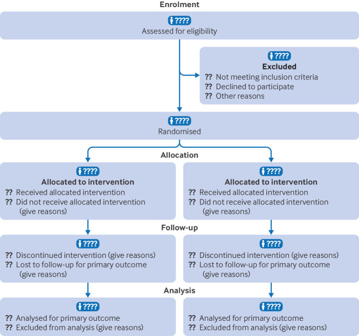
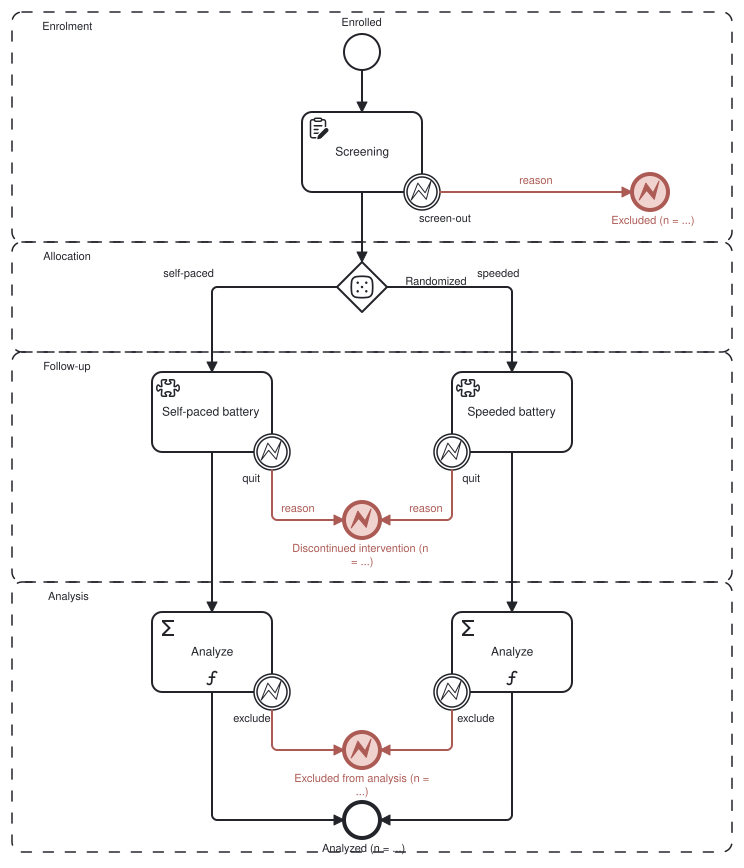
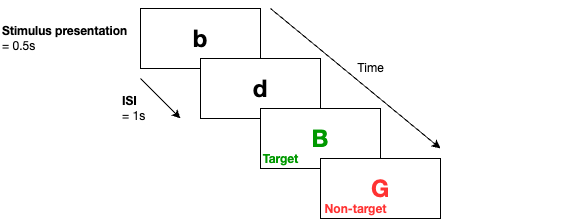
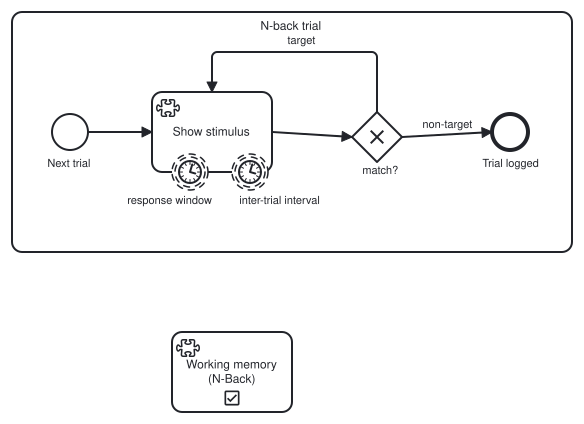

# **Studyflow, an executable visual notation for experimental workflows in the cognitive sciences, from design to publication**

# **Abstract**

A cognitive science study is spread across several artifacts (protocol, experiment script, data, analysis pipeline, reports, manuscript figures), and no single one of them fully records what was actually done. Anyone who wants to reproduce the study, or to make sense of it, must access the *data* and reconstruct the *process* from all of those artifacts at once. That burden persists because while the data usually exists in standard formats, such as BIDS, the process that produced the data still lives in scattered text, slides, and custom code. We present Studyflow, a visual notation that gives the experimental \*process\* a single representation that is machine-readable, human-understandable, and executable. One diagram is the single source of truth for the \*process\*, serving at once as the protocol, the runnable study, the analysis specification, and the publication figure, each a projection for a different audience, so there is no second copy to drift. Studyflow formulates a study as a typed directed graph, realized as an extension of the Business Process Model and Notation (BPMN 2.0) with the elements that experimental cognitive research needs. We demonstrate it end to end on an example study whose single file enrolls, screens, administers, and analyzes a cohort of artificial agents through one interface, the same file running a human cohort without any change, and we release an open-source reference tool to author, validate, and execute Studyflow diagrams.  
**Keywords.** scientific workflows, process modeling, experimental design, BPMN, reproducibility  
**Impact statement.** A single machine-readable diagram serves as a study's protocol, runnable experiment, analysis specification, and publication figure.

# **Introduction**

## **The reproducibility gap is in *\*processes\**, not just data**

An experimental study in cognitive science passes through many hands, human and automated. It is designed, approved, preregistered, run, analyzed, trained on, reviewed as a manuscript, and rebuilt by a replicator. Each stage leaves its own artifact. Nothing keeps those artifacts consistent; each carries its own copy of the study's parameters, and separate copies drift.

That drift is documented at every stage of a study's lifecycle, even where standards were endorsed: only nine of 67 audited trials reported their outcomes faithfully \[@goldacre2019compare\]; only 11 of 35 open-data articles reproduced without author assistance \[@hardwicke2018cognition\]; 29 teams given one question and one dataset returned odds ratios spanning 0.89 to 2.93 \[@silberzahn2018manyanalysts\]; and 70 teams analyzing a single dataset produced no two identical neuroimaging workflows \[@botviniknezer2020\].

These consistency failures point to a common cause: the field standardized its data but not the process that produces the data \[@olive2007conceptual; @aguilar2022experiments; @momeni2026guidelines\]. BIDS and its siblings gave data a shared format \[@bids; @psychds; @bdm\], yet the process behind the data has no equivalent standard. It survives in prose, lab convention, slides, and custom code \[@bell2021perspectives; @osc2015; @nosek2022replicability\], which could be why even studies that share open data still resist reproduction \[@cruwell2023badge\].

The usual substitute for a standard process model is voluntary narrative reporting, mainly preregistration and data sharing, and both remain minority practices \[@hardwicke2024prevalence\]. The gap between endorsing a guideline and adhering to it recurs across fields and journal policies \[@percie2020arrive; @hair2019iicarus; @hardwicke2024transparency\]. The failure is structural, not motivational, for example a checklist records \*what to mention\* without requiring \*what to share\*, and a preregistration fixes a static plan, and the gap between it and the executed procedure reopens the moment the study deviates \[@claesen2021adherence; @hardwicke2023preregistration\]. The problem is not confined to cognitive science. AI evaluation, a sibling field, has arrived at the same place on its own: a benchmark is an experiment, and audit after audit finds that what was actually run cannot be recovered from what was reported \[@burnell2023rethink; @reuel2024betterbench\].

Existing tools do not close the gap either, because each addresses only part of it (Supplementary Materials give a full review). Workflow engines execute pipelines; experiment builders specify tasks and trials; reporting guidelines structure the write-up; data standards fix the input/output formats; and evaluation harnesses standardize scoring and statistics. No single tool spans the whole lifecycle in a form that every audience can read, validate, and execute (@fig-gap).

{#fig-gap width=95%}

We argue that reproducibility should be a property of the shared artifact itself, not of the documentation kept beside it. A notation able to carry that weight has to meet seven requirements at once (R1 to R7, @tbl-requirements). Guided by these requirements, this paper presents Studyflow, a visual notation that gives the experimental process a single representation that is machine-readable, human-understandable, and executable. One file then serves at once as the protocol, the runnable study, the analysis specification, and the publication figure, each a projection of the same artifact for a different audience.

| Requirement | How Studyflow meets it |
| :---- | :---- |
| R1 Single source of truth | One shareable Studyflow file is at once the protocol, the runnable experiment, the analysis, and the figure |
| R2 Executable, not merely descriptive | An executor app walks the same file a reviewer reads or an experimenter runs |
| R3 Understandable to every audience without code | Multiple visual views that project from the same file |
| R4 Grounded in standards | Maps losslessly to a valid BPMN 2.0 document; binds to community standards (e.g., BIDS, CSVW); degrades gracefully in generic tools |
| R5 Process and data in one artifact | Datasets bound to schemas, data joins to control flow by data-association edges |
| R6 Extensible | New domains extend the notation without changing the core or tooling |
| R7 Execution agnostic | One interface for any execution strategy, human or artificial |

: The seven requirements and where the notation meets each. {#tbl-requirements}

Such a problem in experimental cognitive science meets the classic criteria for a domain-specific language, a notation built around one field's recurring structures rather than general purpose code \[@mernik2005dsl\]. However, rather than invent a new DSL, Studyflow extends a notation that engineers and researchers already recognize. Business Process Model and Notation (BPMN 2.0) supplies the backbone: an ISO-standardized graphical process language, proven wherever an under-specified process carries real cost, and already used in other research and clinical settings \[@white2004introduction; @bpmnspec; @dhond2021projectflow; @knight2024visualizing; @braun2014; @tetzlaff2022bpmn4sml; @zarour2019\]. From BPMN, Studyflow inherits a control-flow vocabulary with well-known semantics, a serialization that outlives any tool, and an extension mechanism that keeps diagrams valid even for generic tools \[@magnani2009bpdmn\].

Two design decisions keep the cost of using BPMN low for a researcher who does not already know it. First, an author works with domain elements (for example, a cognitive task, a questionnaire, or a randomization gateway) rather than BPMN's generic vocabulary (a service task, a manual task, an exclusive gateway). Second, execution semantics come from the Studyflow specification rather than from a third-party BPMN engine \[@geiger2016bpmn\], so a Studyflow diagram runs without the author learning any additional tools to work with BPMN diagrams.

Following that, this paper makes three contributions. The first is the notation: a domain-specific BPMN 2.0 profile that carries the elements experimental research needs, defined by a schema and supported by open-source authoring and execution tools. The second is a formal account of the Studyflow diagram: a typed directed graph with validity conditions, visual projections, and execution semantics. The third is an example study that runs end to end from one Studyflow file, a benchmark structured by common reporting guidelines, in which a cohort of artificial agents is enrolled, screened, allocated, administered, excluded, analyzed, and reported through that single artifact, which runs a human cohort without any change.

# **The Studyflow notation**

Studyflow is easiest to understand as one formal object with several projections for rendering the diagram. This section defines that object, relates it to the BPMN standard, describes how it is stored on disk, and gives its execution semantics.

## **The formal object**

Behind every Studyflow diagram is a single formal object, $S$, that every later claim  rests on it (e.g., execution, validation, and projection). A Studyflow diagram represents a study workflow as a typed directed multigraph $S \= (N, E, \\mathrm{src}, \\mathrm{tgt}, \\tau, \\lambda)$ over a schema $\\Sigma$ that fixes the type hierarchy of the elements in the $S$ (i.e., nodes and edges). In experimental terms, the nodes are a study's events, tasks, decisions, and data, and the edges record both what happens next (sequence flow) and which data each node reads and writes (data association).

More precisely, $N$ is a finite set of nodes and $E$ a finite set of edges, with $\\mathrm{src}, \\mathrm{tgt}: E \\to N$ mapping each edge to its source and target. The schema fixes a type hierarchy $T$, split into node types $T\_N$ (events, activities, gateways, and data elements) and edge types $T\_E$ (hence, $T \= T\_N \\cup T\_E$). The typing $\\tau: N \\cup E \\to T$ assigns each node a type in $T\_N$ and each edge a type in $T\_E$. The attribution $\\lambda$ gives each element the attributes its type allows under $\\Sigma$, e.g., the instrument name of a cognitive task, the probability function of a random gateway, or the onset and duration of an activity node.

Because data elements are themselves nodes of $S$, the data specification and the control flow live in one object, and edge type is what separates them. The sequence flow edges $E\_{\\mathrm{seq}}$ (those $e$ whose type $\\tau(e)$ is a BPMN sequence flow) induce the control-flow graph $G\_{\\mathrm{ctrl}} \= (N, E\_{\\mathrm{seq}})$, and the data association edges $E\_{\\mathrm{assoc}}$ induce the data-flow graph $G\_{\\mathrm{data}} \= (N, E\_{\\mathrm{assoc}})$. The two graphs share the node set but no edges. Executing $S$ is then a walk over $G\_{\\mathrm{ctrl}}$, and an analysis pipeline is a path through $G\_{\\mathrm{data}}$.

$G\_{\\mathrm{ctrl}}$ is directed but not acyclic, because experimental procedures contain interrupts, loops, and multi-agent exchanges that a plain directed acyclic graph (DAG, a common abstraction for workflows) can express only through logic left outside the graph. Where a custom DAG would push that control logic elsewhere, BPMN's boundary events, message flows, and choreography express the interrupts, loops, and exchanges natively within the same diagram.

Not all Studyflow diagrams are valid. A diagram is well-formed when four conditions hold. First, $\\tau$ and $\\lambda$ validate against the $\\Sigma$ type hierarchy and the context-free grammar that relates the types in $\\Sigma$ (Supplementary Materials 1). Second, edge endpoints respect type: every control-flow edge runs between flow nodes (events, activities, gateways), and every data-flow edge connects a data element to a flow node. Third, $G\_{\\mathrm{ctrl}}$ is sound, meaning it contains at least one start event, at least one end event, and every flow node lying on some path from a start to an end, so execution can proceed from a start event to an end event without dead branches or unreachable activities. Fourth, the projection of $S$ to BPMN 2.0 is a valid XML file. The first condition states the syntactic and semantic constraints; the second and third state the domain-specific constraints that a generic BPMN validator cannot express, and both can be checked by simulation before a study runs; the fourth states the compatibility and extensibility constraint.

The same graph $S$ can support many projections (a mapping from the $S$ to a visual representation). Given a predicate $p$ over elements, the view $\\pi\_p(S)$ is the subset selected by $\\{x \\in N \\cup E : p(x)\\}$, carrying each selected element's attributes $\\lambda(x)$ unchanged and discarding the rest. Projections match the study to the needs of different audiences. For example, each view in the Results section below is defined by such a predicate: the \*Study\* view keeps everything; the \*Gantt\* view keeps elements that carry an onset or duration and renders them as interdependent tasks; the \*Checklist\* view keeps elements that carry checklist items and renders them as a list; and the \*Figure\* view keeps elements marked visible and discards the rest (but embeds the full $S$ as metadata). A projection only discards some properties of the $S$, and never adds or rewrites, so every projected view stays consistent with the single source of truth by construction.

## **Relation to the BPMN standard**

Studyflow notation implements the object $S$ as a domain-specific profile of BPMN 2.0 \[@white2004introduction\], using BPMN's own extension mechanisms (nested \`extensionElements\` and namespaced attributes) to add the domain semantics of $T$ and $\\lambda$ without breaking the standard \[@stroppi2011; @magnani2009bpdmn\].

\*What Studyflow inherits.\* Studyflow reuses BPMN's full control-flow vocabulary and visual shapes: events, activities, gateways, data objects and stores, pools and lanes, and choreography. Each keeps its standard BPMN shape and behaves as the OMG specification defines \[@bpmnspec\]. The XML projection leaves BPMN's XML serialization, namespaces, and element identifiers untouched.

\*What Studyflow adds.\* Four groups of elements extend BPMN. First, a root study container carries study-wide metadata such as title, version, authors, and runtime environment. Second, domain activity types specialize the generic task, among them cognitive tasks, questionnaires, instructions, rest, and video games, each with a distinctive icon but an ordinary BPMN task underneath. Third, data elements bind to community schemas (e.g., BIDS \[@bids\], Psych-DS \[@psychds\], BDM \[@bdm\], CSVW \[@csvw\]), and a data-operation icon marks the transformation an activity performs on data, the vocabulary of a dataframe pipeline, with an optional \`studyflow:uses\` reference to an external implementation (a Python function, a container image, or a script URL of the form \`scheme://ref@version\`). Fourth, research gateways encode randomization, stratified allocation, and eligibility, while optional temporal attributes (onset, duration, progress) let the Gantt projection derive schedules and draw task dependencies. @tbl-elements shows a representative subset; the full catalog is in Supplementary Table S1.

| Element | BPMN base | What it adds |
| :---- | :---- | :---- |
| Study | bpmn:Process | Root container carrying study-wide metadata (title, version, authors, runtime) |
| CognitiveTask | bpmn:Task | A cognitive test, naming its instrument and passing inline configuration |
| Questionnaire | bpmn:Task | A questionnaire instrument administered to a participant |
| DataOperationActivity | bpmn:Activity | An activity marked with a data operation and typed inputs and outputs |
| Dataset | bpmn:DataStoreReference | A typed dataset bound to a schema (BDM, BIDS, or Psych-DS) |
| RandomGateway | bpmn:ExclusiveGateway | Random assignment to one outgoing branch |
| EligibilityGateway | bpmn:ExclusiveGateway | Inclusion and exclusion decision gateway |

: Representative Studyflow elements, each subclassing a standard BPMN type. The complete catalog is in Supplementary Table S1. {#tbl-elements}

Studyflow extends BPMN, but it is itself extensible via a simpler strategy. A new element plugs in through a schema $\\Sigma'$ that extends the core $\\Sigma$. Each new type subclasses a core type and adds its own attributes, so the extended diagram stays valid Studyflow, stays valid BPMN 2.0, and gains new semantics. The core $\\Sigma$ already covers common experimental designs, and extensions such as data transforms or multimodal brain-imaging processing add what a specific domain needs (@fig-extensions).

{#fig-extensions width=80%}

## **Serialization**

The object $S$ lives on disk in two interchangeable formats. A Studyflow file (\`.studyflow\`) is a YAML document, a lossless mapping of the BPMN object tree (Listings 1 and 2). The same tree projects to a valid BPMN 2.0 XML document (\`.bpmn\` or \`.xml\`), in which every element is a standard BPMN element where its Studyflow payload sits inside \`extensionElements\` blocks. This separation leaves the structure a generic BPMN tool expects intact so each tool reads only the elements it recognizes. The two forms convert losslessly in both directions: the YAML is the machine- and human-readable source of truth, and the XML is its interoperability projection. Two further conventions serve the design requirements described above. First, YAML's layout diffs cleanly in Git. Second, the source can be embedded losslessly in an exported image's metadata (for example, in the \`\<metadata\>\` element of an SVG file); it is the embedded source, not the rendering, that stays authoritative.

## 

## **Execution**

Executing a well-formed Studyflow file is a deterministic walk over its control-flow graph $G\_{\\mathrm{ctrl}}$. A run with actor $i$ is a sequence of configurations $\\kappa\_n \= (s, v\_n, g\_n, \\sigma\_n)$, where $s$ is the current study state (i.e., global variables), $v\_n$ is the current node state (i.e., local variables), $g\_n$ the pseudo-random state, and $\\sigma\_n$ the actor state. Control is a single token that occupies one node at a time, so each step is a transition

$$\\kappa\_{n+1} \= \\operatorname{step}(F, \\kappa\_n, \\rho\_n),$$

where $\\rho\_n$ is the response recorded at step $n$. Concretely, an executor app advances along the outgoing control-flow edges, e.g., at a gateway it selects the branch by the gateway's rule, drawing any randomness from $g\_n$, and at an activity it emits data to the actor and consumes $\\rho\_n$ as external input.

Note that building a full execution engine is a difficult job.  The same execution strategy can validate a diagram against the well-formedness rules above using token simulation rather than by a full execution in the real world. Additionally, a lighter execution script may support only a subset of the elements.

# **Results (Example Study)**

The example study is a benchmark with the structure of a randomized controlled trial, enrolling families of artificial agents on a battery of cognitive tasks (Materials and methods and Supplementary Note 1 give the full apparatus). An artificial agent is enrolled at a start event, screened against eligibility criteria, randomly allocated to an experimental condition, and then administered a set of cognitive tasks one trial at a time (a seven-task battery spanning working memory, attention, processing speed, reasoning, and set-shifting). Any agent who quits early or fails too many trials leaves through an exit that the diagram records on its error events. The same file runs a human cohort without any change to the protocol.

```yaml
Minimal_Study:
  type: bpmn:Process
  name: Minimal study
  extensionElements:
    - type: studyflow:Study
  flowElements:
    enroll:
      type: bpmn:StartEvent
      consentFormUri: consent.md
    flanker:
      type: bpmn:Task
      name: Flanker
      uses: https://github.com/jspsych/jspsych-contrib@v0.4.0#flanker
      extensionElements:
        - type: cognitive:CognitiveTask
          instrument: jspsych
    done:
      type: bpmn:EndEvent
      redirectTo: https://app.prolific.com/submissions/complete?cc={COMPLETION_CODE}
      completionCodeType: dynamic
    f1: { type: bpmn:SequenceFlow, sourceRef: enroll, targetRef: flanker }
    f2: { type: bpmn:SequenceFlow, sourceRef: flanker, targetRef: done }
```

*Listing 1. A complete minimal study: a start event, one task, an end event. Dropped into the runner, this file records consent at the start event, administers a Flanker, and issues a completion code at the end. The steps below grow this skeleton one fragment at a time: a design with gateways and counted exits (Step 1), a battery (Step 2), data contracts and an analysis (Step 3), and the report (Step 4).*

This section builds the study the way a researcher would: step by step, one per stage of the study lifecycle: design, run, analyze, and report. Every fragment is itself a well-formed Studyflow diagram, with its own start and end events, so each validates and runs on its own. Each step demonstrates one thing the notation provides: (1) the design is executable rather than descriptive (Step 1), (2) one interface administers any actor (Step 2), (3) the analysis is fixed before the first run (Step 3), and (4) the reporting artifacts are projections of the same file, exported rather than redrawn (Step 4). The final subsection then combines the fragments into a single file that specifies the entire study, shown as one diagram in @fig-combined, and delivers a single source that keeps every artifact from drifting. Almost nothing about the study lives outside that combined file: the protocol, battery, analysis, and report are all in it, so the file is the preregistration, runs the experiment, specifies the analysis, and projects into the figure printed in this paper. What remains outside is only the cohort roster (which actors run the protocol, and how many runs per condition), supplied by the runner as executor configuration, with each artificial actor's model id, digest, sampling parameters, and trait prompt pinned per run. The file fixes the protocol every actor runs, not the roster of actors that run it.

## **Design: the protocol is the diagram**

The first fragment describes the enrollment and allocation phases of the study, from the consented start event through screening and eligibility to random allocation. The study has the structure of a randomized controlled trial, and its CONSORT participant flow is not a picture drawn for publication, rather it is the protocol itself (@fig-step1). @fig-consort places the CONSORT 2025 reference flow beside its Studyflow diagram, both of which share the same labels and pathways \[@hopewell2025consort\].

::: {#fig-consort layout-ncol=2}
{#fig-consort-ref}

{#fig-consort-sf}

The example study's participant flow is the protocol itself, not a picture drawn for publication. (a) The CONSORT 2025 reference flow \[@hopewell2025consort\]. (b) The same flow as a Studyflow diagram, grouped into the four CONSORT phases—enrolment, allocation, follow-up, analysis—with attrition encoded as boundary error events that terminate at counted error end events. The topology of the published flow is the topology the runner executes.
:::

Domain-specific elements make each design decision explicit rather than narrative. The enrollment start event references the consent document, so that when the protocol runs a human cohort, an ethics board approves the very form that renders at that node. The screening task carries the checklist that later drives the guideline audits. The eligibility gateway lists its inclusion and exclusion criteria: it requires a registered agent family with a pinned model version for the artificial cohort, and it carries the human criteria (aged 18 to 65, normal or corrected-to-normal vision) a human cohort would be screened against, unchanged. The randomization gateway carries its allocation rule and parameters, and each cognitive task declares its own parameters (e.g., for the N-back, the N, the timing, and the trials per block). Every element defines something used later in the study lifecycle.


```yaml
Enroll:
  type: bpmn:StartEvent
  name: Enrolled and consented
  consentFormUri: https://behaverse.org/protocols/example-study/consent.md
Screening:
  type: bpmn:Task
  name: Screening
  extensionElements:
    - type: cognitive:Questionnaire
      instrument: screening
  checklist: |-
    - [ ] Informed consent recorded
    - [ ] Inclusion and exclusion criteria checked
Eligibility_Gateway:
  type: bpmn:ExclusiveGateway
  name: Assessed for eligibility
  extensionElements:
    - type: cognitive:EligibilityGateway
      inclusionCriteria:
        - Registered agent family with a pinned model version (artificial cohort)
        - Aged 18 to 65 years, normal or corrected-to-normal vision (human cohort)
      exclusionCriteria: [prior exposure to the battery, failed comprehension check]
Excluded_Pre:
  type: bpmn:EndEvent
  name: Excluded (n=...)
  eventDefinitions:
    err: { type: bpmn:ErrorEventDefinition }
Randomize_Gateway:
  type: bpmn:ExclusiveGateway
  name: Randomized
  extensionElements:
    - type: cognitive:RandomGateway
      algorithm: probabilistic
      probabilityFunction: uniform
Allocate_Speeded:
  type: bpmn:Task
  name: Allocated to speeded path (n=...)
DidNotStart_Speeded:
  type: bpmn:BoundaryEvent
  name: Did not receive allocated intervention (n=...)
  attachedToRef: Allocate_Speeded
  eventDefinitions:
    err: { type: bpmn:ErrorEventDefinition }
```

*Listing 2. Step 1, `01_design.studyflow` (excerpt; the self-paced branch mirrors the speeded one, and sequence flows follow the pattern of Listing 1): the enrolment and allocation design as a complete, runnable fragment carrying CONSORT 2025 labels. The start event binds the consent form an ethics board approves when a human cohort runs the protocol; the screening questionnaire carries the audit checklist; the gateways carry their eligibility criteria and allocation rule as attributes; and every early exit is a counted error event.*

{#fig-step1 width=95%}

Beyond the individual elements, the way they are wired together is itself part of the design. For example, participant attrition is encoded in the control flow, not annotated beside it. In a published CONSORT figure, each Excluded, Lost to follow-up, or Discontinued box sits off to the side, and the reader has to infer that its counts subtract from the main path. In Studyflow, every exit is instead a boundary error event, BPMN's standard interrupt mechanism. It attaches to the activity a participant left from and terminates at a counted error end event \[@bpmnspec; @dijkman2008semantics\]. The topology of the published flow diagram is then the topology that executes.

The counts on those events are properties of the diagram and filled in during runtime. The file is initially deposited at preregistration with the counts empty, and the runner fills them in as actors leave the study, so the registered plan and the final report are one diagram at two points in its life. A tool can check that the filled counts stay consistent, with inflow equal to outflow plus attrition at each activity.

## **Run: one interface, any user**

The second fragment is about execution and describes the cognitive battery, administered one trial at a time. The runner walks the diagram node by node and drives every actor through one interface: the same interface serves an artificial agent or, without any change, a human participant. Per trial it may send an observation (the stimulus, the response options, the timing constraint, and, where needed, rendered frames) and record the response. Studyflow encodes that exchange in the notation itself, as a BPMN choreography between the runner and the actor: one message carries the stimulus, options, and timing (plus a rendered frame where needed) and the return message carries the response and its latency (`administer_trial.studyflow`). This is the abstraction that AI evaluation harnesses and task standards already expose \[@metr2024taskstandard; @aisi2024inspect\]. A human participant would respond in an interactive GUI; language models receive the trial as instructions, and vision models additionally read the rendered screenshots \[@schulzebuschoff2025visual; @tangtartharakul2026deficits\].

The reported cohort is deliberately small, enough to exercise the machinery of the diagram. It crosses three agent families (a uniform random baseline as the chance reference, an open-weight language model served locally, and a commercial vision-language model that also reads the rendered screen) with a two-level trait contrast and both time-pressure paths, at $k \\= 30$ runs per condition. The trait is a disposition prompt rather than a target accuracy \[@argyle2023silicon; @aher2023llms; @ratcliff2008diffusion\]. Agents run the full factorial; the protocol's random allocation applies when a human cohort runs it, recorded explicitly in the file at Step 1. Time pressure is implemented per family (a prompt deadline for language models; a response timeout when a human cohort runs the protocol), so comparisons hold only within a family.

Run the different kinds of tasks, every task can reference external software. A cognitive task node names its implementation with a \`studyflow:uses\` property alongside its parameters, and the runner administers whatever the reference resolves to. In the example study, six tasks come from the Behaverse battery \[@behaverse\] (an N-back, a digit span, SART, serial RT, Belval matrices, and Belval card sorting, spanning working memory, attention, processing speed, reasoning, and set-shifting), and the Flanker task comes from jsPsych \[@deleeuw2015jspsych\]. The study seed fixes each subject's path, task order, stimulus order, and every random branch (e.g., the randomization gateway).

@fig-nback shows the traditional slide figure of the N-back beside its Studyflow diagram. The slide is intuitive but underspecified: timing values live in the caption, the trial-to-block boundary stays implicit, and what counts as a correct match is buried in analysis code. The diagram makes the trial an explicit subprocess, with a stimulus activity, a boundary timer for the response window, a second timer for the inter-trial interval, and labeled target and non-target branches, and this subprocess compresses into a single task whose payload declares the parameters (Listing 3). Every trial is logged in a standard format (here, BDM \[@bdm\]). The data schema fixes the columns and the diagram fixes their use, hence both data description and process description in one place.

::: {#fig-nback layout-ncol=2}
{#fig-nback-slide}

{#fig-nback-sf}

Step 2 (Run): the N-back. (a) The traditional slide-style figure is intuitive but underspecified—timing values live in the caption, the trial-to-block boundary stays implicit, and what counts as a correct match is buried in analysis code. (b) The Studyflow diagram makes the trial an explicit subprocess—a stimulus activity, a boundary timer for the response window, a second timer for the inter-trial interval, and labeled target and non-target branches—that compresses into a single task declaring its parameters (N, ISI, trials per block).
:::


```yaml
Task_NBack:
  type: bpmn:Task
  name: Working memory (N-Back)
  extensionElements:
    - type: behaverse:Task
      scene: NB
      configurations:
        NValue: 2
        TrialsPerBlock: 40
        InterStimulusInterval: 1.5

Task_Flanker:
  type: bpmn:Task
  name: Attention (Flanker)
  uses: https://github.com/jspsych/jspsych-contrib@v0.4.0#flanker
  extensionElements:
    - type: cognitive:CognitiveTask
      instrument: jspsych
```

*Listing 3. Two task nodes from Step 2, `02_run.studyflow` (stimulus streams omitted; their BPMN 2.0 XML projection is in Supplementary Listing S2). The two tasks resolve their implementations through different mechanisms under one notation: the Behaverse N-back through its extension's `scene` (no external `uses` needed), and the jsPsych Flanker through an explicit versioned `uses` reference. Each carries a typed extension declaring the instrument and the inline configurations the runner passes to it.*

One feature of BPMN worth mentioning here is error handling. For example, failed trials are handled inside the same flow. An agent that replies outside the allowed response options is recorded raw and flagged, with nothing imputed, and a run whose failed trial rate exceeds 20% on any task exits through the protocol's boundary error events and is counted in the participant flow. The exit propagates in two levels: a task's failed-trial boundary event ends the battery subprocess, whose own boundary error event catches that end and routes to the counted \`Discontinued intervention\` exit, so agent dropout leaves through the same edge a human cohort's loss to follow-up would (@fig-step2). Failures are typed by mode (invalid, timeout, refusal) and reported in @tbl-agents (the full execution configuration is pinned to every run \[@ivanova2025cognitive; @lampinen2024content\]).

{#fig-step2 width=55%}

## **Analyze: the pipeline is the preregistration**

The third fragment (Listing 4\) is the analysis, and it is not a script kept beside the study. It is instead a set of typed elements in the same Studyflow notation. Three outcomes of the analysis ask where the agents land relative to chance, to one another, and to the baseline: the Flanker congruency effect, an agreement test, and a divergence test. @tbl-analyses gives each question, its test, and its decision rule. What the Studyflow shows is that, again, the registered analysis and the executed analysis are the same object.

| Question | Test | Decision rule |
|:--|:--|:--|
| Does an agent show the marker effect? | Flanker congruency effect | TO FILL IN (threshold, from test-retest variability) |
| Does an agent match a reference cohort? | Equivalence of accuracy (agreement) | TO FILL IN (equivalence margin) |
| Is an agent distinguishable from the reference? | Distinguishability (divergence) | TO FILL IN (classifier criterion) |

: The three analysis questions, their tests, and their decision rules. {#tbl-analyses}

The analysis pipeline itself is a chain of typed steps (@fig-step3). It reads the raw trials, filters invalid trials (RT \< 100ms, missing data, flagged rows), maps each trial to its derived measures, branches at an exclusive gateway on the comparison of interest, and reduces in two stages, first to per-run summaries and then to group statistics. The filter step is the analysis exclusion that the CONSORT flow reports, and a manual outlier review (performed by the human analyst) precedes the final write in Step 4\. @fig-pipeline shows the analysis pipeline as typed data-operation nodes, each naming through `studyflow:uses` the external code that runs it. Any step can run inline (via domain-specific elements that correspond to DataTrove functions) or delegate through a \`studyflow:uses\` external function (for example, \`python://pkg.fn@1.2\`) with specified arguments. The diagram then shows each step's operation type, inferred inputs, and outputs, while the implementation may live in pinned external code. The divergence test's classifier is authored in the same diagram: a classic statistical pipeline and a machine learning training pipeline share one notation, differing only in their elements \[@kapoor2023leakage; @tetzlaff2022bpmn4sml\].

![Step 3 (Analyze): the analysis pipeline as typed data-operation nodes—read, filter (the analysis exclusion), map to derived measures, branch, reduce to per-run summaries then to group statistics, a manual outlier review, and render/write—reading a BDM trials dataset and writing a results dataset. Each node shows its operation type and its inferred inputs and outputs, while the implementation lives in pinned external code referenced through `studyflow:uses` (for example, `python://behaverse_analysis.filter_invalid@1.0`).](figures/fig6_pipeline.svg){#fig-pipeline width=32%}

The Studyflow diagram also fixes the data contract. Datasets and schemas are nodes on the data-flow graph, joined to activities by data associations (the dashed edges of the BPMN 2.0 standard), so the data specification and the control flow live in one artifact (Listing 4). Every dataset declares its format (e.g., BDM, BIDS, or Psych-DS) and a schema: tabular data carries a CSVW body or reference \[@csvw; @hoytO3GuidelinesOpen2024\], and non-tabular data documents its dimensions, dtypes, and units. From the diagram alone, an analyst can confirm that a downstream step consumes exactly the column an upstream step produced, and a step that violates the data formatting rules fails validation before any data moves around.

```` ```yaml ````  
`trials:`  
 `type: bpmn:DataStoreReference`  
 `name: Trials (BDM)`  
 `extensionElements:`  
   `- type: studyflow:Dataset`  
     `format: bdm`  
     `bdmDataLevel: trials`  
`trial_schema:`  
 `type: bpmn:DataObjectReference`  
 `name: Trial schema (CSVW)`  
 `extensionElements:`  
   `- type: studyflow:Schema`  
     `format: csvw`  
`read_trials:`  
 `type: bpmn:Association`  
 `associationDirection: One`  
 `sourceRef: trials`  
 `targetRef: read_raw_trials`  
```` ``` ````  
``| \*Listing 4.\* Step 3, \`03\_analyze.studyflow\` (excerpt): the data contract as nodes. A typed dataset declares its format and binds to a CSVW schema, and dashed data associations join it to the steps that write and read it. |``

{#fig-step3 width=60%}

@tbl-agents reports accuracy, fail rate, and response time for every executed condition. The congruency effect, agreement, and divergence analyses each yield an estimate for every executed condition, and the agents recover the classic Flanker congruency cost in response time and accuracy, as expected. Note that we read the agent estimates as outputs of the demonstrated pipeline, not as claims about agent cognition. What a congruency effect would mean in an artificial cohort is a question we treat cautiously in the Discussion.

| Condition (family, trait, path) | Accuracy | Failed-trial rate | Response time |
|:--|:--|:--|:--|
| TO FILL IN, one row per executed condition | | | |

: Accuracy, failed-trial rate, and response time for every executed condition. {#tbl-agents}

## **Report**

The fourth step closes the study lifecycle. A node turns the analysis outputs into the reporting artifacts, and a completion end event issues a completion code (for a human cohort, the code a participant returns to the recruitment platform to confirm completion and release payment). Beyond those two nodes (@fig-step4), however, reporting adds nothing to the study and every reporting artifact is a projection of the same file (@fig-views). The four views presented here illustrate this: the Study view keeps everything; the Gantt view places inter-dependent elements on a time axis; the Checklist view flattens the diagram into items for day-to-day updates and guideline audits; and the Figure view renders a selected subset as an image (whose file also embeds the full Studyflow content, so a deposited figure is the runnable study rather than just a picture of it). Because projections only discard and never rewrite, editing the Studyflow file updates every view.

{#fig-step4 width=95%}

The same mechanism serves three reporting guidelines simultaneously. The SPIRIT 2025 schedule of enrollment and assessment is the Gantt view \[@chan2025spirit; @spirit2013\]. The CONSORT flow diagram is the Figure view of the same file after execution, with attrition already written into the boundary events (@fig-views). CHART's language-model report draws on the executor configuration pinned to each run (the model id, digest, sampling parameters, and trait prompt of the actors the file administered), recorded alongside the file rather than inside the protocol topology. At publication, these artifacts are exported rather than redrawn by hand.

{#fig-views width=42%}

The study's deviation report is likewise mechanical. A deviation from the preregistration entry is simply the diff between the registered Studyflow file and the file after execution (Listing 5). Any deviation that touches the topology or a parameter therefore appears in the diff, e.g., a rewired branch, a changed threshold, and a modified time interval. A prose comparison between a preregistration entry and a published paper cannot promise that \[@claesen2021adherence; @cummins2026regcheck\].

| Listing 5\. The deviation report of the example study: the diff between the Studyflow file deposited at preregistration and the same file after the execution. The protocol's topology and parameters are untouched. The only changes are the participant-flow counts the runner wrote onto the boundary error events as agents left the study. |

Guideline adherence and internal consistency are checked the same way, mechanically from the file. Guideline items map onto the elements that satisfy them (Supplementary Table S2), so the Checklist projection can audit the study against CONSORT, SPIRIT, or CHART without leaving the diagram. This extends validation to faults that text descriptions cannot catch (or at least makes them far easier to catch). For example:  
`ERROR CONSORT flow-consistency at activity "Cognitive battery (one trial at a time)":`  
     `inflow (24) != outflow (20) + attrition (3); 1 participant unaccounted`  
`ERROR data-contract at activity "Reduce to per-run summaries":`  
     `reads column "elapsed_time"; schema "bdm-trials" defines`  
     `no such column (closest: "response_time")`

These are constructed demonstrations, but the mechanism is what guards a real deposit.

## **One file for everything**

Each fragment above is a complete study on its own; the full study is what they become together. Combining them is mechanical too: each fragment's boundary events fuse into the gateways that connect the phases, the run and analysis fragments become the expanded subprocesses, and every domain attribute carries over unchanged. The result is the single Studyflow file that specifies the entire example study, shown as one diagram in @fig-combined. Read from top to bottom, it is Steps 1 through 4 in order, laid out in lanes named for the CONSORT phases (enrolment, allocation, follow-up, analysis), with the cognitive battery and the analysis as expanded subprocesses. The views, guideline audits, and deviation report all read from this one artifact.

{#fig-combined width=42%}

The combined diagram is a single source of truth. For example, the N-back's inter-stimulus interval shows the single source concretely. It exists in the file exactly once (\`InterStimulusInterval: 1.5\` in Listing 3), and every artifact that would traditionally hold its own copy is a projection of that one node: the Study view renders it, the executor app applies it trial by trial, the analysis receives data stamped with it, and the exported figure renders it. A protocol, a script, a methods paragraph, and a figure cannot disagree about its value, because there is no second copy to drift. A single source turns a design change from a coordination problem into a one-line diff. For example, increasing the interval to two seconds is a single edit whose entire footprint under version control is:

\-        InterStimulusInterval: 1.5    
\+       InterStimulusInterval: 2.0

# **Discussion**

## **One artifact instead of a document trail**

Current practice in cognitive science scatters an experimental study across a registry entry, an ethics PDF, a recruitment system, custom analysis code, and a flow diagram drawn only for publication, none of them a machine-readable representation of the others \[@moher2012; @rennie2001\]. Studyflow collapses that trail into one diagram whose views cannot disagree. Because the file is plain text, it also diffs in Git and embeds in exported images.

For preregistration, the merge of documents changes the registered object itself. Preregistered studies routinely deviate without disclosure \[@claesen2021adherence; @hardwicke2023preregistration; @bakcoleman2024rigour\], to the point that researchers now use language models to compare registrations against the papers that follow them \[@cummins2026regcheck\]. Two earlier ideas in this space pushed in the same direction as Studyflow: structured preregistration made the plan machine-readable \[@peters2023preregr\], and machine-readable hypothesis tests made the results checkable \[@lakens2021machinereadable\]. Studyflow extends that logic to the whole process of doing experimental research. The diagram is the plan, the analysis spec is one valid workflow inside it, and a deviation is a diff rather than an unstructured prose comparison (Listing 5).

For AI evaluation, a benchmark and a human baseline can become one auditable artifact. Rankings built on a single task are fragile \[@dehghani2021lottery\], so the example study varies the diagram (the task, the response timeout, the prompt) across a battery of parametrically modifiable activities, the design that psychometric evaluation calls for \[@wang2026psychometrics; @bean2025construct\]. Related efforts do not fully cover this. CogBench, for example, scores language models on fixed paradigms behind a single harness \[@codaforno2024cogbench\], and Psych-101 transcribes 160 experiments into text \[@binz2025centaur\], but in neither can one registered protocol administer both human and artificial cohorts. In the example study, the same file that runs the artificial cohort would run a human baseline through the identical protocol without change, whereas existing agentic benchmarks collect their human baselines outside the process the experimental design defines \[@mialon2024gaia\]. This places the Studyflow file in line with model cards, evaluation cards, and datasheets \[@mitchell2019modelcards; @dhar2025evalcards; @gebru2021datasheets\]. But it is an eval card a third party can execute rather than only read. That executability supports the multi-execution protocol that agreement analyses require \[e.g., @nayebi2026alignment\]. That executability is also what independent audit needs: a Studyflow diagram is a pinned, reproducible specification of what was evaluated \[@raji2022outsider\], and it is the artifact that benchmark reporting initiatives are converging on \[@reuel2024betterbench; @dhar2025evalcards\].

Reporting guidelines fit the same notation. Each is a controlled vocabulary, a checklist, and sometimes a flow diagram, and authored as a Studyflow diagram these become labels, attributes, and views, so adherence turns into a property of the file. The pattern applies from CONSORT-AI and SPIRIT-AI through PRISMA, TIDieR, ARRIVE, and the consensus reporting checklist for language-model studies \[@liu2020consortai; @cruzrivera2020spiritai; @page2021prisma; @hoffmann2014tidier; @percie2020arrive; @feuerriegel2026guidellm\], while AI benchmark checklists converge on the same shape \[@reuel2024betterbench; @zhu2025abc\]. These guidelines are mainly for human participants. For the artificial cohort, the closest guideline is CHART, written for studies that evaluate a chatbot, whose model identification, prompts, and query items map onto the executor configuration pinned to each run in the example study, the model id, digest, sampling parameters, and trait prompt referenced by the file and fixed before that run \[@chart2025\]. In the example study, the same guideline-compliant artifact runs the artificial cohort and, unchanged, a human cohort, and that single file renders as CONSORT, SPIRIT, or CHART.

Studyflow can be thought of as a workflow modeling approach. Existing approaches to workflow modeling separate along two axes: (axis 1\) definition versus execution, and (axis 2\) domain-generic versus domain-specific. No approach is at once a readable definition and an executable specification of the whole experimental study. Studyflow targets that gap, and it replaces none of its workflow modeling alternatives (@fig-gap). @tbl-compare shows the neighboring approaches against the requirements (Supplementary Note 2 gives the extended comparison).

| Family | R1 | R2 | R3 | R4 | R5 | R6 | R7 |  
|:--|:-:|:-:|:-:|:-:|:-:|:-:|:-:|  
| Workflow engines, evaluation harnesses | TODO | | | | | | |  
| Experiment builders, task languages | TODO | | | | | | |  
| Data, provenance, reporting standards | TODO | | | | | | |  
| Studyflow | yes | yes | yes\* | yes | yes | yes | yes |

: Similar notations scored against the requirements: R1 single source of truth, R2 executable, R3 readable without code, R4 grounded in standards, R5 process and data on one artifact, R6 extensible without forking, R7 executor agnostic. Each cell is scored against the rubric in Supplementary Note 2; \*partial\* means the property holds only on the system's slice of the lifecycle. Studyflow's R3 is marked yes\* because it holds by design but its comprehension benefit is untested (Limitations). {#tbl-compare}

Workflow engines and evaluation harnesses execute directed acyclic graphs of computation (DAG) at scale \[@nextflow; @cwl; @pydra; @zhao2008scientific\_workflows; @cuevasvicenttin2013workflows\]. A study, by contrast, is iterative and cyclic, e.g., piloting revises the design, sessions repeat, and an analysis can send a researcher back to collect more data \[@ghareeb2025\]. Studyflow keeps the loop, as a directed graph, in the diagram and delegates each external computation through \`studyflow:uses\` to the toolkit built for it \[@ghosh2025reproducible\_digital\_health\].

Experiment builders and task scripts specify the trial, the stimuli, or the runtime platform, several of them more expressively than Studyflow does \[@strittmatter2025sweetbean; @tessler2025deliberatelab; @beadl; @musslick2022sweetpea; @musslick2024autora; @harrison2026psynet; @almaatouq2021empirica\]. Studyflow composes these rather than competing with them. So a task authored in jsPsych \[@deleeuw2015jspsych\] can be followed by one authored in PsychoPy \[@peirce2019psychopy\], with the diagram supplying the surrounding consent, eligibility, allocation, data format, and rendering (Listing 3).

Data, provenance, and reporting standards occupy the data subspace and describe the datasets \[@bids; @bdm; @psychds; @csvw\]. Studyflow references them and describes the process that produced the data. Provenance tools, in turn, describe what was run after the fact \[@w3cprov; @soilandreyes2022rocrate; @leo2024wfrunrocrate\], whereas Studyflow specifies the study in advance and accumulates its metadata across the study lifecycle, in an interchangeable format that can be executed, diffed, and audited.

# **Limitations**

BPMN is heavyweight, and asking researchers to learn one more notation is a real cost. Moreover, the comprehension of a process model degrades as it grows \[@reijers2011understandability; @bogale2024\]. We hold that cost down with a small core vocabulary that is specific to cognitive science. Conceptually, a Studyflow diagram is just a flowchart carrying extra attributes, one that happens to validate against a schema, diff in Git, embed in an image, and execute when walked.

An executable figure shifts where trust in a study rests. However, running a Studyflow diagram asks the reader to trust two things: the external code it references, and the correspondence between the rendered diagram and its Studyflow source file. Both yield to ordinary software engineering and cyber security remedies, e.g., hashing the source, pinning the external code, and restricting each external call to its declared operation (e.g., via containers).

A single source of truth also concentrates risk, so the Studyflow design keeps the notation independent of any one tool. The notation's core specification is a schema maintained separately from the tooling, and the Studyflow files on disk are plain YAML with a lossless projection to BPMN 2.0 XML. The XML file opens in any compliant BPMN tool and degrades gracefully when a tool does not recognize the Studyflow extensions \[@white2004introduction; @magnani2009bpdmn\]. A project that abandons our toolkits is left with a valid, standard file that no single tool owns.

We have not measured whether Studyflow diagrams are easier to read than the protocol PDFs, figures, and scripts they replace. In fact the classic flowchart-versus-text comparisons are mixed \[@scanlan1989flowcharts; @shneiderman1977flowcharts\]. We designed every feature with comprehension in mind, but we treat the benefit as a hypothesis awaiting a usability study \[@figl2017comprehension\].

Finally, the large language models in the example study are not replacements for humans. Treating their data as human evidence invites misinterpretation with a documented risk of illusions \[@dillion2023replace; @lin2025fallacies; @messeri2024illusions\]. Most experimental research in cognitive science has so far engaged AI as the intervention rather than the subject, the setting that CONSORT-AI and SPIRIT-AI were written for \[@liu2020consortai; @cruzrivera2020spiritai\]. Our claim in the example study stays at the level of notation to demonstrate that the protocol topology is one diagram, and that diagram can run a human cohort or an artificial one. Whether the tasks measure the same constructs in agents as in humans is an open question that the shared protocol makes testable rather than settles \[@bean2025construct\]. One clear case is the working memory construct, which a language model's context window may represent, so an N-back administered with the full transcript in context is a retrieval task, not a working memory task.

# **Future work**

Experimental science increasingly runs on large datasets and automated pipelines, yet the process that produces the data still has no counterpart to what BIDS gave the data itself. Studyflow is one candidate for that role: a study read, run, and trusted from a single source instead of from a trail of documents about it. A study built this way ends with its resources in agreement, because it keeps only one.

A further direction is machine authorship. Systems that generate research, from hypothesis-generating agents to autonomous pipelines, currently emit their protocols as prose that no validator can certify, and language models draft process diagrams fluently but without guarantees \[@kourani2024promoai; @lauer2026assessing\]. What is missing is a verifiable, human-understandable notation with static checks for well-formedness, consistency, and data formats. Studyflow supplies one, and it suggests a separation of concern, so a language model drafts the study, the validator verifies what can be checked, and a human reviews a diff rather than a complete manuscript. The notation then becomes the oversight interface for machine-generated studies.
