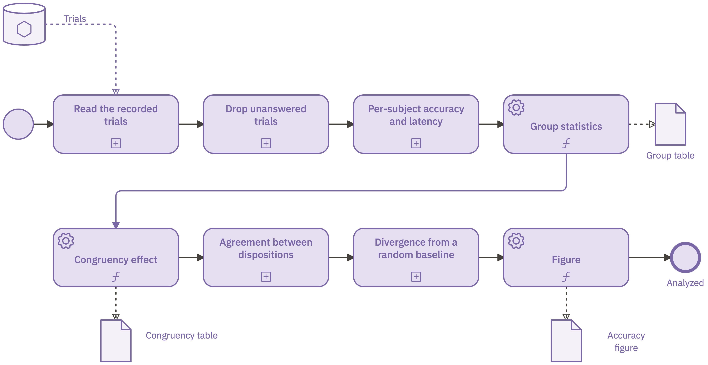
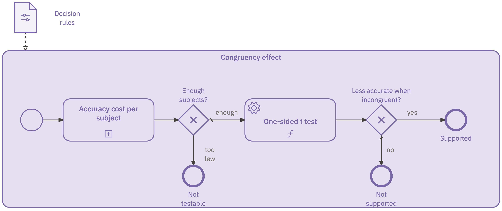

<!-- Mirrors the Google Doc "Studyflow Paper (eLife)", latest version (2026-09-07). -->

# Introduction

## A key driver of the reproducibility gap: *processes*, not just data

An experimental study in cognitive science passes through many hands and computerized systems. It is designed, evaluated, approved, preregistered, run, analyzed, trained on, reviewed as a manuscript, and rebuilt by a replicator. Each stage typically creates its own artifacts (e.g., diagrams, text files, code). Critically, there are no solid mechanisms to ensure those artifacts remain consistent: as each artifact carries its own copy of the study's parameters (with different copies typically containing partially overlapping subsets of information), there is a substantial risk for copies to drift apart and for information about the study to become ambiguous, inaccurate, or plainly wrong.

This drift is real and consequential, even when standard research practices are endorsed. It has been documented at every stage of a study's lifecycle: only nine of 67 audited trials reported their outcomes faithfully [@goldacre2019compare]; only 11 of 35 open-data articles reproduced without author assistance [@hardwicke2018cognition]; 29 teams given one question and one dataset returned odds ratios spanning 0.89 to 2.93 [@silberzahn2018manyanalysts]; and 70 teams analyzing a single dataset produced no two identical neuroimaging workflows [@botviniknezer2020variability].

The root cause of these consistency failures is the lack of standardized processes. Over the past decade, there have been notable efforts towards standardizing data (i.e., how they are formatted, organized in files, named and shared; see e.g., [@bids; @psychds; @bdm]), an objective which undoubtedly remains essential. However, standardized data is insufficient to address the reproducibility gap: we also need standardized processes to cover the whole data pipeline [@olive2007conceptual; @aguilar2022experiments; @momeni2026guidelines]. Indeed, even studies that share standardized data cannot be reliably replicated [@cruwell2023badge].

As stated earlier, experimental studies in cognitive science, and in other fields, can be complex, involve many people and tools, and serve a variety of purposes. These processes are currently handled in idiosyncratic, segmented ways: they may be described in prose or hand-made diagrams, placed in project documents, lab conventions, slides or custom code [@bell2021perspectives; @osc2015; @nosek2022replicability]. There are initiatives aiming to enforce greater standardization of processes, typically via voluntary narrative reporting, preregistration and data sharing. But adoption of these practices remains limited [@hardwicke2024prevalence], perhaps because they require substantial "additional" effort without offering a clear, immediate benefit. Furthermore, there is a gap between endorsing a guideline and actually adhering to it, as can be seen when reviewing practices across fields and journal policies [@percie2020arrive; @hair2019iicarus; @hardwicke2024transparency]. When standards are based only on narrative reporting, assessing conformance with the standard requires substantial human effort, is subjective and error-prone.

The problem with current practices is not motivational: convincing more people to adopt current standards will not solve it. Instead, the problem is structural: we need a better approach to standardizing research processes. This is a realization that has already occurred in other fields (e.g., AI evaluation, [@burnell2023rethink; @reuel2024betterbench]). The numbers from those fields mirror the ones in human sciences. None of 400 surveyed AI papers documented everything needed to reproduce them [@gundersen2018state], and an independent attempt reproduced only about 64% of 255 machine learning papers [@raff2019step].

Reviewing current approaches highlights several pain points (Supplementary materials give a full review). For instance, most tools cover only a small aspect of the study lifecycle: workflow engines execute pipelines; experiment builders specify tasks and trials; reporting guidelines structure the write-up; data standards fix the input/output formats; and evaluation harnesses standardize scoring and statistics. Furthermore, there are no clear mechanisms to connect the artifacts of these different elements in a form that is complete and consistent and which every audience could read, validate, and execute (@fig-overview). Finally, most tools lack specificity (e.g., a checklist mentioning what to report but not how) and seem unable to cope with the inevitable changes that occur during the study lifecycle (e.g., a preregistration fixes a static plan, and the gap between it and the executed procedure reopens the moment the study deviates [@claesen2021adherence; @hardwicke2023preregistration]).

The key insight behind our approach is that to overcome these challenges, reproducibility must be a core property that is integrated in the shared artifact itself, and not simply optional documentation that lives somewhere beside it. To realize such a system, seven key requirements must be met (R1 to R7, @tbl-requirements).

Here we present Studyflow, a visual notation that gives the experimental process a single representation that is machine-readable, human-understandable, and executable. One single file serves at once as the protocol, the runnable study, the analysis specification, and the publication figure; each of these is a projection of the same artifact for a different audience, rather than being distinct artifacts (@tbl-requirements describes how Studyflow meets each of the requirements).

There is also a theoretical reason why prose plus custom code cannot close this gap. A complete program has two parts, a computation model, and a coordination model that binds the individual activities into an ensemble [@gelernter1992coordination]. Ordinary code hides the coordination of a study (ordering, dependencies, data passing between stages) inside call graphs and shared state, which is exactly where drift accumulates. The machine learning community has documented the resulting failure modes as glue code and pipeline jungles, where changing anything changes everything [@sculley2015hidden]. A workflow notation externalizes that coordination and makes it first-class. In these terms, Studyflow is a coordination language for experimental studies, so the computations (content of a protocol, code to show a stimulus, code to process the data, figure to report the results) stay in the tools built for them, while the notation carries the coordination that currently lives in preregistrations, manuscripts, slides, and glue code.

The design of Studyflow follows from the realization that the problem at hand meets the classic criteria for preferring a domain-specific language (DSL; i.e., a notation built around one field's recurring structures) over general purpose code [@mernik2005dsl]. However, rather than inventing a new DSL from scratch, Studyflow extends a tried-and-tested notation that many engineers and researchers already recognize: the Business Process Model and Notation (BPMN 2.0). BPMN is a robust, expressive, well documented, and widely adopted solution that has proven invaluable across innumerable use cases, supporting a large number of domain-specific extensions, for example for research and clinical settings [@white2004introduction; @bpmnspec; @dhond2021projectflow; @knight2024visualizing; @braun2014; @tetzlaff2022bpmn4sml; @zarour2019].

BPMN supplies the backbone of Studyflow: a graphical process language built from a standard set of shapes with precisely defined meanings whose vocabulary, semantics, and file format are set by an international standard (ISO/IEC 19510), not by any tool or vendor [@bpmnspec]. From BPMN, Studyflow inherits a control-flow vocabulary with well-known semantics, a serialization that outlives any tool, and an extension mechanism that keeps diagrams valid even for generic tools [@magnani2009bpdmn].

Two design decisions keep the cost of using BPMN low for a researcher who does not already know it. First, an author works with domain elements (for example, a cognitive task, a questionnaire, or a randomization gateway) rather than BPMN's generic vocabulary (a service task, a manual task, an exclusive gateway). Second, execution semantics come from the Studyflow specification rather than from a third-party BPMN engine [@geiger2016bpmn], so a Studyflow diagram runs without the author learning any additional tools to work with BPMN diagrams.

Following that, this paper makes three contributions. The first contribution is the notation: a domain-specific BPMN 2.0 profile that carries the elements experimental research needs, defined by a schema and supported by open-source authoring and execution tools. This makes BPMN accessible to cognitive science researchers by presenting it in the language of experimental design. The second contribution is a formal account of the Studyflow diagram: a typed directed graph with validity conditions, visual projections, and execution semantics, providing the formal basis for Studyflow's execution, validation, and visual projections. The third contribution is a demonstration of Studyflow's capabilities using an example study that runs end to end from one Studyflow file. More specifically, this demonstration study is a benchmark structured by common reporting guidelines, in which a cohort of artificial agents is enrolled, screened, allocated, administered, excluded, analyzed, and reported through that single artifact, which runs a human cohort without any change. This demonstrates that a single Studyflow file can support the complete study lifecycle while remaining applicable to both artificial and human cohorts.

# The Studyflow notation

Studyflow is one formal object rendered through several projections. This section defines that object, relates it to the BPMN standard, describes how it is stored on disk, and gives its execution semantics.

## The formal object

A Studyflow diagram represents a study workflow as a typed directed multigraph $S = (N, E, \mathrm{src}, \mathrm{tgt}, \tau, \lambda)$ over a schema $\Sigma$ that fixes the type hierarchy of its nodes and edges. Everything that follows rests on this object: execution, validation, and projection are all defined over $S$. In experimental terms, the nodes are a study's events, tasks, decisions, and data, and the edges record both what happens next (sequence flow) and which data each node reads and writes (data association).

More precisely, $N$ is a finite set of nodes and $E$ a finite set of edges, with $\mathrm{src}, \mathrm{tgt}: E \to N$ mapping each edge to its source and target. The schema fixes a type hierarchy $T$, split into node types $T_N$ (events, activities, gateways, and data elements) and edge types $T_E$, so $T = T_N \cup T_E$. The typing $\tau: N \cup E \to T$ assigns each node a type in $T_N$ and each edge a type in $T_E$. The attribution $\lambda$ gives each element the attributes its type allows under $\Sigma$: the instrument name of a cognitive task, the probability function of a random gateway, or the onset and duration of an activity node.

Because data elements are themselves nodes of $S$, the data specification and the control flow live in one object, and edge type separates them. The sequence flow edges $E_{\mathrm{seq}}$ (those $e$ whose type $\tau(e)$ is a BPMN sequence flow) induce the control-flow graph $G_{\mathrm{ctrl}} = (N, E_{\mathrm{seq}})$, and the data association edges $E_{\mathrm{assoc}}$ induce the data-flow graph $G_{\mathrm{data}} = (N, E_{\mathrm{assoc}})$. The two graphs share the node set but no edges. Executing $S$ is then a walk over $G_{\mathrm{ctrl}}$, and an analysis pipeline is a path through $G_{\mathrm{data}}$.

Note also that among the data elements, a subset holds the study's *state*, e.g., the values a run accumulates and later reads, such as an allocated condition, a running count of failed trials, or a fitted model. BPMN separates these from the datasets an author draws, and Studyflow uses the separation as given [@bpmnspec]. A *property* is an element that a process, an activity, or an event declares and that the BPMN standard specifies is never rendered on a diagram. Properties carry the run's variables. What unifies properties and other data elements is that each is declared by a container, and the container fixes its scope. Study-scoped state lives for one run of one subject and similarly state declared on a subprocess (a cognitive battery, an analysis pipeline) lives for one instance of that subprocess.

$G_{\mathrm{ctrl}}$ is directed but not acyclic. Experimental procedures often contain interrupts, loops, and multi-agent exchanges, which cannot be expressed by plain directed acyclic graphs (DAG). Where a custom DAG pushes that control logic elsewhere, BPMN's boundary events, message flows, and choreography express these constructs natively, in the same diagram.

Not every diagram is well-formed. A diagram is well-formed when four conditions hold. First, $\tau$ and $\lambda$ validate against the $\Sigma$ type hierarchy and against the context-free grammar relating the types in $\Sigma$ (@lst-grammar in the Supplementary materials). Second, edge endpoints respect type and scope: every control-flow edge runs between flow nodes (events, activities, gateways), every data-flow edge connects a data element to a flow node, and a node reads or writes a property only where a containing scope declares it. Third, $G_{\mathrm{ctrl}}$ is sound: it has at least one start event and at least one end event, and every flow node lies on some path from a start event to an end event. Soundness rules out dead branches and unreachable activities. Fourth, the projection of $S$ to BPMN 2.0 is a valid XML document. In summary, the first condition states the syntactic and semantic constraints; the second and third state domain-specific constraints that a generic BPMN validator cannot express; and the fourth states the compatibility and extensibility constraint. The reference implementation checks the first and the third before any run and refuses to start a study that fails them; the second is enforced while drawing, since the modeler offers only the connections a type allows (Materials and methods).

The same graph supports many projections; these are simply a mapping from $S$ to a specific visual representation. Given a predicate $p$ over elements, the view $\pi_p(S)$ is the subset $\{x \in N \cup E : p(x)\}$, carrying each selected element's attributes $\lambda(x)$ unchanged and discarding the rest. Importantly, a projection only discards (or equivalently selects) information; it never adds or rewrites $S$. Every view is therefore consistent with the single source of truth by construction.

Projections are the key mechanism to satisfy the specific information needs of different audiences about a common study. @fig-views shows the most common views supported by Studyflow (via specific predicates/projections) and which target different information needs. The *Study* view shows all the information available about the study. The *Gantt* view keeps elements carrying an onset or duration and renders them as interdependent tasks with a timeline. The *Checklist* view keeps elements carrying checklist items and renders them as a list. The *Figure* view keeps elements marked visible and discards the rest, but embeds the full $S$ as metadata. The projection mechanism implemented in Studyflow therefore addresses multiple limitations these study artifacts have when they are handcrafted as is custom practice today: with Studyflow the different artifacts are consistent, complete, standardized, automatable and verifiable.

## Relation to the BPMN standard

The object $S$ can be implemented as a domain-specific profile of BPMN 2.0 [@bpmnspec; @white2004introduction], using BPMN's own extension mechanisms (i.e., nested `extensionElements` and namespaced attributes) to add the domain semantics of $T$ and $\lambda$ without breaking the standard [@stroppi2011; @magnani2009bpdmn].

*What Studyflow inherits.* Studyflow reuses BPMN's control-flow vocabulary and visual shapes: events, activities, gateways, data objects and stores, pools and lanes, and choreography. Each element keeps its standard appearance and behaves as the Object Management Group (OMG; <https://www.omg.org/>) specification defines [@bpmnspec]. The XML projection leaves BPMN's serialization, namespaces, and element identifiers untouched.

*What Studyflow adds.* Four groups of elements extend BPMN. First, a root study container carries study-wide metadata: title, version, authors, and runtime environment. Second, domain activity types specialize the generic task, among them cognitive tasks, questionnaires, instructions, rest, and video games, each with a distinctive icon but an ordinary BPMN task underneath. Third, data elements bind to community schemas (see e.g., BIDS [@bids], Psych-DS [@psychds], BDM [@bdm], CSVW [@csvw]), and a data-operation icon marks the transformation an activity performs, drawing on the vocabulary of dataframe pipelines; an optional `bpmn:implementation` points to an external implementation, such as a Python function, a container image, or a script URL of the form `scheme://ref@version`. Fourth, research gateways encode randomization, stratified allocation, and eligibility, and optional temporal attributes (onset, duration, progress) let the Gantt projection derive schedules and task dependencies. @tbl-elements shows a representative subset; @fig-elements gives the full catalog.

Studyflow extends BPMN, and is itself extensible by a simpler mechanism. A new element plugs in through a schema $\Sigma'$ that extends the core $\Sigma$. Each new type subclasses a core type and adds its own attributes, so the extended diagram stays a well-formed Studyflow diagram, still projects to valid BPMN 2.0, and gains new semantics. The core $\Sigma$ is intended to cover common experimental designs, and extensions such as data transforms or multimodal brain-imaging processing add what a specific domain needs (@fig-overview; @fig-s1-multimodal).

## Serialization

The object $S$ lives on disk in two interchangeable formats. A Studyflow file (`.studyflow`) is a YAML document, a lossless mapping of the BPMN object tree (@lst-minimal-study and @lst-step1-design). The same tree projects to a valid BPMN 2.0 XML document (`.bpmn` or `.xml`), in which every element is a standard BPMN element with its Studyflow payload inside `extensionElements` blocks. This separation leaves intact the structure a generic BPMN tool expects, so each tool reads only the elements it recognizes. The two forms convert losslessly in both directions: the YAML is the machine- and human-readable source of truth, and the XML is its interoperability projection.

Two further conventions serve the single source of truth requirement (R1 in @tbl-requirements). First, YAML's layout diffs cleanly in Git. Second, the source can be embedded losslessly in an exported image's metadata, for example in the `<metadata>` element of an SVG file; the embedded source, not the rendering, is authoritative.

Both conventions have precedents outside research. Configuration-as-code is standard practice in CI/CD, yet studies of GitHub Actions report plain YAML as a recurring usability failure, with misconfigurations that surface only at runtime [@kinsman2021; @zheng2025actionsfail]. Studyflow keeps the YAML and adds the two things those studies report missing: 1) a validating schema, and 2) a visual view that is kept synchronized with the source. Embedding the source in the exported artifact (e.g., ComfyUI pipelines) makes it shareable: every generated image carries its full workflow, so sharing a reproducible pipeline amounts to sharing a picture [@comfyui2023]. A deposited Studyflow figure is shareable in the same sense, because the BPMN image *is* the studyflow (i.e., contains all the information about the study).

## Execution

Executing a well-formed Studyflow file is a walk over its control-flow graph $G_{\mathrm{ctrl}}$, deterministic given its initial state (i.e., random seed). A run is a sequence of configurations $\kappa_n = (s_n, v_n, g_n, \sigma_n)$, where $s_n$ is the study state (i.e., global variables), $v_n$ the node state (i.e., local variables), $g_n$ the pseudo-random state, and $\sigma_n$ the actor state. Control is a single token that occupies one node at a time, so each step is a transition

$$\kappa_{n+1} = \operatorname{step}(S, \kappa_n, \rho_n),$$

where $\rho_n$ is the response recorded at step $n$. Concretely, an executor app advances along outgoing control-flow edges: at a gateway it selects a branch by the gateway's rule, drawing any randomness from $g_n$; at an activity it emits data to the actor and consumes $\rho_n$ as external input. In a subprocess it opens a scope instance and closes it again at that subprocess's completion.

A Studyflow file is read before a run and written to during one, and that duality has a standard name. W3C PROV distinguishes prospective provenance, the plan or recipe, from retrospective provenance, the record of what executed [@w3cprov]. A Studyflow file is prospective provenance at deposit, and accumulates retrospective provenance as it runs: the tool, the seed, a digest of the protocol each run walked, and the attrition counts. The two forms live in the same object, so the study's deviation report (@sec-results) is the diff between its prospective and retrospective states, rather than a comparison across unrelated documents.

# Results: one study, from design to report {#sec-results}

The example study takes the form of a randomized controlled trial. It enrolls a small cohort of artificial agents and administers two cognitive tasks (Supplementary Materials describe the apparatus). A subject is enrolled at a start event, screened against eligibility criteria, allocated at random to one of two conditions, and then administered the tasks one trial at a time: an interference-control task (a Simon task) and a working-memory task (a 1-back). A subject who fails the screening, or leaves more than one trial in five unanswered on a task, leaves through an exit that the diagram draws and counts. We use artificial agents for convenience, but the same file would be able to run the same study on a human cohort without any change to the protocol.

This section builds the study the way a researcher would, one step per stage of the study lifecycle: design, run, analyze, and report. Every stage is itself a well-formed Studyflow diagram, with its own start and end events, so each validates on its own. Each step also demonstrates one property of the notation: the design is executable rather than descriptive (Step 1), one interface administers any actor (Step 2), the analysis and its decisions are fixed before the first run (Step 3), and the reporting artifacts are views projected from the same file, exported rather than redrawn and checked rather than trusted (Step 4).

The final subsection combines the four steps into one file that specifies the entire study, shown as a single diagram in @fig-combined. That file is the preregistration, runs the experiment, specifies the analysis, and projects into the figure printed in this paper, so no artifact can drift away from another. The file alone fixes the protocol every audience receives.

## Step 1) Design: the protocol is the diagram

The first diagram describes the enrollment and allocation phases of the study, from the consent start event through screening and eligibility to random allocation (@fig-step1-design). The study has the structure of a randomized controlled trial, and its CONSORT participant flow is not a picture drawn for publication; it is the protocol itself. @fig-consort places the CONSORT 2025 reference flow beside its Studyflow diagram; the two share labels and pathways [@hopewell2025consort].

Domain-specific elements make each design decision explicit rather than narrative. The enrollment start event references the consent document, so when the protocol runs a human cohort, an ethics board approves the same form that renders at that node. The screening task carries the checklist that later drives the guideline audits, and asks the actor the comprehension check wired into it. The eligibility gateway lists its inclusion and exclusion criteria (a registered actor family with a pinned model tag, and a comprehension check answered as instructed), and its "yes" flow carries the condition that tests the screening answer. The randomization gateway carries its allocation rule and parameters (permuted blocks of four, 1:1), and each cognitive task reads the settings wired into it. Every element defines information that the study will later consume, such as the random assignment of agents during data collection.

How these elements are wired together is as much a part of the design as the elements themselves. Participant attrition, for example, is encoded in the control flow rather than manually annotated beside it. In a published CONSORT figure, each Excluded, Lost to follow-up, or Discontinued box sits off to the side, and the reader has to infer that its counts subtract from the main path. In Studyflow, every exit is a path of the control flow that ends at a named end event: the eligibility gateway's "no" answer ends at the Excluded exit, and each task carries a conditional boundary event, BPMN's standard mechanism for leaving an activity when a condition on its result holds, that ends at the Discontinued exit [@bpmnspec; @dijkman2008semantics]. The connections of the published flow diagram describe how the study is coordinated during execution.

The labels on those exit nodes are part of the study state introduced above (see "The formal object"). The runner counts every element a subject reaches, and every flow it follows, and a label cites its own element's count as `n={reached}`. At preregistration the file is deposited with every count at zero. Each run of a subject then advances the study state $s_n$ (see "Execution"), and the runner appends the run to the file as provenance record, so the registered plan and the final report are one diagram at two points in its life. The label reads `n={reached}` in the deposited file and renders as a number in the post-run figure. Because flows are counted too, the counts must balance: at every node, the subjects that came in equal those that went on plus those that left through its exits, which the validator checks (Step 4).

## Step 2) Run: one interface, any actor

The second step executes the two tasks, one trial at a time. The runner walks the diagram node by node and, at each trial, exchanges two messages with the actor, that is, whoever is taking the study (human or artificial). The first message carries the observation: the stimulus, the response options, the timing constraint, and, for actors that need to see the screen, the rendered frame. The second carries back the response and its latency. Studyflow defines this exchange in the notation itself, as a choreography (BPMN's construct for a message exchange between two parties) inside the trial subprocess, so the interface between runner and actor is part of the diagram rather than of the custom code. What the exchange looks like during execution depends only on the actor, so a language model receives the trial as text instructions, a vision model additionally reads the rendered screenshot [@schulzebuschoff2025visual; @tangtartharakul2026deficits], and a human would respond in an interactive GUI.

The cohort of the example study is four instances of one open-weight language model, drawn once as the pool the study exchanges messages with (Materials and methods). The subjects' pool runs four instances of the subject's process, one per subject, which do not depend on one another. Each subject receives one of two disposition prompts, a cautious or an impulsive persona, to induce a behavioral tendency in a language model [@argyle2023silicon; @aher2023llms], and the randomization gateway from Step 1 assigns it to one of them. The cohort is deliberately small, enough to exercise every path of the diagram in a few minutes, not to estimate an effect.

What each agent is administered is decided by the task nodes, and every task node works the same way: it names its instrument, reads the settings wired into it, and the runner manages whatever that reference resolves to. In the example study both tasks come from the Behaverse battery [@behaverse]: an interference-control task (a Simon task) and a working-memory task (a 1-back). The study seed fixes every random branch the diagram draws, the allocation included, so the path of any run can be replayed.

To see what one of these tasks contains, @fig-step2-nback shows the traditional slide figure of the N-back next to its Studyflow diagram. The traditional slide is intuitive but underspecified: timing values live in the caption, the trial-to-block boundary stays implicit, and what counts as a correct match is buried in analysis code. In contrast, the Studyflow diagram makes the trial an explicit subprocess, with a stimulus activity, a boundary timer that closes the response window, a second timer for the inter-stimulus interval, and labeled match and non-match branches. That subprocess collapses into a single task that reads its settings from a Parameters element (@lst-step2-run). Trial data is logged in a standard format, here the BDM schema [@bdm]. The data schema fixes the columns and the diagram fixes their use, so data description and process description live in one place.

Not every trial succeeds, and failures take the exits that Step 1 already describes. An agent that replies outside the allowed response options, times out, or refuses to answer leaves that trial unanswered, and each task's result carries the share of its trials that went unanswered. Each task carries a conditional boundary event whose condition compares that share with the study's threshold of one trial in five; when it holds, the subject leaves at the exit labeled "Discontinued" (@fig-step2-run). Agent dropout therefore adds to the same counts as any other attrition, and every exchange with the model is recorded with the run (Materials and methods), so failures can be studied afterwards rather than silently dropped [@ivanova2025cognitive; @lampinen2024content].

## Step 3) Analyze: the pipeline is the preregistration

The third step is the analysis, and it is drawn in the same notation as the study it analyzes rather than kept as a separate script (@fig-step3-analyze). It asks three questions of the agents. 1) Does an agent show the classic congruency effect of the Simon task, slower responses when the stimulus appears on the side opposite the response it calls for [@simon1969reactions]? 2) Do the two dispositions agree, that is, are their accuracies equivalent within a preset margin? 3) Can the two dispositions be told apart, that is, does a classifier separate them better than chance? Each question has a test and a decision rule fixed in the diagram before the first run (@tbl-analyses), so the registered analysis and the executed analysis are the same object.

The pipeline that answers them is a chain of data operations, using the vocabulary of dataframe pipelines (read, filter, map, reduce). It reads the raw trials, filters the unanswered ones, reduces in two stages, first to participant-level statistics and then to group-level statistics, and hands each question the table it needs. The filter operation is the analysis exclusion that the CONSORT flow reports.

Each question ends in a decision, and the decision is drawn (@fig-step3-analyze-b). A first gateway sends a cohort too small for the test to *Not testable* (fewer than four subjects per arm for a test between the arms, three for a test within subjects); otherwise the test runs, and a second gateway compares its $p$ value with alpha, ending at *Supported* or *Not supported*. The run records which end was reached, so every question leaves the study with a claim state rather than a bare estimate. The direction of a hypothesis is part of its rule, which guards against a failure an agentic analysis system reported: a sign-blind acceptance rule that its automated review missed and a human caught [@chen2026brainresearcher]. Every threshold sits once, in a Decision rules element wired into the analysis.

Each operation activity shows its inputs and outputs, while the code that performs it may live elsewhere. An operation delegates to external code through a `bpmn:implementation` reference such as `python://scipy.stats.ttest_1samp` with its arguments (@fig-step3-analyze), and the study pins every package the analysis imports. The classifier for the third question is authored the same way, so a statistical pipeline and a machine learning pipeline share one notation and differ only in their elements [@kapoor2023leakage; @tetzlaff2022bpmn4sml].

The diagram also fixes what flows between the operation activities. Datasets and schemas are nodes in the diagram, connected to activities by data associations (the dashed edges of the BPMN 2.0 standard), so the data specification and the control flow live in one artifact (@lst-step3-analyze). Every dataset declares its format (BDM, BIDS, or Psych-DS, or a custom schema in CSVW format [@csvw; @hoytO3GuidelinesOpen2024]), and non-tabular data documents its properties in human-readable text (e.g., dimensions, dtypes, and units). The trials dataset of the example study is bound to a CSVW schema of the columns the analysis reads, so an operation that names a column the schema lacks fails validation before any data moves (Step 4).

Running the pipeline on the cohort of Step 2 gives @tbl-agents and a decision for each question (@tbl-analyses). All four subjects completed the protocol, two in each arm. The congruency question ended at *Not supported*: the latency cost ran the other way ($t(3) = -3.39$, one-sided $p = .98$), and a rule blind to the sign would have read the two-sided $p = .04$ as support. The two questions between the arms ended at *Not testable*, since two subjects per arm fall short of the four their rule requires. We read these estimates as outputs of the demonstrated pipeline, not as claims about agent cognition; what a congruency effect would mean in an artificial cohort is a question we return to in @sec-discussion.

## Step 4) Report

The fourth step closes the study lifecycle (@fig-step4-report) with one activity that turns the analysis outputs into the reporting artifacts, and another activity that ends the study using a completion end event (the BPMN standard's event that marks the completion of a process). For a human cohort the completion event would imply handing the participant the code that the recruitment platform exchanges for payment. Nothing else is added for reporting, because every reporting artifact renders a view of the file that Steps 1 to 3 built (@fig-views).

What each projected view shows for the example study is what a reader of that artifact would look for. The Study view is the full diagram of @fig-combined. The Gantt view reads the onset and duration of each activity and lays them out on a time axis, so one can see that the two tasks run in a fixed order, the Simon task first and the 1-back second, and how long a full session takes per agent. The Checklist view lists the screening checklist, the analysis exclusion criteria, and the reporting exports as items, which is the form an audit ticks off. The Figure view is the diagram with the state of Step 1 resolved: after the runs, the exit labels read the actual counts, and the exported image embeds the full file in its metadata, so a deposited figure is the runnable study and provenance rather than a picture of it. Because a projection only selects, editing the file updates every view, and no view can disagree with another.

The same views are the artifacts many reporting guidelines ask for. The SPIRIT 2025 schedule of enrollment and assessment is the Gantt view [@chan2025spirit; @spirit2013]. The CONSORT participant flow is the Figure view after execution, with attrition already counted on the error events. CHART's language-model report draws on the executor configuration recorded with each run in the file's provenance [@chart2025]. At publication these artifacts are exported, not redrawn.

Deviations from the preregistration are found the same way. Since the file deposited at registration and the file after execution are the same object at two points in time, their diff is the deviation report (@lst-diff). In the example study every line of that diff is an addition: the run's records, the counts, and the values the analysis wrote. A protocol edited after the run cannot hide from that comparison either, because each run records a digest of the protocol it walked and the validator recomputes it (Materials and methods). A prose comparison between a registry entry and a published paper offers no such guarantee [@claesen2021adherence; @cummins2026regcheck].

Adherence to guidelines is checked from the same file. Guideline items map onto the elements that satisfy them (@fig-elements), so the Checklist view can audit the study against CONSORT, SPIRIT, or CHART without leaving the diagram, and a validator catches faults a text description is unlikely to catch, such as a count that does not add up or an analysis that reads a column no schema defines. Seeded one at a time into a small study, ten of twelve faults were caught (@tbl-faults). The two that were missed are scientific rather than formal, a decision rule whose inequality was flipped before deposit and a difference test used where the question asks for equivalence: both files are well-formed, and only a reader who knows what the question means can see the fault.

## Step 5) Conclusion: one file for everything

<!-- Doc outline for this section: studyflow works; supports full lifecycle; can replace current practices (CONSORT); avoids the problems of current practices (one document); opens up new opportunities (orchestrating artificial agents and automating the analysis with the modeler alone, no code). -->

The four steps together make the case for the notation. Each step exercised one property, and each held: the design ran as written (Step 1), the same file was used for execution and data collection (Step 2), the preregistered pipeline produced the reported estimates and decided each question by its registered rule (Step 3), and the reporting artifacts were exported rather than redrawn and checked against the file (Step 4). Taken together, they cover the full lifecycle of a study, from consent to deviation report, in a form that replaces the hand-drawn flow (e.g., as in CONSORT), the analysis script, and the registry entry with only one document that cannot disagree with itself. The example also shows something current practice does not offer at all: a cohort of artificial agents was enrolled, administered two cognitive tasks, and analyzed based on the diagram alone, without writing any code beyond the implementations of the cognitive tasks. The same file, unchanged, would run a human cohort.

Each step described above is a complete working example on its own, but the full study is their composition: the end events of one diagram meet the start events of the next. The result is the single Studyflow file shown in @fig-combined, laid out to match the CONSORT structure. It is at once the protocol as registered, the study as executed, and the provenance record of what happened. The CONSORT flow, the SPIRIT schedule, the checklist, and the deviation report are views of it.

The 1-back's inter-stimulus interval shows what that provides. It exists in the file exactly once (`InterStimulusInterval: 0.3` in the task settings of @lst-step2-run). The Study view displays it, the runner uses it to configure and execute the 1-back, the analysis receives data stamped with it, and the exported figure renders it. A protocol, a script, a methods paragraph, and a figure cannot disagree about its value, because there is no second copy. Changing it to half a second is one edit whose entire footprint under version control is:

```diff
-              InterStimulusInterval: 0.3
+              InterStimulusInterval: 0.5
```

# Discussion {#sec-discussion}

## One artifact instead of a document trail

Current practice in cognitive science typically scatters an experimental study across a registry entry, an ethics PDF, a recruitment system, custom analysis code, and a flow diagram drawn only for publication, none of them a machine-readable representation of the others [@moher2012; @rennie2001]. Studyflow collapses that trail into one diagram whose views cannot diverge. Because the file is plain text, it also diffs in Git and embeds in exported images. <!-- TODO: say why this matters (e.g., reproducibility, quality control) -->

For preregistration, merging those documents changes the registered object itself. Preregistered studies deviate from their registrations without disclosure often enough that researchers now use language models to compare registrations against the papers that follow them [@claesen2021adherence; @hardwicke2023preregistration; @bakcoleman2024rigour; @cummins2026regcheck]. Two earlier ideas pushed in the same direction: structured preregistration made the plan machine-readable [@peters2023preregr], and machine-readable hypothesis tests made the results checkable [@lakens2021machinereadable]. Studyflow extends that logic to the whole experimental process. The diagram is the plan, the analysis specification is one valid workflow inside it, each question ends in a claim state its registered rule decides, and a deviation is a diff rather than an unstructured prose comparison (@lst-diff). Agentic analysis systems have converged on the same records from the other direction. Brain Researcher seals a commitment card with a content hash before an analysis runs and writes a claim card with one of six claim states after it [@chen2026brainresearcher]. A deposited Studyflow file plays the part of the commitment card, and its executed copy the part of the claim record, with two differences: the file also runs and prints as the figure, and it spans the study from consent to report rather than the analysis of data that already exist.

The notation also shows who decides what: a manual task is a person's step, a language model only answers the messages the study sends its pool, and a gateway's decision is a condition anyone can read. Agentic research systems draw that boundary in a separate figure [@chen2026brainresearcher]; here it is part of the diagram that runs.

For AI evaluation, a benchmark and a human baseline can become one auditable artifact. Rankings built on a single task are fragile [@dehghani2021lottery], so the example study varies the diagram (the task, the response timeout, the prompt) across a battery of parametrically modifiable activities, the design that psychometric evaluation calls for [@wang2026psychometrics; @bean2025construct]. Related efforts cover part of this. CogBench scores language models on fixed paradigms behind a single harness [@codaforno2024cogbench], and Psych-101 transcribes 160 experiments into text [@binz2025centaur]; in neither case, however, can one registered protocol administer both a human and an artificial cohort. In the example study, the file that runs the artificial cohort would run a human baseline through the identical protocol without change, whereas current agentic benchmarks typically collect their human baselines outside the process the experimental design defines [@mialon2024gaia].

This places the Studyflow file alongside model cards, evaluation cards, and datasheets [@mitchell2019modelcards; @dhar2025evalcards; @gebru2021datasheets], but as an eval card a third party can execute rather than only read. Executability is what the multi-execution protocol of agreement analyses requires [e.g., @nayebi2026alignment], and what independent audit needs: a Studyflow diagram is a pinned, reproducible specification of what was evaluated [@raji2022outsider], and the kind of artifact that benchmark reporting initiatives are converging on [@reuel2024betterbench; @dhar2025evalcards].

The reporting guidelines that journals ask authors to follow, such as CONSORT for trials or PRISMA for reviews, fit the same notation. A guideline consists of a controlled vocabulary, a checklist, and sometimes a flow diagram. In a Studyflow diagram, the vocabulary becomes the elements, the checklist becomes an attribute of the elements it concerns, and the flow becomes the topology of the diagram itself. Adherence is then a property of the file that a validator script can verify. The same mapping holds for the other guidelines in this family, among them SPIRIT, TIDieR, ARRIVE, their AI extensions CONSORT-AI and SPIRIT-AI, and the consensus reporting checklist for language-model studies [@page2021prisma; @hoffmann2014tidier; @percie2020arrive; @liu2020consortai; @cruzrivera2020spiritai; @feuerriegel2026guidellm], and the checklists proposed for AI benchmarks have the same parts [@reuel2024betterbench; @zhu2025abc]. For an artificial cohort, e.g., in studies that evaluate a chatbot, guidelines further consist of items on model identification, prompts, queries, and executor configuration recorded with each run [@chart2025]. One Studyflow file would therefore satisfy both human and artificial agents, such that it renders as CONSORT or SPIRIT for the human cohort and as CHART for the artificial agents.

## Where Studyflow sits among workflow tools

Studyflow can be read as a workflow modeling approach. Existing approaches separate along three axes: definition versus execution, domain-generic versus domain-specific, and control-flow versus data-flow orientation. On the third axis, control-flow systems model what happens next, while data-flow systems model what is derived from what, increasingly with the artifact itself as the first-class object (e.g., software-defined assets in Dagster). A study needs both a procedural flow (conditions, phases, approvals) and a data flow (raw to cleaned to analyzed), which is why $S$ carries $G_{\mathrm{ctrl}}$ and $G_{\mathrm{data}}$ over one shared node set; few existing systems offer both in one object. To our knowledge, no existing approach is at once a readable definition and an executable specification of a whole experimental study. Studyflow targets that gap and replaces none of the alternatives (@fig-overview). @tbl-compare sets the neighboring approaches against the requirements, and Supplementary Note 2 gives the extended comparison.

Workflow engines and evaluation harnesses execute directed acyclic graphs of computation at scale [@nextflow; @cwl; @pydra; @zhao2008scientific_workflows; @cuevasvicenttin2013workflows]. A study, by contrast, is iterative and cyclic: piloting revises the design, sessions repeat, and an analysis can send a researcher back to collect more data [@ghareeb2025]. Studyflow keeps the loop in the diagram, as a directed graph, and delegates each external computation through `bpmn:implementation` to the toolkit built for it [@ghosh2025reproducible_digital_health].

The move beyond DAGs is not unique to research. Statecharts added hierarchy and reactivity to state machines because real processes wait, interrupt, and repeat [@harel1987statecharts], and agentic AI frameworks rediscovered the same limit because language-model applications need cycles, state, and human interrupts [@langgraph2024].

Experiment builders and task scripts specify the trial, the stimuli, or the runtime platform, several of them more expressively than Studyflow does [@strittmatter2025sweetbean; @tessler2025deliberatelab; @beadl; @musslick2022sweetpea; @musslick2024autora; @harrison2026psynet; @almaatouq2021empirica]. Studyflow composes these rather than competing with them: a task authored in jsPsych [@deleeuw2015jspsych] can be followed by one authored in PsychoPy [@peirce2019psychopy], with the diagram supplying the surrounding consent, eligibility, allocation, data format, and rendering (@lst-step2-run).

Data, provenance, and reporting standards occupy the data subspace and describe the datasets [@bids; @bdm; @psychds; @csvw]. Studyflow references them and describes the process that produced the data. Provenance tools, in turn, describe what was run after the fact [@w3cprov; @soilandreyes2022rocrate; @leo2024wfrunrocrate], whereas Studyflow specifies the study in advance and accumulates its metadata across the study lifecycle, in an interchangeable format that can be executed, diffed, and audited.

Zooming out from any single alternative, the convergence itself is informative. Seven independently evolved tool families (build systems, CI/CD, data and ML orchestrators, scientific workflow systems, provenance standards, experiment trackers, and agent frameworks) arrived at broadly the same primitives: typed steps, first-class data artifacts, directed graphs, and provenance. Such convergence suggests that the abstraction is fundamental rather than fashionable. None of these families, however, can express the study itself: a between-subjects design, assignment semantics, a consent step, or a preregistered hypothesis. Studyflow adopts the shared primitives and focuses its novelty on that missing layer.

# Limitations

BPMN is heavyweight, and asking researchers to learn one more notation is a real cost. Comprehension of a process model also degrades as the model grows [@reijers2011understandability; @bogale2024]. Node-based visual tools outside research report the same failure at scale, a flat canvas degenerating into spaghetti, and the working mitigation is hierarchical decomposition, which Studyflow inherits from BPMN as subprocesses that expand and collapse. We hold that cost down with a small core vocabulary specific to cognitive science. Conceptually, a Studyflow diagram is a flowchart carrying extra attributes, one that happens to validate against a schema, diff in Git, embed in an image, and execute when walked. Like any domain-specific notation, Studyflow's core vocabulary is designed to cover common experimental workflows rather than every possible experimental paradigm. Specialized use cases are expected to extend the core schema with additional elements where needed, while preserving compatibility with the underlying notation.

An executable figure shifts where trust in a study rests. Running a Studyflow diagram asks the reader to trust two things: the external code it references, and the correspondence between the rendered diagram and its source file. Both yield to ordinary software engineering and security remedies: hashing the source and pinning the external code, which the reference implementation does, and restricting each external call to its declared operation, for example through containers, which it does not yet do.

Validation checks form, not science. A file that passes validation is well-formed, its counts balance, and its protocol is the one its runs recorded; the validator cannot tell a difference test from an equivalence test, or a flipped inequality from an intended one (@tbl-faults). An agentic analysis system reports the same limit: its automated review missed a sign-blind acceptance rule that a human found by reading the code [@chen2026brainresearcher]. A passing check read as an endorsement would discourage exactly the reading those faults need.

The two reference runners do not yet record the same things: the local runtime writes the counts and the provenance back into the file, while the browser runner, which a human cohort would take the study through, keeps them for the session and reaches the file only through a server.

A single source of truth also concentrates risk, so the design keeps the notation independent of any one tool. The core specification is a schema maintained separately from the tooling, and the files on disk are plain YAML with a lossless projection to BPMN 2.0 XML. That XML opens in any compliant BPMN tool and degrades gracefully when the tool does not recognize the Studyflow extensions [@bpmnspec; @magnani2009bpdmn]. A project that no longer uses our toolkits is left with a valid, standard file that no single tool owns.

We have not measured whether Studyflow diagrams are easier to read than the protocol PDFs, figures, and scripts they replace, and the classic flowchart-versus-text comparisons are mixed [@scanlan1989flowcharts; @shneiderman1977flowcharts]. We designed every feature with comprehension in mind, but we treat the benefit as a hypothesis awaiting a usability study [@figl2017comprehension].

Finally, the large language models in the example study are not replacements for humans, and treating their data as human evidence invites documented misinterpretations [@dillion2023replace; @lin2025fallacies; @messeri2024illusions]. Most experimental research in cognitive science has so far engaged AI as the intervention rather than the subject, the setting CONSORT-AI and SPIRIT-AI were written for [@liu2020consortai; @cruzrivera2020spiritai]. Our claim in the example study stays at the level of notation. Whether the tasks measure the same constructs in artificial agents as in humans is an open question that the shared protocol makes testable rather than resolves [@bean2025construct]. Working memory is one clear case, because a language model's context window may itself hold the protocol, so an N-back administered with the full transcript in context is a retrieval task rather than a working memory task.

# Future work

The first future direction is machine authorship. Systems that generate research (from agents generating hypotheses to autonomous pipelines) typically produce their protocols as prose that no validator can verify. In fact, language models draft process diagrams fluently but without guarantees [@kourani2024promoai; @lauer2026assessing], and agents that run analyses can reproduce selective analysis, premature declarations of success, and the optimization of the wrong criterion [@chen2026brainresearcher]. Resolving that needs a verifiable, human-understandable notation with static checks for well-formedness, consistency, and standard format. Studyflow enables a language model to draft the study, the validator to verify it, and a human reviewer to review a diff rather than a complete manuscript. It becomes the oversight notation for machine-generated experiments. How much the validator adds can be measured the way agentic systems are now evaluated, by the same models drafting the same studies with and without it [@chen2026brainresearcher].

The second direction is to standardize experimental science. Experimental science increasingly runs on large datasets and automated pipelines, yet the process that produces the data still has no counterpart to what data standards gave the data. Studyflow is one candidate for that process standard role, hence a study read, run, and trusted from a single source instead of from a trail of documents about it. A study built this way ends with its resources in agreement, because it keeps only one.

# Figures


![**Unlike data, the process has no standard shared artifact. Studyflow notation standardizes the process.** The four columns are the stages of a study's lifecycle (Design, Run, Analyze, Report), coloured as in every following figure. **(a)** Today, each audience works from its own artifact: the researcher from a protocol PDF, the ethics board from an ethics application, the engineer from an experiment script, the participant from task screens, the analyst from an analysis notebook, the reviewer from checklists, and the replicator from a manuscript figure. Each holds its own copy of the study's parameters, and nothing keeps the copies consistent. **(b)** Families of existing tools mapped onto the slice of the lifecycle each covers; no representation spans the whole study in a form every audience can read, validate, and execute. **(c)** Studyflow closes that gap with one file. The example study of @sec-results, compacted to one row (the pool of four subjects drawn as one, the analysis collapsed), as the reference modeler draws it: a consented start event, the screening questionnaire, the eligibility and randomization gateways, the two allocation arms, the two tasks with the disposition prompt wired in as a data object, the preregistered analysis, and the report, with the counts the runner recorded at every exit. Existing tools plug into it (Behaverse or jsPsych tasks, library code for the analysis) rather than being replaced. Below it, three of the modeler's projections of that same file, unedited: the Gantt view from each activity's onset and duration (the schedule an ethics board or a SPIRIT registration asks for), the Checklist view from the checklists the elements carry (what a reviewer audits), and the Provenance view from the run records (the seed, the tool, and the run repository a replicator needs, with the protocol digest in the same record): the one run that executed the study. The participant meets the file through the runner (Figure S3). The Figure view of the full study, its CONSORT participant flow, is @fig-consort; its Gantt, Provenance, and Checklist views at full size are @fig-views.](figures/fig-overview.studyflow.png){#fig-overview}

<!-- TODO (fig-consort), from the doc: to make our version equivalent to the CONSORT image requires (1) a count not only of the excluded but also those kept in each branch; (2) branch-specific counts (CONSORT) vs grouped counts (ours), solvable if counts are on the arrows too; (3) CONSORT texts of different natures (checklist-like "give reason", grouping of conditions); mention the interactivity/nesting of Studyflow where clicking an element gives further details (multiple rejection paths out of analysis). -->

::: {#fig-consort layout="[[38,62]]"}

{#fig-consort-a}

{#fig-consort-b}

**The CONSORT flow.** The example study's participant flow is the protocol itself, not a picture drawn for publication. (a) The CONSORT 2025 reference flow, redrawn from the template [@hopewell2025consort]. (b) The executed example study projected as its Figure view: the three CONSORT phases as lanes of the subjects' pool, the analysis and the report as a pool of their own, attrition drawn as the paths that end at the Excluded and Discontinued exits, and every `n` a count the runner wrote (`{reached}` on each element the subjects passed).
:::

![**Step 1 (Design): the enrollment and allocation phases** as a complete, runnable fragment, laid out in Enrolment and Allocation lanes. The consented start event binds the consent form; the screening questionnaire carries the audit checklist and asks the language model the comprehension check along message flows; the eligibility gateway lists its criteria and its "yes" flow tests the answer; the randomization gateway carries its allocation rule (permuted blocks of four, 1:1); the allocation tasks write the instruction each arm receives into the subject's `arm`. Every exit counts the subjects that reach it, cited by its label as `n={reached}`, and the file is deposited with every count at zero.](figures/fig-step1-design.studyflow.png){#fig-step1-design}

::: {#fig-step2-nback layout="[[51,-49],[100]]"}

{#fig-step2-nback-a}

{#fig-step2-nback-b}

**Step 2 (Run): the N-back.** (a) The traditional slide-style figure is intuitive but underspecified: timing values live in the caption, the trial-to-block boundary stays implicit, and what counts as a correct match is buried in analysis code. (b) The Studyflow diagram makes the trial of the example study's 1-back an explicit subprocess repeated 32 times, two blocks of 16 (BPMN's loop marker): a stimulus activity, a boundary timer that closes the response window, labeled match and non-match branches, and a timer for the inter-stimulus interval. The same block collapses into a single Behaverse task configured by the same settings, wired into it as a Parameters element; the runner expands them into trials.
:::

![**Step 2 (Run): one interface, any actor.** The subjects' pool administers the two tasks one trial at a time; at every trial a task sends a trial (stimulus, options, timing) to the pool of the language model and receives its response, drawn as typed message flows (`behaverse:Trial`, `behaverse:Response`). The model's pool is a `studyflow:Actor` with its kind and its implementation (`ollama://gemma4:e2b-mlx`); a human participant or another model would take the same exchange through a pool of its own, with the protocol unchanged. The disposition prompt is an `agentic:Prompt` citing the subject's `arm`, wired into both tasks, and each task, a Behaverse task naming its instrument, reads the settings wired into it. A task whose result reports more than 20% of its trials unanswered raises its conditional boundary event, which routes to the counted Discontinued exit. Every trial is logged to the BDM trials dataset.](figures/fig-step2-run.studyflow.png){#fig-step2-run}

::: {#fig-step3-analyze layout="[[100],[100]]"}

{#fig-step3-analyze-a}

{#fig-step3-analyze-b}

**Step 3 (Analyze): the analysis as data operations, each question ending in a decision.** (a) Eight preregistered operations: read the recorded trials, drop the unanswered ones (the analysis exclusion), reduce to per-subject and then to group statistics, the three questions (the congruency effect, the agreement between the two dispositions, and the divergence between them), and the figure. Every operation is a service task whose `implementation` names the library function it calls (for example `python://scipy.stats.ttest_1samp`), or a collapsed sub-process holding the few such calls one operation takes; nothing here is code written for the study. The trials dataset is bound to its CSVW schema, and the thresholds of every decision (alpha, the minimum samples, the equivalence margin, the number of permutations) are one Parameters element, Decision rules, wired into the questions that read them, so a change of rule is a data edit rather than a redraw. (b) The congruency question expanded: its data shaping collapsed, a feasibility gateway that ends a cohort too small for the test at Not testable, the one-sided t test, and a decision gateway whose answers end at Supported or Not supported. The run records which end each question reached. Everything here is fixed before the first run, so the registered and the executed analysis are the same object.
:::

![**Step 4 (Report): the report as a runnable fragment.** In each subject's pool a debrief instruction closes the session and a completion end event ends it; for a human cohort, that end event would carry the recruitment platform's completion code. In the analysis pool one manual task, a person's step, renders the reporting artifacts from the results dataset and reads them before they go into the manuscript (its checklist lists the exports an audit ticks off). Everything else about reporting is a projection of the same file.](figures/fig-step4-report.studyflow.png){#fig-step4-report}

![**Step 4 (Report): one file, five views.** The Study view of the executed example study is @fig-combined and its Figure view, the CONSORT participant flow, is @fig-consort; the other three views are the reference modeler's own renderings of the same file. (a) The Gantt view, from each activity's onset and duration, on a time axis from the consent event. (b) The Provenance view, from the records the runner appended: the run that executed the study, named by its seed (42), its tool (`studyflow-cli/26.9.28`), and its run repository, with a record for every step it ran; the digest of the protocol it walked is kept in the same run record. (c) The Checklist view, from the declared checklists: the screening checklist, the analysis exclusion criteria, and the reporting exports. Because projections only discard and never rewrite, editing the file updates every view.](figures/fig-views.studyflow.png){#fig-views}

![**The complete example study as a single Studyflow file (`example_study.studyflow.yaml`), after execution.** Three pools, top to bottom: the language model the subjects answer through, the subjects (one process with a participant multiplicity of four, the parallel marker in its title band, its three CONSORT phases as lanes), and the analysis and report, which the subjects' pool starts once its last instance has ended. Every `n` is a count the runner wrote as the cohort ran: 4 assessed for eligibility, none excluded, 4 randomized, 2 allocated to each disposition, none discontinued, and 4 completed the protocol. Beside the trials dataset sits the CSVW schema it is bound to, and beside the collapsed analysis the Decision rules it reads. The protocol, tasks, analysis, and report all live in this one artifact; the views, guideline audits, and deviation report are projections of it.](figures/fig-combined.studyflow.png){#fig-combined}

{#fig-elements}

# Code listings

```{#lst-minimal-study .yaml lst-cap="A complete minimal study: a start event, one task, an end event. The start event binds the consent form, the task names a jsPsych plugin as its implementation (the form the modeler's jsPsych import writes; the reference runners do not execute jsPsych tasks yet), and the end event issues a completion code. The steps in the Results grow this skeleton one fragment at a time: a design with gateways and counted exits (Step 1), a battery (Step 2), data contracts and an analysis (Step 3), and the report (Step 4)."}
Minimal_Study:
  type: bpmn:Process
  name: Minimal study
  extensionElements:
    - type: studyflow:Study
  flowElements:
    enroll:
      type: bpmn:StartEvent
      consentFormUri: consent.md
    flanker:
      type: bpmn:Task
      name: Flanker
      implementation: https://github.com/jspsych/jspsych-contrib@v0.4.0#flanker
      extensionElements:
        - type: cognitive:CognitiveTask
          instrument: jspsych
    done:
      type: bpmn:EndEvent
      redirectTo: https://app.prolific.com/submissions/complete?cc={COMPLETION_CODE}
      completionCodeType: dynamic
    f1: { type: bpmn:SequenceFlow, sourceRef: enroll, targetRef: flanker }
    f2: { type: bpmn:SequenceFlow, sourceRef: flanker, targetRef: done }
```

```{#lst-step1-design .yaml lst-cap="Step 1: a runnable fragment carrying CONSORT 2025 labels (an excerpt of the example study, its drawing omitted). The start event binds the consent form an ethics board approves; the eligibility gateway lists its criteria and its yes flow tests the screening answer; the randomization gateway carries its allocation rule, permuted blocks at the default size of four; and every exit cites its own count as n={reached}."}
Enroll:
  type: StartEvent
  name: Enrolled and consented
  consentFormUri: https://behaverse.org/protocols/example-study/consent.md
Eligibility_Gateway:
  type: ExclusiveGateway
  extensionElements:
    - type: cognitive:EligibilityGateway
      inclusionCriteria:
        - Registered artificial actor family with a pinned model tag
        - Comprehension check answered as instructed
      exclusionCriteria:
        - No answer, or an answer that does not follow the instruction
  name: Understood the instructions?
  default: Flow_Excluded_Pre
Flow_Eligible:
  name: "yes"
  conditionExpression: "'READY' in (Screening or '').upper()"
  sourceRef: Eligibility_Gateway
  targetRef: Randomize_Disposition
Excluded_Pre:
  type: EndEvent
  name: "Excluded: did not understand the task (n={reached})"
Randomize_Disposition:
  type: ExclusiveGateway
  extensionElements:
    - type: cognitive:RandomGateway
      algorithm: block
      allocationRatio: "1:1"
  name: Which disposition? (n={reached})
  default: Flow_Allocate_Impulsive
```

```{#lst-step2-run .yaml lst-cap="Step 2: the 1-back task node, the settings wired into it, and its exit (an excerpt of the example study, its drawing omitted). The task names its instrument and timeline in a typed extension; the Parameters element carries the settings the runner passes to the task, InterStimulusInterval among them; the conditional boundary event reads the task's own result."}
Task_WorkingMemory:
  type: ChoreographyTask
  extensionElements:
    - type: behaverse:Task
      instrument: NB
      timeline: Debug
  name: Working memory (1-back)
  dataInputAssociations:
    In_Prompt_WorkingMemory:
      sourceRef:
        - Prompt_Battery
    In_Pace_WorkingMemory:
      sourceRef:
        - Bot_Pace_NB
Bot_Pace_NB:
  type: DataObjectReference
  extensionElements:
    - type: studyflow:Parameters
      values:
        Bot:
          Speed: 20
          SkipInstructions: true
          AutoClickInstructions: true
          SkipFocusArea: true
          overrideUserInputParameters: true
          playerPaced: true
          useNonMatchButton: true
          maxResponseTime: 20
          OverrideTemporalParameters: true
          StimulusDisplayDuration: 0.3
          InterStimulusInterval: 0.3
          TrialForeperiod: 0.1
  name: Task settings (1-back)
Failed_WorkingMemory:
  type: BoundaryEvent
  name: "> 20% unanswered"
  eventDefinitions:
    Cond_WorkingMemory:
      type: ConditionalEventDefinition
      condition: "{Task_WorkingMemory.failedTrialRate} > 0.2"
  attachedToRef: Task_WorkingMemory
```

```{#lst-step3-analyze .yaml lst-cap="Step 3 (excerpt): the data model and one decision as nodes. The trials dataset declares its format and binds to its CSVW schema; the Decision rules element holds every threshold once; the congruency question's decision gateway compares the test's p value with alpha, and its default flow, not shown, is the Not supported answer."}
Dataset_Trials:
  type: DataStoreReference
  extensionElements:
    - type: behaverse:BDMDataset
      schema: Trial_Schema
      dataLevel: trials
  uri: data/trials.jsonl
  name: Trials
Trial_Schema:
  type: DataObjectReference
  extensionElements:
    - type: studyflow:Schema
      body:
        "@context": http://www.w3.org/ns/csvw
        tableSchema:
          columns:
            - name: context.subject
              datatype: string
            - name: context.state.arm
              datatype: string
            # six more: the trial's keys, its congruency, whether it was correct, its latency
  name: Trial schema
Decision_Rules:
  type: DataObjectReference
  extensionElements:
    - type: studyflow:Parameters
      values:
        alpha: 0.05
        min_subjects: 3
        min_per_arm: 4
        margin_low: -0.1
        margin_high: 0.1
        n_permutations: 1000
  name: Decision rules
Congruency_Decision:
  type: ExclusiveGateway
  name: Slower when incongruent?
  default: C_No
C_Yes:
  name: "yes"
  conditionExpression: congruency_test['pvalue'] < alpha
  sourceRef: Congruency_Decision
  targetRef: C_Supported
```

```{#lst-diff .diff lst-cap="The deviation report of the example study: the diff between the Studyflow file deposited at preregistration and the same file after execution (excerpt). Every line is an addition: the run record the runner appended, carrying the digest of the protocol it walked; a record on each element it ran; the counts of the subjects that reached each element and followed each flow; and the values the analysis wrote, among them the congruency test. No line of the protocol changed, and `studyflow validate` confirms it by recomputing the digest."}
--- example_study.studyflow.yaml (deposited)
+++ example_study.studyflow.yaml (after execution)
+state:
+  _meta:
+    prov:
+      - action: executed
+        when: "2026-09-21T08:43:55.172+02:00"
+        with: studyflow-cli/26.9.28
+        run: run
+        seed: 42
+        plan: sha256:daeefe00a260ef679e395a9f72939b9eedb40f1e816c994900c80f8efeb96bf4
+    reached:
+      Enroll: 4
+      Screening: 4
+      Flow_Eligible: 4
+      Randomize_Disposition: 4
+      Allocate_Impulsive: 2
+      Allocate_Cautious: 2
+      Task_Interference: 4
+      Task_WorkingMemory: 4
+      Sub_End: 4
+      C_Not_Supported: 1
+      A_Not_Testable: 1
+      D_Not_Testable: 1
+      Completed: 1
+  Congruency:
+    congruency_n: 4
+    congruency_test:
+      statistic: -3.3943472161453743
+      pvalue: 0.9786808981792949
```

<!-- Every float placed before the first longtable: a float left pending when a longtable breaks a page loops pdflatex. -->
```{=latex}
\clearpage
```

# Tables

| Requirement | How Studyflow meets it | Precedent |
|:----|:----|:----|
| **R1** Single source of truth | One shared `.studyflow` file is at once the protocol, the runnable study, the analysis, and the figure | Config-as-code and GitOps: one versioned declaration, everything else a projection of it |
| **R2** Executable, not merely descriptive | An executing tool walks the same file a reviewer reads | Workflow engines from Make to Airflow: the description is the thing that runs |
| **R3** Understandable to every audience without code | Multiple visual views that project from one file | BPMN's original promise: one diagram read by domain experts and engineers alike [@bpmnspec] |
| **R4** Grounded in standards | Projects losslessly to a valid BPMN 2.0 document; binds to community standards (e.g., BIDS, CSVW); degrades gracefully in generic tools | BIDS, CWL, and W3C PROV: community standards outlive any single tool [@bids; @cwl; @w3cprov] |
| **R5** Process and data in one artifact | Typed data, bound to schemas, joined to control flow by data association edges | Typed IO in scientific workflows and asset-centric orchestration (e.g., Dagster): data as first-class nodes |
| **R6** Extensible | New domains extend the notation without changing the core or tooling | BPMN extension mechanism and its domain profiles, from clinical to ML workflows [@tetzlaff2022bpmn4sml] |
| **R7** Execution agnostic | One interface for any execution strategy, human or artificial | The scheduler/builder separation in build systems: one spec, many conforming executors [@mokhov2018build] |

: The seven requirements, how the notation meets each, and the precedent that motivates it. {#tbl-requirements}

| Element | BPMN base | What it adds |
|:----|:----|:----|
| Study | bpmn:Process | Root container carrying study-wide metadata (title, version, authors, runtime) |
| CognitiveTask | bpmn:Task | A cognitive test, naming its instrument and passing inline configuration |
| Questionnaire | bpmn:Task | A questionnaire instrument administered to a participant |
| DataOperationActivity | bpmn:Activity | An activity marked with a data operation and typed inputs and outputs |
| Dataset | bpmn:DataStoreReference | A typed dataset bound to a schema (BDM, BIDS, or Psych-DS) |
| RandomGateway | bpmn:ExclusiveGateway | Random assignment to one outgoing branch |
| EligibilityGateway | bpmn:ExclusiveGateway | Inclusion and exclusion decision gateway |

: Representative Studyflow elements, each subclassing a standard BPMN type. The complete catalog is in @fig-elements. {#tbl-elements}

<!-- TODO: merge tbl-analyses into the text and remove the table. -->

| Question | Test | Decision rule, fixed before the first run | Decision reached |
|:----|:----|:----|:----|
| Is an agent slower on incongruent than on congruent Simon trials? | One-sided one-sample *t* test on each subject's latency cost (incongruent minus congruent) | Not testable with fewer than 3 subjects; supported if *p* < .05; not supported otherwise | Not supported ($t(3) = -3.39$, $p = .98$) |
| Do the two dispositions reach equivalent accuracy? | Two one-sided tests (TOST) against a margin of ±0.10 on per-subject accuracy | Not testable with fewer than 4 subjects per arm; supported if *p* < .05; not supported otherwise | Not testable (2 subjects per arm) |
| Can the two dispositions be told apart? | Logistic regression on per-subject accuracy and latency, scored leave-one-subject-out, against 1,000 permutations of the arm labels across subjects | Not testable with fewer than 4 subjects per arm; supported if *p* < .05; not supported otherwise | Not testable (2 subjects per arm) |

: The example study's three analysis questions, their tests, their decision rules, and the decision each reached in the run. Every threshold is read from the Decision rules element of the diagram. {#tbl-analyses}

| Disposition | Subjects | Accuracy, mean (SD) | Latency in s, mean (SD) |
|:----|:---:|:---:|:---:|
| Cautious ("Take your time on every trial") | 2 | 0.325 (0.011) | 15.00 (0.39) |
| Impulsive ("Go with your first impression") | 2 | 0.384 (0.004) | 14.98 (0.24) |

: Accuracy and latency for each disposition, from the run's `results/group.csv`: means over subjects, with their standard deviations, pooled over both tasks. Latency is the time from a trial's onset to its last recorded event. {#tbl-agents}

<!-- TODO: remove tbl-compare or move it to the supplementary. -->

| Solution family | R1 | R2 | R3 | R4 | R5 | R6 | R7 |
|:----|:---:|:---:|:---:|:---:|:---:|:---:|:---:|
| Workflow engines, evaluation harnesses |  |  |  |  |  |  |  |
| Experiment builders, task languages |  |  |  |  |  |  |  |
| Data, provenance, reporting standards |  |  |  |  |  |  |  |
| Studyflow | yes | yes | yes\* | yes | yes | yes | yes |

: Similar notations evaluated against the requirements: R1 single source of truth, R2 executable, R3 readable without code, R4 grounded in standards, R5 process and data in one artifact, R6 extensible without forking, R7 executor agnostic. Each cell is scored against the rubric in Supplementary Note 2. Studyflow's R3 is partial because it holds by design but can reference external implementations too. {#tbl-compare}

# Supplementary materials

<!-- NOTE (from the doc): the supplementary is outdated and work-in-progress, depending on the main content. -->

## Materials and methods

### The language specification

The Studyflow language is defined once and projected into the format each tool needs. The core is defined by a versioned schema (in LinkML [@moxon2025linkml]) that fixes the element types, attribute constraints, and validation rules independently of any tool or arbitrary documentation. The reference copy lives in the schemas repository (behaverse.org/schemas/studyflow).

The schema drives everything downstream: the element catalog of @tbl-elements and @fig-elements is generated from it.

### The executor interface and execution semantics

The runner administers every user through one message-passing interface. Per trial it sends an observation (the stimulus, the allowed responses, the timing constraint, and where needed a rendered frame at a declared resolution) and receives a response and, where the actor produces one behaviorally, a response time. An actor is anything that implements this function from observations to responses; humans and language models are instances of one abstraction. The interface coincides with the observation-action loop AI evaluation harnesses and task standards expose [@metr2024taskstandard; @aisi2024inspect], so a bridge to those harnesses is a compilation, not a redesign (Discussion). The exchange itself is expressible in the notation: the deposited `administer_trial.studyflow` encodes one trial as a BPMN choreography between the runner and a generic actor, the stimulus message initiated by the runner and the response message by the actor. A task from another toolkit is named the same way: the modeler imports a jsPsych timeline as cognitive tasks bound to their plugins [@deleeuw2015jspsych], the form of @lst-minimal-study, although the reference runners execute only Behaverse tasks so far.

The semantics are pinned in the specification because most engines that claim BPMN 2.0 compliance do not actually run the execution format [@geiger2016bpmn]. A runner conforms at one of three graded levels: it reads, validates, or executes. The local runtime emits a complete execution trace as it walks, kept as a git repository with one commit per step and the step's record in the commit body: the seed, every gateway decision with the conditions it weighed, every exchange with a model (the request as sent, the executor configuration, and the reply), and the trials table (observation, response, and latency per trial) together reconstruct the path any subject took. Packaging that repository as a Workflow Run RO-Crate [@leo2024wfrunrocrate] is future work.

### Expressiveness and limits

The formal object $S$ fixes what a diagram *is*; it also fixes what the executable language can and cannot say. The native, runnable vocabulary expresses exactly the *finite control* experimental protocols, those whose next step is a function of the current observation and a bounded state, so that execution is a walk by a single token over $G_{\mathrm{ctrl}}$. That vocabulary is the set of start, end, and boundary (timer, error) events, the typed domain-specific gateways (random, stratified, eligibility), sequence flow, and sub-process loops. A single token simulation checks the well-formedness of this vocabulary statically, before a study runs.

A multi-instance activity over a list, BPMN's `loopDataInputRef`, stays inside the class: it runs the same operations once per item and collects what each pass returns. Over a list of admissible analysis specifications it runs a multiverse analysis, a specification curve drawn as one marker on one box; the reference implementation ships an example that scores one classifier under three settings of a hyper-parameter. Designs whose next step depends on accumulated history or on external inference (adaptive staircases beyond a seeded bound, Bayesian sequential designs, ABAB designs with data-dependent reallocation) fall outside this class. They remain expressible, but only by leaving the statically checkable core: by delegating to an external system via `bpmn:implementation`, invisible to the well-formedness checks, or by BPMN choreography and message flow, which validate but show their behavior only when run.

The boundary is therefore precise: the vocabulary defined in $S$ captures finite control designs with full static checkability, and everything beyond it trades that checkability for the expressiveness of external code, the counterpart of BPMN's own scope limit [@bpmnspec; @dijkman2008semantics]. The single-artifact discipline is not so bounded: an adaptive design that leaves the checkable core still records exactly what was administered, trial by trial, through the execution trace and boundary events, even where its forward behavior cannot be certified statically.

### Interruption, resumption, and partial runs

Real runs are interrupted: a participant closes the browser, a provider errors, a trial times out. The semantics above handle this without new machinery, because the walk is already a function of $(F, s, i)$ and the input sequence. The local runtime checkpoints after each completed step, one commit in the run's repository. Re-running the executed copy in that repository skips every step whose record still stands, replays each recorded gateway decision, restores an output the working copy lost from the commit that made it, and re-runs a step whose drawing or inputs changed, together with everything downstream of it. The unit of a checkpoint is the step, not the trial: a task interrupted mid-block runs again from its first trial. We distinguish two cases. *Recoverable interruption* (a dropped connection, a transient provider fault) resumes onto the same protocol, since the visited-node sequence is fixed by $(F, s, i)$ and the recorded inputs. *Terminal exit* leaves the run through a boundary event and is counted in the participant flow, as agent dropout and human loss to follow-up already are. The browser runner keeps its state in the session and does not resume.

### The example study

The cohort is four instances of Gemma 4, the `gemma4:e2b-mlx` tag, served by a local Ollama (version 0.34.1) with the model's default sampling parameters (temperature 1, top-k 64, top-p 0.95), which every exchange records (Reproducibility). Both tasks run from the Behaverse WebGL build: the Simon task, its block stopped after 15 trials by the settings wired into it, and the 1-back, two blocks of 16 trials. Allocation is in permuted blocks of four at 1:1, so a cohort of four splits two and two.

Each test fits its question. The congruency effect is tested within subjects, as the one-sided one-sample *t* test of each subject's latency cost (incongruent minus congruent) against zero. Agreement is a question of equivalence, so it is answered by two one-sided tests against a margin of ±0.10 in accuracy [@lakens2017equivalence], not by a difference test whose null result would not show agreement. The divergence classifier, a logistic regression, works on one row per subject, the unit that was randomized; it is scored by leave-one-subject-out cross-validation and tested against 1,000 permutations of the arm labels across subjects, so the trials of one subject never sit on both sides of a split [@kapoor2023leakage]. The minimum of four subjects per arm is the smallest for which a permutation across subjects can reach $p < .05$ (with three per arm, the 20 relabelings leave $p \geq .05$). Every step names a library function, and the study's `dependencies` pin the packages; a version written into an implementation reference, `python://pkg.fn@1.2`, is checked against the installed package before the step runs.

### Validation and its calibration

The validator checks a file before it runs and an executed copy after. Before the run, it checks the first and third conditions of well-formedness, reports the paths the reference runners do not take (a parallel split within one pool, which it refuses; an inclusive gateway, which it flags), and checks every column an operation names against the schema of the dataset it reads; `studyflow run` refuses to start a study that fails any of these. After the run, it checks that the counts balance at every node and that the protocol is still the one the run walked. For the latter, each run records a digest of its protocol, a SHA-256 over a canonical reading of the file that leaves out the run state, the provenance, the drawing, and the ticks of its checklists, so the digest changes with any edit to the protocol and with nothing else. The digest proves that the file has not changed since the run recorded it; when the file was registered is proved, as for any preregistration, by depositing it with an archive that timestamps it. The example study is deposited in the spelling the tools write, so its executed copy differs from it only by additions.

Seeded into copies of the example study, an exit count edited after the run and a misspelled column in the first analysis step read:

```
error: flow consistency at "Completed the protocol (n={reached})":
       reached 3 != inflow 4 (1 unaccounted)
error: "One row per trial" reads column "trialContext.trial.timeInTrail",
       which schema "Trial schema" does not define
       (closest: "trialContext.trial.timeInTrial")
```

@tbl-faults measures what these checks catch: twelve faults seeded one at a time into a small study, with the check that reports each. Ten are caught, eight by the validator before or after the run and two when the step that would go wrong runs; two are missed, and will stay missed, because they are errors of meaning in well-formed files. The table is a test of the reference implementation, re-run with every release. Like any calibration built by the authors of the checks it scores, it measures what the checks were designed to catch, not how often faults escape in deposited studies.

| Seeded fault | Where it is caught | By |
|:----|:----|:----|
| An exit count edited after the run | `studyflow validate`, executed copy | flow consistency (error) |
| An analysis step reads a column its schema does not define | `studyflow validate`, before the run | data contract (error) |
| A step on no path from the start to an end | `studyflow validate`, before the run | soundness (error) |
| A parameter changed after the run | `studyflow validate`, executed copy | protocol digest (warning) |
| Parallel branches within one pool | `studyflow validate`, before the run | runner paths (error) |
| An inclusive gateway | `studyflow validate`, before the run | runner paths (warning) |
| Two elements share an id | `studyflow validate`, before the run | reader (error) |
| A misspelled attribute | `studyflow validate`, before the run | reader (warning) |
| A pinned package version the environment does not have | when the step runs | version pin (the step fails) |
| A step reads a column a derived table does not have | when the step runs | column check (the step fails, naming the closest column) |
| A decision rule whose inequality is flipped before deposit | missed | none |
| A difference test where the question asks for equivalence | missed | none |

: Faults seeded one at a time into a small study, where the reference implementation catches each, and which check reports it. The table is two tests of the reference implementation, `packages/core/tests/fault-library.unit.spec.ts` for the first eight and the last two rows, and `skills/python/test_local.py` for the two caught when the step runs; both are re-run with every release. {#tbl-faults}

### Reproducibility

The seed policy separates what is fixed from what is sampled. Every draw the diagram makes comes from the study seed, the drawing gateway, and the visit number, bit for bit the same in both runtimes; permuted blocks, which only the local runtime applies because only it sees the whole cohort, are shuffled from the seed, the gateway, and the block. The run record keeps the seed. Keyed this way, a draw does not depend on the order of the walk, so inserting a node upstream leaves the draws of every untouched gateway unchanged. The tasks' own stimulus streams come from their shipped timelines, and the Simon task draws each trial's congruency with its own generator, which the study seed does not reach. <!-- TODO: confirm allocation concealment mechanics for the human participants --> Responses are sampled, not seeded: language model responses are draws under recorded sampling parameters, so the spread reported across the subjects of a condition spans allocations and response sampling.

Every exchange with a model records the executor configuration with it: the model's name, the content digest and quantization level its local server reports, the model's default sampling parameters and the options the runner sends, the server's version (or, for a provider's API, the model the response names), and the request as sent, prompt included, beside the reply. The trials table is the run's behavioral trace, and reproducing the agent runs requires only the `.studyflow` file, its run repository, and these records. This record also covers CHART's model-identification, prompt-engineering, and query-strategy items, and the overlapping algorithm-version, input, and output items of CONSORT-AI and SPIRIT-AI [@chart2025; @liu2020consortai; @cruzrivera2020spiritai].

**What is tested.** The draws of the two runtimes are pinned against each other by a shared fixture of seeds, gateways, visits, and draws. Amendment stability follows from how a draw is keyed rather than from a separate test. Bit-identical trial records across machines are not claimed for sampled model responses. @tbl-claims lists every capability this paper claims and where the reference implementation tests it.

| Claim in this paper | Status in the reference implementation | Tested in |
|:----|:----|:----|
| The file validates against the language schema, with unknown keys and duplicate ids reported | implemented | `core/fault-library` |
| Every flow node lies on a path from a start to an end event (well-formedness, third condition) | implemented; `studyflow run` refuses a study that fails it | `core/soundness` |
| The counts balance at every node of an executed copy | implemented; the runners count sequence flows as well as nodes | `core/flow-consistency`, `local/cli-run` |
| A column an operation reads exists in the schema of its dataset | implemented before the run for schema-bound datasets; for derived tables, when the step runs | `core/data-contract`, `python/test_local` |
| A protocol edited after a run is detected | implemented: each run records a protocol digest, and `studyflow validate` recomputes it | `core/protocol-digest`, `core/seal` |
| Paths the reference runners do not take are reported before the run | implemented: a parallel split is an error, an inclusive gateway a warning | `core/runner-paths` |
| The same seed draws the same branches in both runtimes | implemented | `local/test_run`, against a shared fixture of draws |
| Allocation in permuted blocks, at the ratio the gateway declares | implemented in the local runtime; the browser runner draws uniformly and warns | `local/test_run`, `local/cli-run` |
| Every question ends in a claim state its registered rule decides | drawn with standard gateways and end events; the run records the end it reached | the example study's executed copy |
| The executor configuration is recorded with every model exchange | implemented for a local Ollama server and for the Claude API | `agentic/test_local` |
| A version pinned in a `python://` reference is enforced | implemented | `python/test_local` |
| A multi-instance activity over a list runs a multiverse | implemented in the local runtime | `local/cli-run`, and a shipped example |
| A step inherits its pool's message flows, as the screening does | implemented | `local/cli-run` |
| A re-run resumes from the last completed step | implemented in the local runtime, per step rather than per trial | `local/cli-run` |
| The counts and the provenance are written back into the file | the local runtime only; the browser runner keeps them in its session | `local/cli-run` |
| Guideline items are attributes of the elements they concern | implemented as checklists; scoring adherence automatically is not, apart from the flow consistency of CONSORT | `modeler/checklist-groups` |
| A task from another toolkit is named the same way | the jsPsych import is implemented; executing jsPsych tasks is not | `jspsych/tests/jspsych-import` |
| External calls run in containers | not implemented | none |
| The run trace packages as a Workflow Run RO-Crate | not implemented | none |

: The capabilities this paper claims, whether the reference implementation (studyflow-modeler as built for the example study's run, which records it as `studyflow-cli/26.9.28`) implements each, and the test that pins it. A capability without a test is not used as evidence in the Results. Tests are named by folder and file, without their `.unit.spec.ts` or `.py` suffix: `core/` is `packages/core/tests`, `modeler/` is `tests`, `local/cli-run` is `skills/local/tests/cli-run`, and `local/`, `python/`, `agentic/`, and `jspsych/` are the skills of those names. {#tbl-claims}

## Data availability

All artifacts are open source under the MIT license and run in the browser without installation. The modeler, runner, and documentation are hosted at <https://behaverse.org/studyflow-modeler/app>, and the source code is available at <https://github.com/behaverse/studyflow-modeler>. The Studyflow schema is versioned separately at <https://github.com/behaverse/schemas>. Archived releases of the modeler, runner, and schemas, tagged by version, are deposited with DOIs <!-- TODO: Zenodo DOIs --> and in the GitHub repositories.

## Author contributions

<!-- TODO: CRediT roles per author (conceptualization, software, methodology, investigation, writing). -->

## Competing interests

The authors develop the Behaverse task battery and data model used in the demonstration; the notation, schema, and tooling are specified and licensed independently of them, and the modeler imports tasks from another toolkit, jsPsych, through the same mechanism (Data availability). The authors declare no competing interests.

## Supplementary Note 1. The reference toolkit: a modeler and a runner

An open-source, browser-based application is the reference implementation of the language. Each component evolves on its own (the schema, the modeler, the runner) while one `.studyflow` file ties them together.

**The modeler** authors, simulates, and publishes diagrams (@fig-s2-modeler), and its interface is generated from the schemas (Materials and methods). A simulation mode steps through the diagram and runs the gateway logic to catch dead branches and missing conditions before a study runs [@dijkman2008semantics]. **The runner** executes a diagram step by step for any actor, human or artificial. It validates an uploaded diagram, traverses it from start to end rendering each node as a step, and applies any function call or redirect. @fig-s3-runner walks a participant from consent through an instruction, a questionnaire, and a cognitive task to the end screen, all on one diagram.

## Supplementary Note 2. Extended related work

**Workflow engines.** Graphical platforms such as Galaxy [@thegalaxycommunity2024] and KNIME [@berthold2009] lowered the barrier to composing analysis pipelines; modern engines (Nextflow [@nextflow], Snakemake [@wirth2024], Kedro [@kedro], NiPype and Pydra [@pydra]) model a process as a directed acyclic graph (DAG) and orchestrate it at scale; the Common Workflow Language [@cwl] makes pipelines portable and declarative [@zhao2008scientific_workflows; @cuevasvicenttin2013workflows]; and within psychology, reproducible practice wraps the analysis in code, containers, and build tools [@peikert2021reproducible], as do continuous integration tools repurposed for analysis [@kinsman2021]. All target machines and developers, model the workflow as a fixed-input DAG, and demand programming skills that ethics boards, reviewers, and many collaborators do not have.

**Experiment builders and orchestration platforms.** A separate ecosystem specifies and runs the behavioral experiment itself. Presentation libraries and builders implement tasks and studies: PsychoPy [@peirce2019psychopy], jsPsych [@deleeuw2015jspsych], lab.js [@henninger2022labjs], OpenSesame, and the online Gorilla platform [@anwylirvine2020gorilla]. Above them, orchestration platforms run whole online studies: oTree [@chen2016otree] and Empirica [@almaatouq2021empirica] for interactive experiment designs, Dallinger and PsyNet for complex automated timelines [@harrison2026psynet], Pushkin for massive online cohorts [@hartshorne2019pushkin], and the Experiment Factory for containerized deployment of many cognitive tasks [@sochat2018expfactory]. A design layer is emerging: SweetPea compiles declarative factorial designs into stimulus sequences [@musslick2022sweetpea], AutoRA closes the loop between design, collection, and model discovery [@musslick2024autora], and SweetBean compiles one declarative stimulus specification to a jsPsych experiment for humans or a text experiment for language models [@strittmatter2025sweetbean]. Neuroscience has pushed furthest toward machine-readable task representation: BEADL specifies the state machine inside a single trial in validated XML [@beadl], and Bonsai [@lopes2015bonsai], pyControl [@akam2022pycontrol], and Autopilot [@saunders2019autopilot] drive the experimental apparatus from formal task descriptions. Each of these specifies or runs one slice (a stimulus sequence, a state machine for single trials, a deployment) in code or a proprietary builder; none represents the whole study, from eligibility and allocation through analysis to the published figure, as one shared executable artifact.

**Guidelines and protocol registries.** Experimental protocols are shared as free-form text through registries such as protocols.io [@teytelman2016] or as manuscript supplements, and the EQUATOR network [@simera2010equator] catalogs reporting guidelines: CONSORT for randomized trials [@hopewell2025consort; @moher2012], SPIRIT for protocols [@spirit2013; @chan2025spirit], CHART for chatbot evaluations [@chart2025], STROBE [@strobe], STARD [@stard], PRISMA [@page2021prisma], and TIDieR [@hoffmann2014tidier], several of which standardize flow diagrams [@egger2001]. These enforce structure only at the reporting stage, store it in free-form fields and proprietary formats such as PDF or DOCX, and yield no representation of the procedure that a machine can execute or verify. Executable publishing addresses the same problem from the publisher's side: eLife's Executable Research Articles make the analysis narrative live and runnable inside the published paper [@maciocci2019era; @tsang2020era], and hypothesis tests as code make the statistical prediction checkable [@lakens2021machinereadable], but the experimental procedure that produced the data still stays prose.

**Data standards and ontologies.** Community standards prescribe how datasets are organized: BIDS [@bids] and its extensions [@pernet2019eegbids], Psych-DS [@psychds], CSVW [@csvw], the Behaverse Data Model [@bdm], and the FAIR principles [@fair]. Adjacent efforts structure analysis outputs and methods reporting (NIDM-Results [@maumet2016nidm], ARTEM-IS [@styles2021artemis; @soskic2025artemis]), and process ontologies formalize semantics relevant to modeling workflow data [@norouzi2025semantic_processes]. All make the data or its products machine-readable but say little about the process that produced them.

**Provenance and packaging.** A related line of work pins the computational environment so that an analysis re-runs identically: package managers (conda, pip) and container images (Docker, Singularity, Caliban [@ritchie2020]) freeze software dependencies, but they capture only the code's execution environment, not the experimental procedure that produced the data. The W3C PROV standard defines a vocabulary for provenance, where data came from and which process produced it [@w3cprov], RO-Crate packages research artifacts with their metadata for FAIR exchange and archival [@soilandreyes2022rocrate], and Workflow Run RO-Crate records computational workflow runs [@leo2024wfrunrocrate]; systems such as Science Capsule record which software produced which output [@ghoshal2021; @souza2020provenance], and process mining recovers models from runtime traces [@vanderaalst2016process]. All of these describe what was run after the fact, and they track the computation but rarely the experimental context: eligibility decisions, randomization, manual annotations, protocol deviations, or the behavior of a participant [@simmons2018provenance_sport]. Studyflow is complementary, an up-front specification whose runs these standards can package.

**Visual notations.** Box-and-arrow figures communicate study logic at a glance but are not always standardized, rarely connected to the code, and usually tailored to one stakeholder: a CONSORT flow for a journal, a slide deck for a funding agency, a sketch for an engineer [@bogale2024]. Standardized graphical notations exist in adjacent fields, notably Systems Biology Graphical Notation [@novere2009]. BPMN [@bpmnspec] itself has been used for clinical pathways [@braun2014], serverless machine learning [@tetzlaff2022bpmn4sml], human and agent collaboration [@ait2024bpmn_humanagent], organizational modeling [@guerreiro2024], and process simulation [@cimino2025], with mature tooling (e.g., bpmn-js [@bpmnjs]) and engines that generate executable code from diagrams [@diagrid]. Recent large language model authoring tools (ProMoAI [@kourani2024promoai], conversational modeling [@kopke2025]) accelerate diagram drafting, but their syntactic fluency alone does not supply semantics or validation [@lauer2026assessing]. Dedicated efforts to document and visualize workflows for communication and publication point the same way [@willoughby2017], yet no such notation targets experimental cognitive science.

**AI evaluation harnesses.** The same gap has been named inside AI evaluation. Shared harnesses standardize how models are scored, among them HELM [@liang2023helm], the LM Evaluation Harness [@biderman2024lessons], BIG-bench [@srivastava2023bigbench], and Inspect [@aisi2024inspect], onto which new evaluation frameworks are converging from earlier task specifications [@metr2024taskstandard]. Agentic benchmarks now ship whole executable environments [@zhou2024webarena; @xie2024osworld; @mialon2024gaia]. Yet audits keep finding that what was run is unrecoverable from what was reported: results shift with undocumented details of the experiments [@biderman2024lessons; @leech2024questionable], aggregate scores hide the behavior of single instances [@burnell2023rethink], and widely used benchmarks fail basic reproducibility criteria [@reuel2024betterbench; @kapoor2025agents]. These harnesses specify something that only developers read, and for machines only; none extends to a human cohort, eligibility criteria, or publication figures.

**Agents as participants.** Machine behavior research called for studying intelligent machines with the methods of behavioral science [@rahwan2019machine]. A fast-growing literature now administers psychology experiments to language models: cognitive task batteries [@binz2023gpt3; @codaforno2024cogbench], simulated human samples [@aher2023llms; @argyle2023silicon], human versus model comparisons on the same battery of tasks [@webb2023analogical; @strachan2024tom; @mei2024turing], and foundation models of cognition trained on human performance transcribed into text [@binz2025centaur], all under the banner of machine psychology [@hagendorff2024machinepsych]. In each, the protocol is a custom prompting harness re-implemented per paper, and human and model administration are matched by hand. Methodological critiques [@ivanova2025cognitive; @dillion2023replace; @lin2025fallacies], a consensus reporting checklist for language model studies [@feuerriegel2026guidellm], and the CHART guideline for studies that evaluate chatbots [@chart2025] now demand exactly what no current artifact provides: a pinned, shareable, executable record of how the experiment was administered.

The drive toward machine-readable protocols is not unique to cognitive and behavioral sciences. Clinical research is standardizing the protocol document itself, with CDISC ODM and its study design extension [@cdisc_odm], the ICH M11 structured digital protocol [@ich2025m11], and the AI-specific extensions SPIRIT-AI and CONSORT-AI [@cruzrivera2020spiritai; @liu2020consortai]. In the wet lab, executable protocol languages such as Autoprotocol, LabOP, and Aquarium author and log bench procedures from a single specification [@beal2022labop; @vasilev2021aquarium]; ISA-Tab structures experiment metadata for reuse [@sansone2012isa]; and psychology is formalizing the analysis plan as machine-readable preregistration [@peters2023preregr]. None specifies an executable experiment in which the instrument is as diverse as a cognitive task and the subject may, unknowingly, be a person or an artificial agent.

## Supplementary figures

{#fig-s1-multimodal}

{#fig-s2-modeler}

{#fig-s3-runner}

## Supplementary Table S1. The Studyflow element catalog

List of core Studyflow elements. Every element specializes a standard BPMN type, given in the *extends* column. See @fig-elements for the complete catalog.

## Supplementary Listing S1. Grammar

```{#lst-grammar .ebnf lst-cap="The abstract syntax of a Studyflow diagram, independent of its on-disk format, as an EBNF grammar (representative subset). Its productions map onto the formal object (N, E, T, tau, lambda): the Element alternatives are the node types, SequenceFlow and DataAssociation the edge types, and Attribute the attribution lambda; deriving from Study supplies the syntactic part of well-formedness (see main text). Inherited BPMN constructs follow the OMG grammar and are abbreviated. Further elements are listed in the element catalog."}
/* ========== Top level ========== */
Definitions       ::= Study
Study             ::= 'Study' Identifier Attribute* (Element | SequenceFlow | DataAssociation)*  /* attributes: runtime, authors, isExecutable, etc */
SubProcess        ::= 'SubProcess' Identifier Attribute* (Element | SequenceFlow | DataAssociation)*
Element           ::= Event | Activity | Gateway | SubProcess | Actor
                    | DataObject | DataCatalog | DataStorage | Dataset
                    | Schema | Table | Timeseries | EventMarker | Array | Snapshot

/* ========== Events ========== */
Event             ::= StartEvent | EndEvent | BoundaryEvent
StartEvent        ::= 'StartEvent' Identifier Attribute*    /* consentFormUri; onset, duration, progress */
EndEvent          ::= 'EndEvent' Identifier Attribute*      /* redirectTo, completionCode, errorRef, state (e.g., count) */
BoundaryEvent     ::= 'BoundaryEvent' Identifier Attribute* /* attachedToRef; timer or error definition */
Actor             ::= 'Actor' Identifier Attribute*         /* a BPMN participant; actorType: human | llm | agent | instrument, with model, promptTemplate (llm), agentSpec (agent), instrumentSpec (instrument) */

/* ========== Activities ========== */
Activity              ::= 'Activity' Identifier ActivityAttributeList Choreography?
ActivityAttributeList ::= ActivityType ActivityAttribute*
ActivityType          ::= '@type' ('CognitiveTask' | 'Questionnaire' | 'Instruction' | 'Rest' | 'VideoGame' | DataOperationType)
ActivityAttribute     ::= Attribute | Uses | DataInput | DataOutput    /* CognitiveTask, Questionnaire: instrument, configurations (inline YAML); any Activity: onset, duration, progress, uri */

/* ========== Data operations ========== */
DataOperationType  ::= 'Transform' | 'Map' | 'FlatMap' | 'Reduce' | 'Filter' | 'Compose'
Uses               ::= '@uses' UsesUri Arguments?   /* delegate to an external implementation */
UsesUri            ::= String   /* '<scheme>://<ref>[@<version|digest>]', e.g. python://pkg.fn@1.2, docker://img@sha256:..., https://... */
Arguments          ::= '@arguments' YAMLBlock
DataInput          ::= '@in' Identifier
DataOutput         ::= '@out' Identifier

/* ========== Data elements ========== */
DataCatalog        ::= 'DataCatalog' Identifier Attribute*
DataStorage        ::= 'DataStorage' Identifier Attribute*    /* persistent physical store */
Dataset            ::= 'Dataset' Identifier Attribute*        /* catalog, storage, schema; format: bdm|bids|psych-ds|kedro */
Schema             ::= 'Schema' Identifier Attribute*         /* format: csvw|linkml|jsonschema; body */
Table              ::= 'Table' Identifier Attribute*          /* format: csv|tsv|parquet|arrow|jsonl; schema */
Timeseries         ::= 'Timeseries' Identifier Attribute*     /* samplingRate, channelCount, units; format: edf|bdf|fif|set|... */
EventMarker        ::= 'EventMarker' Identifier Attribute*    /* eventType, eventOnset, eventOffset */
Array              ::= 'Array' Identifier Attribute*
Snapshot           ::= 'Snapshot' Identifier Attribute*       /* source, version */
DataObject         ::= 'DataObject' Identifier Attribute*

/* ========== Choreography ========== */
Choreography     ::= 'Choreography' Attribute* ParticipantRef ParticipantRef+ InitiatingParticipant MessageFlowList
ParticipantRef   ::= ProcessRef
InitiatingParticipant ::= ParticipantRef
MessageFlowList  ::= MessageFlow*
MessageFlow      ::= 'MessageFlow' Identifier Attribute* ParticipantRef '->' ParticipantRef

/* ========== Gateways ========== */
Gateway          ::= 'Gateway' Identifier GatewayAttribute*
GatewayAttribute ::= GatewayType | Attribute
GatewayType      ::= '@type' ('Random' | 'StratifiedAllocation' | 'Eligibility' | 'Exclusive' | 'Parallel' | 'Inclusive' | 'Complex')
                          /* Random: algorithm, probabilityFunction;
                             StratifiedAllocation: stratificationVariable, strata; Eligibility: inclusionCriteria, exclusionCriteria */
SequenceFlow     ::= 'SequenceFlow' Identifier Attribute* NodeRef '->' NodeRef   /* optional conditionExpression */
DataAssociation  ::= 'DataAssociation' Identifier NodeRef '->' NodeRef

/* ========== Common definitions ========== */
Attribute             ::= Identifier Value
ProcessRef            ::= Identifier
NodeRef               ::= Identifier

/* ========== Basic value types ========== */
Boolean    ::= 'true' | 'false'
Value      ::= String | Number | Boolean | Identifier
YAMLBlock  ::= String   /* inline YAML */
Number     ::= '-'? ( [0-9]+ ('.' [0-9]*)? | '.' [0-9]+ )
String     ::= '"' [^"]* '"'
Identifier ::= [A-Za-z] [A-Za-z0-9_]*
```

# References
